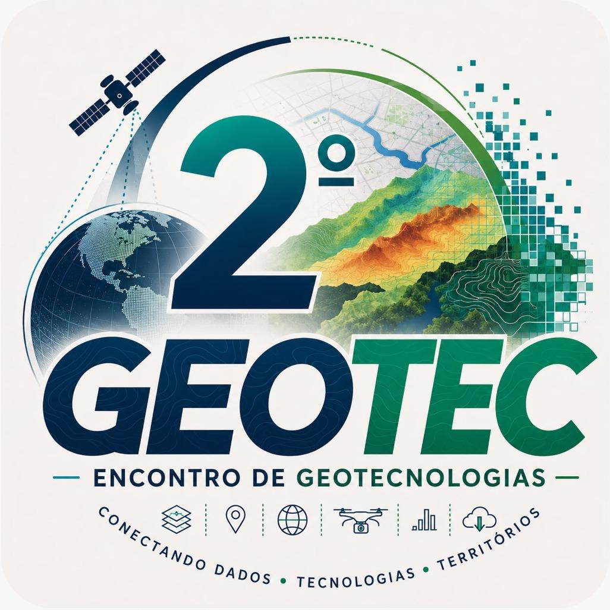

<p align="center">
  
  &nbsp;&nbsp;&nbsp;&nbsp;
  
</p>

<h1 align="center">Automatizando o QGIS com Python e IA</h1>


<p align="center">
  
  
  
  
</p>

---

<table align="center">
  <tr><td>🎤 <b>Palestrante</b></td><td>Prof. Msc. Marcello Benigno — <a href="mailto:marcello@ifpb.edu.br">marcello@ifpb.edu.br</a></td></tr>
  <tr><td>🏛️ <b>Instituição</b></td><td>Instituto Federal da Paraíba (IFPB) — Campus João Pessoa</td></tr>
  <tr><td>📅 <b>Evento</b></td><td>2º GeoTEC — Encontro de Geotecnologias</td></tr>
  <tr><td>📍 <b>Data e local</b></td><td>10/11/2026 — IFPB, Campus João Pessoa</td></tr>
  <tr><td>⏱️ <b>Carga horária</b></td><td>4 horas</td></tr>
  <tr><td>🎯 <b>Público</b></td><td>Estudantes e profissionais da área de Geotecnologias</td></tr>
</table>

---

## Sobre o minicurso

Quase todo trabalho de geoprocessamento repete a mesma sequência de ferramentas: abrir, reprojetar, gerar buffer, recortar, calcular áreas, exportar… e de novo, para o próximo arquivo. Este minicurso parte de uma ideia simples: **se você sabe fazer à mão, pode ensinar o computador a fazer por você.**

O curso é **totalmente prático e baseado em exercícios** com dados reais. Em cada um, primeiro entendemos as ferramentas e o raciocínio geográfico da análise; depois **traduzimos cada clique em código Python** com o *Processing Framework* do QGIS, usando a **IA generativa como copiloto** para escrever, explicar e depurar os scripts. Por fim, **validamos** o resultado: rodar sem erro não significa estar certo.

Os exercícios formam uma **trilha progressiva**, em ordem crescente de complexidade. Cada um parte do que o anterior ensinou.

> ℹ️ O curso **não aborda a criação de plugins**. O foco é automatizar análises com scripts no Console Python e com o Processing Framework.

---

## 🧭 Navegação pelo material

### Trilha de módulos

| Módulo | Nível | O que você vai praticar |
| --- | :---: | --- |
| 📘 [**Introdução**](modulos/introducao/introducao.md) | 🟢 Iniciante | Conceitos de automação, as peças do quebra-cabeça (QGIS, PyQGIS, Processing, Console e IA), como escrever bons prompts, por que validar e o método de trabalho usado em todos os exercícios. Aula de abertura de 35 min. |
| 📍 [**Geocodificação urbana em João Pessoa**](modulos/geocodificacao/geocodificacao.md) | 🟢 Iniciante | Ler um CSV com Python, consultar o Nominatim (OpenStreetMap) respeitando o limite de requisições e criar uma camada de pontos. |
| 🛣️ [**Impacto ambiental da duplicação da PB-200**](modulos/pb200/pb200.md) | 🟡 Intermediário | Fazer a análise à mão e traduzir cada passo em `processing.run(...)`: buffer de 3 km, municípios atingidos e uso do solo em hectares. |
| 🗺️ [**Grade interativa SRTM/TOPODATA**](modulos/grade_topodata/grade_topodata.md) | 🟡 Intermediário | Investigar uma página web com IA, gerar uma grade vetorial e criar ações em Python que baixam o MDE da célula clicada. |
| ⛰️ [**Perfil topográfico da PB-200**](modulos/perfil_pb200/perfil_pb200.md) | 🟡 Intermediário | Unir os trechos da rodovia numa linha só, amostrar o MDE TOPODATA a cada 30 m, desenhar o perfil com matplotlib e atualizar com IA um tutorial escrito para uma versão antiga do QGIS. |
| 🚶 [**Alcance a partir do IFPB**](modulos/alcance_ifpb/alcance_ifpb.md) | 🔴 Avançado | Baixar uma vez a malha viária de João Pessoa com o OSMnx e, offline, calcular com PyQGIS e NetworkX até onde se chega pelas ruas: 800 m a pé e 4 km de carro, respeitando a mão única. |
| 🔥 [**Focos de queimadas na Paraíba**](modulos/queimadas_pb/queimadas_pb.md) | 🔴 Avançado | Animar os focos de 2026 com o Controlador Temporal, automatizar com PyQGIS e publicar no GitHub Pages um dashboard interativo (Leaflet, Vue.js e Highcharts) que qualquer pessoa abre no navegador. 🌐 [**Abrir o dashboard**](https://marcellobenigno.github.io/automatizando-qgis-python-ia/queimadas_pb/) |
| 🚧 **Próximos módulos** | — | Em produção. |

### Material complementar

| | Pasta | Conteúdo |
| :---: | --- | --- |
| 📚 | [`apoio/textos/`](apoio/textos/) | Textos de apoio: [automação no QGIS](apoio/textos/01-introducao-automacao.md), [fundamentos de PyQGIS](apoio/textos/02-fundamentos-pyqgis.md), [IA aplicada](apoio/textos/03-ia-aplicada.md) e [boas práticas](apoio/textos/05-boas-praticas-perspectivas.md). |
| 🐍 | [`apoio/scripts/`](apoio/scripts/) | Scripts PyQGIS de exemplo usados nos textos de apoio. |
| 💬 | [`apoio/prompts.md`](apoio/prompts.md) | Biblioteca de prompts usados no curso. |
| 🗂️ | [`dados_curso/`](dados_curso/README.md) | Onde baixar os dados (Google Drive) e como organizá-los. |
| 🖼️ | [`imgs/`](imgs/) | Figuras, capturas de tela e logomarcas, uma subpasta por tópico. |

---

## Ementa

Introdução à automação de tarefas de geoprocessamento no QGIS. Apresentação do Processing Framework, da Caixa de Ferramentas de Processamento e do Console Python. Fundamentos da API PyQGIS aplicados à execução e à combinação de algoritmos de análise espacial por meio de scripts. Utilização de ferramentas de Inteligência Artificial generativa como assistentes na elaboração, compreensão, depuração e otimização de códigos Python para geoprocessamento. Desenvolvimento de atividade prática envolvendo a construção de um fluxo automatizado de análise espacial, com validação dos resultados e discussão sobre reprodutibilidade, limitações e boas práticas no uso de IA aplicada ao geoprocessamento.

**Objetivo geral:** capacitar os participantes a automatizar tarefas de geoprocessamento no QGIS utilizando Python e o Processing Framework, com apoio de ferramentas de Inteligência Artificial para auxiliar no desenvolvimento, na compreensão e na validação de scripts aplicados à análise espacial.

**Metodologia:** aulas expositivas dialogadas, demonstrações práticas e exercícios orientados no QGIS, com desenvolvimento incremental de scripts Python e utilização de ferramentas de IA como apoio à programação e à resolução de problemas geoespaciais.

## Antes do curso

- **QGIS 3.34 LTR ou mais recente** (material testado no 3.44), com o Console Python habilitado.
- Os dados do curso, baixados do Google Drive para a pasta `dados_curso/` — veja [`dados_curso/README.md`](dados_curso/README.md).
- Noções básicas de QGIS: camadas, tabela de atributos e SRC. **Não é necessário saber Python.**
- Acesso a um assistente de IA generativa (ChatGPT, Claude, Gemini, Copilot ou similar).

## Estrutura do repositório

```
├── README.md          ← você está aqui
├── LICENSE
├── modulos/           ← um módulo por pasta: roteiro (<módulo>.md) e scripts
│   ├── introducao/
│   ├── geocodificacao/
│   ├── pb200/
│   ├── grade_topodata/
│   ├── perfil_pb200/
│   ├── alcance_ifpb/
│   ├── queimadas_pb/
│   ├── composicao_rgb/
│   └── dados_vetoriais/
├── docs/              ← páginas publicadas no GitHub Pages (dashboard de queimadas)
├── apoio/             ← textos de apoio, scripts de exemplo e biblioteca de prompts
├── imgs/              ← figuras e capturas de tela, uma subpasta por tópico
└── dados_curso/       ← dados do Google Drive (fora do git; só o README é versionado)
```

## Precisa de ajuda?

- **Travou num módulo?** Cada pasta de `modulos/` tem um roteiro com o nome do módulo (ex.: `modulos/pb200/pb200.md`), com o passo a passo e o script de solução.
- **Encontrou um erro no material?** Abra uma *issue* neste repositório ou escreva para mim ([marcello@ifpb.edu.br](mailto:marcello@ifpb.edu.br)).

## Referências

- [PyQGIS Developer Cookbook](https://docs.qgis.org/latest/pt_BR/docs/pyqgis_developer_cookbook/)
- [QGIS Python API](https://qgis.org/pyqgis/)
- [Usando os algoritmos de processamento a partir do console](https://docs.qgis.org/latest/pt_BR/docs/user_manual/processing/console.html)
- [GeoPython 2018 — QGIS Processing Workshop](https://github.com/geometalab/GeoPythonConf2018-QGIS-Processing-Workshop) (inspiração para o formato da prática)
- [CSC Training — PyQGIS](https://github.com/csc-training/pyqgis)

## Licença

Todo o conteúdo deste repositório (textos, roteiros, figuras e scripts) está sob a licença [Creative Commons Atribuição 4.0 Internacional (CC BY 4.0)](https://creativecommons.org/licenses/by/4.0/deed.pt_BR), salvo indicação em contrário — veja o arquivo [`LICENSE`](LICENSE). Você pode usar, compartilhar e adaptar o material para qualquer finalidade, **desde que cite a fonte**:

> BENIGNO, Marcello. *Automatizando o QGIS com Python e IA*. Minicurso, 2º GeoTEC — Encontro de Geotecnologias. João Pessoa: IFPB, 2026.

As logomarcas do IFPB e do GeoTEC pertencem às respectivas instituições e não estão cobertas por esta licença.

<p align="center"><sub>Instituto Federal da Paraíba · Campus João Pessoa · 2º GeoTEC — Encontro de Geotecnologias</sub></p>
