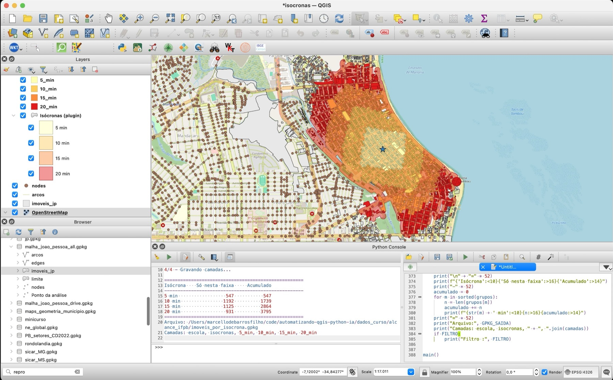
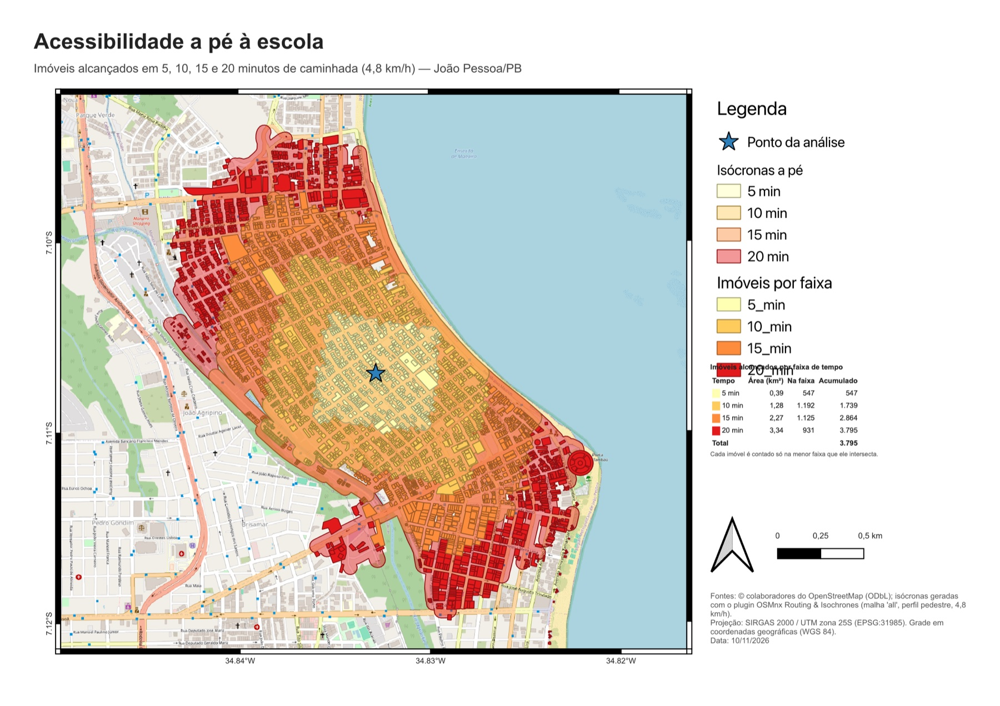

<!-- navegação -->
[⬅️ ⛰️ Perfil da PB-200](../perfil_pb200/perfil_pb200.md) · [🏠 Início](../../README.md) · [🔥 Focos de queimadas ➡️](../queimadas_pb/queimadas_pb.md)

# Acessibilidade a pé à escola: isócronas, imóveis e a IA como copiloto

## 🧭 1. A proposta da aula

Uma escola de João Pessoa quer saber **quantos imóveis estão a 5, 10, 15 e 20 minutos de caminhada** dela, a 4,8 km/h. É uma pergunta típica de planejamento: dimensionar a demanda, comparar escolas, decidir onde abrir vagas.

Nesta aula, a análise inteira é construída **em parceria com um assistente de IA**: os polígonos vêm do OpenStreetMap pelo plugin **QuickOSM**, as isócronas vêm do plugin **[OSMnx Routing & Isochrones](https://marcellobenigno.github.io/osmnx-routing-isochrones/pt-br/)** e a IA escreve os scripts PyQGIS. Quem define o problema, decide as regras, roda no QGIS e confere os números é você.

A pergunta que guia a atividade:

> **Quantos imóveis estão a até 10 minutos a pé da escola, e quantas decisões por trás desse número a IA não pode tomar por você?**



### 🎯 Objetivos de aprendizagem

Ao final da aula, a turma será capaz de:

1. **gerar** isócronas a pé a partir de uma malha viária offline e **reconhecer** que as do plugin são cumulativas;
2. **transformar** uma pergunta em regras explícitas (o que é imóvel, o que é "estar dentro", em que faixa cada um entra) antes de pedir o código;
3. **escrever** um prompt para GIS com contexto, dados, regra, saídas e restrições;
4. **iterar** com a IA em passos pequenos, um ajuste por pedido;
5. **validar** o resultado no QGIS, sem depender do que a IA afirma sobre o próprio código.

---

## 💡 2. Fundamentação

### 2.1 Isócrona: o alcance pelas ruas

Uma **isócrona** (do grego *iso*, igual, e *chronos*, tempo) é a área que se alcança **no mesmo tempo**, seguindo a rede viária. A pé, o plugin converte tempo em distância: a 4,8 km/h, 5 minutos são **400 m**, 10 são **800 m**, 15 são **1.200 m** e 20 são **1.600 m** pelas ruas.

> 🗣️ **Como explicar para a turma:**
> *"Um círculo de 800 m em volta da escola é o alcance de um pássaro. A isócrona é o alcance de quem anda pela calçada: dá a volta no quarteirão, não atravessa muro e para na beira do mar."*

### 2.2 Os dados

Tudo está em `dados_curso/acessibilidade_escola/malha_joao_pessoa_all.gpkg`, em **WGS 84 (EPSG:4326)**:

| Camada | O que é | Feições |
| --- | --- | ---: |
| `arcos` | a malha viária para roteamento, **uma linha por sentido** de percurso | 59.603 |
| `nodes` | cruzamentos e pontas de rua | 22.647 |
| `imoveis_jp` | polígonos do OSM em torno da escola, recortados da camada baixada com o QuickOSM (seção 5.2) | 6.011 |
| `Ponto da análise` | a escola: X = −34,832828172; Y = −7,106927411 | 1 |

A malha foi baixada **uma vez**, com `osmnx_routing:download_network`, tipo **`all`**. Depois disso, a análise roda **sem internet**. Só o fundo do layout (as tiles do OpenStreetMap) precisa de conexão.

> ⚠️ **A malha é uma decisão de análise.** A malha `all` tem calçadas, escadarias e caminhos, e é a certa para quem anda. A malha `drive` só tem as vias de carro: usada a pé, ela deixa o pedestre sem atalhos e encolhe a isócrona. O plugin **não filtra as vias por perfil**: quem decide por onde se anda é a malha escolhida.

### 2.3 As isócronas do plugin são cumulativas

O plugin devolve **uma feição por tempo**, e cada uma contém as menores: a de 20 minutos inclui a de 15, que inclui a de 10, que inclui a de 5. Os valores medidos nesta aula:

| Tempo | Distância a pé | Área (km²) | Vias alcançadas (km) |
| --- | ---: | ---: | ---: |
| 5 min | 400 m | 0,39 | 8,65 |
| 10 min | 800 m | 1,28 | 29,23 |
| 15 min | 1.200 m | 2,27 | 51,64 |
| 20 min | 1.600 m | 3,34 | 75,44 |

Duas consequências:

- **Contar os imóveis que intersectam cada isócrona** dá o **acumulado** ("até 10 minutos"), não a faixa ("entre 5 e 10 minutos"). Somar essas contagens conta o mesmo imóvel várias vezes.
- As isócronas maiores **têm buracos**: a de 20 minutos tem **46 anéis internos**, quadras que nenhuma rua alcançada contorna dentro do tempo.

> 🗣️ **Como explicar para a turma:**
> *"As isócronas são como bonecas russas: a de 20 minutos tem a de 15 dentro, que tem a de 10, que tem a de 5. Para saber quem está só na boneca de 15, é preciso tirar quem já estava na de 10."*

Por isso a regra da análise é: **cada imóvel vai para a menor isócrona que ele intersecta.** Ela cumpre o requisito "não pode haver polígonos iguais em duas camadas, prevalece o menor tempo", e a soma das quatro faixas volta a dar o acumulado de 20 minutos.

### 2.4 Polígono do OSM não é imóvel

A camada `imoveis_jp` tem **todos os polígonos** do OSM na área, não só edificações. Dos 3.795 polígonos que a análise conta, **280 não são prédios**:

| O que é (etiqueta do OSM) | Quantos |
| --- | ---: |
| `landuse=residential`: uma quadra ou um condomínio inteiro, com os prédios dentro | 100 |
| `leisure=swimming_pool`: piscinas | 44 |
| `amenity=parking`: estacionamentos | 17 |
| `amenity=school`: o terreno de uma escola | 12 |
| praças, quadras esportivas, jardins, obras e outros | 107 |

> 🚨 **Atenção:** uma piscina não é um imóvel, e um polígono `landuse=residential` conta como "um imóvel" um condomínio que já tem os seus prédios contados um a um. Decidir o que é imóvel é uma escolha do analista, e o script deixa isso num parâmetro (`FILTRO`, seção 3, Atividade 3).

### 2.5 O que quer dizer "intersectar a isócrona"

O plugin desenha a isócrona como uma **faixa de 40 m em volta das vias alcançadas**. Um imóvel intersecta a isócrona quando algum pedaço dele está a até cerca de 40 m de uma rua alcançada dentro do tempo. Um terreno grande que só encosta na faixa também entra. A regra de "estar dentro" é a segunda decisão que a IA não toma por você.

---

## 🛠️ 3. Trilha prática guiada

### 📦 Instalação dos plugins e dados

1. Instale os plugins **QuickOSM** e **OSMnx Routing & Isochrones** pelo *Gerenciador de complementos* (para o segundo, marque *Mostrar também os complementos experimentais*). O OSMnx tem de estar no Python do QGIS: o passo a passo está na [página de instalação do plugin](https://marcellobenigno.github.io/osmnx-routing-isochrones/pt-br/#install).
2. Baixe do Drive a pasta [`dados_curso/acessibilidade_escola/`](https://drive.google.com/drive/folders/1nLdnMuQQkE2FB9WV3GAf5mBgK3kZnLep?usp=sharing), com `malha_joao_pessoa_all.gpkg`.
3. Rode uma vez [`imoveis_por_isocrona.py`](imoveis_por_isocrona.py) e [`layout_isocronas.py`](layout_isocronas.py), ajustando `PASTA` nos dois. O layout baixa as tiles do OSM: confira a internet antes.

A aula tem quatro atividades em 35 minutos: **8 + 12 + 8 + 7**. O cerne são os prompts da Atividade 2 e a conferência da Atividade 3.

---

### 📍 Atividade 1: as isócronas e a pergunta escondida (8 min)

**Objetivo:** ver com os próprios olhos que as isócronas são cumulativas, antes de pedir qualquer código à IA.

1. No **Navegador**, arraste para o mapa as camadas `arcos`, `imoveis_jp` e `Ponto da análise` de `malha_joao_pessoa_all.gpkg`.
2. Na Caixa de Ferramentas, abra **OSMnx Routing & Isochrones → 4. Isócronas** e preencha:
   - **GeoPackage da malha:** `malha_joao_pessoa_all.gpkg`;
   - **Perfil:** Pedestre;
   - **Camada de pontos:** `Ponto da análise`;
   - **Tempos em minutos:** `5, 10, 15, 20`.
3. Abra a **tabela de atributos** das isócronas e leia `minutes` e `area_km2`: 0,39, 1,28, 2,27 e 3,34 km².
4. Desligue e ligue as feições, da maior para a menor: a de 5 minutos está **dentro** da de 10, e assim por diante.
5. Selecione na tabela só a feição de **10 minutos**. Depois, **Vetor → Ferramentas de pesquisa → Selecionar por localização**: feições de `imoveis_jp` que **intersectam** as isócronas, com **Somente feições selecionadas** marcado. O QGIS seleciona **1.739** polígonos.

> 💬 **Pausa para reflexão com a turma:**
> - *Quantos imóveis estão a 10 minutos a pé da escola: 1.739 ou outro número?*
> - *Se eu repetir a seleção para cada tempo e somar os quatro resultados, o que eu obtenho?*

<details>
<summary>Respostas esperadas</summary>

- Depende da pergunta. **Até** 10 minutos são 1.739. **Entre 5 e 10 minutos** são 1.192, porque 547 já estavam na de 5. A IA não sabe qual das duas você quer: isso tem de estar escrito no prompt.
- Um número sem sentido: cada imóvel da faixa de 5 minutos seria contado quatro vezes. É exatamente o que a regra "prevalece o menor tempo" evita.

</details>

---

### 📍 Atividade 2: o prompt, parte a parte (12 min)

**Objetivo:** escrever o pedido que gera o script `imoveis_por_isocrona.py` e entender por que cada frase está lá.

Um prompt bom para GIS diz à IA **o que ela não tem como saber**: onde estão os dados, em que SRC, que ferramenta usar e, principalmente, as regras da análise. Construa com a turma, em cinco blocos.

**Bloco 1: o papel e o ambiente.**

```text
Atue como especialista em PyQGIS. Vou rodar o script no Console Python do
QGIS 3.44.8, sem internet.
```

**Bloco 2: os dados, com caminhos, nomes de camadas e SRC.**

```text
Dados:
- malha viária: dados_curso/acessibilidade_escola/malha_joao_pessoa_all.gpkg, baixada
  com osmnx_routing:download_network, tipo all; a camada de roteamento é
  'arcos' (uma linha por sentido), em EPSG:4326;
- imóveis: camada 'imoveis_jp' no mesmo GeoPackage, polígonos do OSM, EPSG:4326;
- escola, em EPSG:4326: X = -34.832828172, Y = -7.106927411.
Uso o plugin OSMnx Routing & Isochrones:
https://marcellobenigno.github.io/osmnx-routing-isochrones/pt-br/
Em anexo, a tabela de atributos de uma isócrona gerada pelo plugin.
```

**Bloco 3: o cálculo.**

```text
1. Gere as isócronas a pé com osmnx_routing:isochrones: perfil pedestre
   (PROFILE = 1), tempos "5, 10, 15, 20", a 4,8 km/h.
2. Conte quantos imóveis intersectam cada isócrona e salve cada faixa numa
   camada: 5_min, 10_min, 15_min e 20_min.
```

**Bloco 4: a regra.** É a frase mais importante do prompt, e só a Atividade 1 a revela:

```text
3. Não pode haver polígonos iguais em duas camadas diferentes: prevalece o
   menor tempo.
```

**Bloco 5: as saídas e as restrições.**

```text
Saída: um GeoPackage imoveis_por_isocrona.gpkg e, no console, uma tabela com
os imóveis só de cada faixa e o acumulado.
Restrições:
- não invente nomes de parâmetros: se não tiver certeza, consulte
  alg.parameterDefinitions() e só envie o que existir;
- comentários em português;
- no fim, diga o que você não pôde testar.
```

> 💡 **Por que anexar a tabela de atributos?** Foi ela que mostrou à IA que as isócronas são cumulativas: as áreas crescem de 0,39 a 3,34 km² e a de 20 minutos inclui as outras. Sem ela, a IA teria de adivinhar a estrutura da saída do plugin. **Contexto concreto vale mais que uma descrição.**

**O que a IA entregou.** A resposta transformou a regra num laço curto (copiado do script):

```python
for f in poligonos.getFeatures(req):
    ...
    for m in ordem:                                  # 5, 10, 15, 20
        if engines[m].intersects(g.constGet()):
            grupos[m].append((f, g))
            break                                    # o menor tempo prevalece
```

O `break` é a regra do bloco 4: ao achar a menor isócrona que o imóvel intersecta, o laço para, e o imóvel não entra nas maiores.

**Rodar.** Abra [`imoveis_por_isocrona.py`](imoveis_por_isocrona.py) no **Editor do Console Python**, ajuste `PASTA` e clique em **Executar script**:

```text
====================================================
Isócrona    Só nesta faixa     Acumulado
----------------------------------------------------
5 min                  547           547
10 min                1192          1739
15 min                1125          2864
20 min                 931          3795
====================================================
Camadas: escola, isocronas, 5_min, 10_min, 15_min, 20_min
```

> 💬 **Pausa para reflexão:** *o script rodou sem erro e a tabela parece razoável. Já podemos mandar o número para a direção da escola?*

<details>
<summary>Resposta esperada</summary>

Ainda não. "Rodar sem erro" só mostra que o código é válido. A IA conferiu a sintaxe, mas **não executou nada no QGIS**, e disse isso na entrega. Falta conferir se o número responde à pergunta: é o trabalho da Atividade 3.

</details>

---

### 📍 Atividade 3: conferir, e decidir o que a IA não decide (8 min)

**Objetivo:** validar a contagem com ferramentas do QGIS e encontrar as decisões escondidas na palavra "imóvel" e na palavra "intersecta".

**1. A soma das partes dá o todo?** Repita a seleção da Atividade 1 com a isócrona de **20 minutos**: o QGIS seleciona **3.795** polígonos, o mesmo acumulado do script. Abra as camadas `5_min` a `20_min`: 547 + 1.192 + 1.125 + 931 = 3.795. ✅ Nenhum imóvel ficou de fora, e nenhum foi contado duas vezes.

**2. O que é um imóvel?** Na camada `15_min`, filtre `"building" IS NULL`. Aparecem quadras `landuse=residential`, piscinas, estacionamentos, praças. Em toda a análise, são **280** polígonos que não são prédios (seção 2.4). Peça à IA o ajuste, um só:

```text
Quero contar só edificações. Use o parâmetro FILTRO do script com
"building" IS NOT NULL e não mude mais nada.
```

| Faixa | Todos os polígonos | Só edificações |
| --- | ---: | ---: |
| 5 min | 547 | 526 |
| 10 min | 1.192 | 1.158 |
| 15 min | 1.125 | 1.012 |
| 20 min | 931 | 819 |
| **acumulado** | **3.795** | **3.515** |

**3. O que é "estar dentro"?** A regra escolhida foi **intersectar**. Com outras regras, o acumulado de 20 minutos muda (medido nesta aula, sobre todos os polígonos):

| Regra | Acumulado em 20 min |
| --- | ---: |
| intersecta a isócrona (a regra do script) | 3.795 |
| o ponto interior do polígono está na isócrona | 3.713 |
| o polígono está inteiro dentro da isócrona | 3.420 |

Os 375 polígonos de diferença entre a primeira e a última linha **cruzam a borda** da isócrona de 20 minutos.

Para interrogar a regra, peça à IA uma explicação em vez de código:

```text
Explique, sem código, a regra que o script usa para decidir em que faixa
cada imóvel entra. Depois, liste os casos em que essa regra pode contar como
alcançado um imóvel que, na prática, não está a esse tempo da escola, e diga
como eu conferiria cada caso no QGIS.
```

> 💬 **Pausa para reflexão:** *qual das três regras está certa?*

<details>
<summary>Resposta esperada</summary>

Nenhuma é "a certa": cada uma responde a uma pergunta. **Intersectar** pergunta "algum pedaço do terreno é alcançado?", e é generosa com terrenos grandes que só encostam na faixa de 40 m. **Inteiro dentro** é conservadora. **Ponto interior** fica no meio. O importante é escolher, escrever a escolha no prompt e no relatório, e conferir que o script faz o que foi escrito.

</details>

---

### 📍 Atividade 4: o layout, e o que só se vê no PDF (7 min)

**Objetivo:** pedir um layout profissional e conferir o produto final, não só o código.

**O prompt do layout:**

```text
Crie um segundo script, layout_isocronas.py, que leia imoveis_por_isocrona.gpkg
(camadas escola, isocronas e 5_min a 20_min) e monte um layout de impressão
profissional, com o OpenStreetMap de fundo:
- A4 paisagem; mapa em EPSG:31985, para a escala gráfica em metros ficar
  correta; grade de coordenadas geográficas com moldura zebrada;
- título e subtítulo;
- legenda com a escola, as classes das isócronas e um grupo "Imóveis por faixa";
- tabela com amostra de cor, área da isócrona, imóveis na faixa, acumulado e total;
- seta de norte, escala gráfica em km e créditos: © colaboradores do
  OpenStreetMap (ODbL), o plugin usado, a projeção e a data;
- exporte PDF (300 dpi) e PNG (200 dpi) e abra o editor de layout.
Use as mesmas cores do script de análise. Lembre que as tiles do OSM têm
política de uso: não exagere no DPI.
```

1. Rode o [`layout_isocronas.py`](layout_isocronas.py) e abra o PNG exportado.
2. Confira **cada texto** do layout, não só o mapa. A primeira versão do script saiu assim:



> 💬 **Pausa para reflexão:** *o que está errado nesse layout?*

<details>
<summary>Resposta esperada</summary>

Dois defeitos, nenhum deles visível no código:

1. A legenda mostra **"Ponto da análise"** e **"5_min"**, os nomes das camadas, e não os textos que o script define ("Escola (ponto da análise)", "5 min"). Só as isócronas, que são categorizadas, saíram certas.
2. A tabela, fixa a 108 mm do topo, **cobre o último item da legenda** ("20_min").

</details>

**O prompt de correção** descreve o que se viu, com precisão, e pede só a correção:

```text
Rodei o layout_isocronas.py e conferi o PNG. Dois problemas:
1. a legenda mostra "Ponto da análise" e "5_min" a "20_min", e não os textos
   que o script define com setName ("Escola (ponto da análise)", "5 min"...);
   as isócronas, que são categorizadas, saem certas;
2. a tabela, em y = 108 mm, cobre o último item da legenda.
Corrija só esses dois pontos, explique a causa do primeiro e não mude o resto.
```

A causa do primeiro defeito: numa camada de **símbolo único**, o texto que a legenda desenha é o do símbolo, não o do nó da árvore. O `setName` muda o nó, mas a legenda continua mostrando o nome da camada. O script deste repositório já traz a correção (seção 5.5).

---

## 🎓 4. Fechamento: checagem de aprendizagem

### 💬 Check-out oral

Peça que a turma complete as frases:

1. *"Somar os imóveis que intersectam cada isócrona do plugin dá um número errado porque…"*
2. *"Antes de pedir o código, eu tive de decidir…"*
3. *"Mesmo com o script rodando sem erro, eu conferi…"*

<details>
<summary>Respostas esperadas</summary>

1. … as isócronas são cumulativas: a de 20 minutos contém as outras, e cada imóvel próximo da escola seria contado até quatro vezes.
2. … a pergunta (até × entre), o que conta como imóvel (todos os polígonos × só edificações) e o que é estar dentro (intersectar × estar inteiro dentro).
3. … que a soma das faixas dá o acumulado e bate com a seleção por localização (3.795), o que entrou como imóvel e cada texto do layout exportado.

</details>

### 🏁 Mensagem final

> *"A IA escreveu três scripts em minutos, e escreveu bem. Mas foi a tabela de atributos anexada que revelou as isócronas cumulativas, foi você quem decidiu que o menor tempo prevalece e foi a sua conferência que achou as piscinas na contagem e a legenda errada no PDF. A IA acelera a escrita; a responsabilidade pelo número continua sendo de quem assina o mapa."*

---

## 💻 5. Aprofundamento técnico: como a análise foi construída com a IA

### 5.1 O fluxo do exercício

```
┌──────────────────────────┐     ┌──────────────────────────┐     ┌──────────────────────────┐
│ 1. DADOS (com internet)  │ ──> │ 2. ANÁLISE (offline)     │ ──> │ 3. LAYOUT (tiles OSM)    │
│ • polígonos: QuickOSM    │     │ • isócronas: plugin      │     │ • A4, UTM, grade         │
│ • malha all: plugin      │     │ • menor faixa prevalece  │     │ • legenda e tabela       │
│ • revisão cruzada        │     │ • imoveis_por_isocrona   │     │ • layout_isocronas.py    │
└──────────────────────────┘     └──────────────────────────┘     └──────────────────────────┘
```

Cada etapa foi feita do mesmo jeito: **um pedido, uma entrega, uma revisão, um resultado conferido.**

### 5.2 Etapa 1: os polígonos do OSM e a revisão cruzada

**O pedido inicial**, como foi escrito:

```text
eu quero baixar todos os polígonos da área Urbana de João Pessoa no QGIS 3.44-8
a partir do plugin QuickOSM, eu tenho o polígono delimitador. é possível fazer
via Python?
```

O ponto de partida era um **modelo gráfico** do Processing (`.model3`) que baixava tudo do OSM numa extensão (`quickosm:buildrawquery` → `native:filedownloader` → `gdal:convertformat`), estilizava e empacotava num GeoPackage.

**A primeira versão da IA** calculava a extensão do limite em EPSG:4326, montava uma consulta Overpass QL, baixava o `.osm`, lia a camada `multipolygons` pelo driver OSM do GDAL (que decide o que é área pelo `osmconf.ini`), corrigia as geometrias, **recortava pelo limite real**, e não pelo retângulo, e reprojetava para SIRGAS 2000 / UTM 25S (EPSG:31985).

**A revisão cruzada.** Em vez de aceitar a versão, o usuário mandou o **próprio script** para a mesma tarefa:

```text
veja os possíveis pontos de melhoria do seu código, a partir deste código em anexo
```

A IA comparou os dois e juntou o melhor de cada um numa versão 2:

| Do script do usuário, incorporado | Do script do usuário, corrigido |
| --- | --- |
| usar a camada ativa ou só as feições selecionadas | a consulta baixava **todas** as vias e relações: as fronteiras (município, estado, país) e as linhas de ônibus viriam inteiras pelo `recurse down`. Correção: só ways fechados (`if:is_closed()`) e relações `type=multipolygon` |
| validar o tipo de geometria e a camada vazia | timeout curto (180 s) e **duplicado** dentro da consulta: um valor só |
| corrigir e dissolver o limite antes do recorte | o arquivo antigo era apagado **antes** do download: se o Overpass falhasse, perdia-se o antigo sem ganhar o novo |
| um único algoritmo do QuickOSM (`quickosm:downloadosmdatarawquery`) com `QgsReferencedRectangle` | o `replace(".gpkg", ...)` podia alterar o nome de pastas no caminho |
| `context` e `feedback` em todas as etapas | a saída ficava em graus (EPSG:4326), o que distorce áreas e distâncias |
| janela para escolher o arquivo e confirmação antes de sobrescrever | |

**Incerteza declarada.** A IA avisou que não tinha certeza dos nomes de parâmetros do QuickOSM. Em vez de chutar, o script envia só os parâmetros que o algoritmo declara e imprime o `processing.algorithmHelp()` em caso de erro.

> 💡 **A lição da revisão cruzada:** nenhum dos dois scripts era o melhor sozinho. O do usuário tinha a experiência de uso (seleção, validação, confirmação); o da IA tinha a consulta mais enxuta e o recorte pelo limite. Pedir à IA que **compare** rende mais do que pedir que **escreva de novo**.

O resultado foi um GeoPackage com os polígonos da área urbana (21.878 feições, em EPSG:31985). Para a aula, os polígonos em torno da escola foram copiados para a camada `imoveis_jp`, no GeoPackage da malha, em EPSG:4326.

### 5.3 Etapa 2: a malha offline

A malha `malha_joao_pessoa_all.gpkg` foi baixada uma vez com `osmnx_routing:download_network`, tipo `all`. O plugin roteia sobre a camada `arcos`, com uma linha por sentido de percurso; a pé, ele ignora o sentido. A diferença entre as malhas `all` e `drive` está na seção 2.2.

### 5.4 Etapa 3: o script `imoveis_por_isocrona.py`

**A classificação** usa **geometrias preparadas** do GEOS: a isócrona é preparada uma vez, e cada teste de interseção fica muito mais rápido. Um filtro espacial pela extensão da isócrona de 20 minutos evita ler os polígonos distantes, e as geometrias inválidas são corrigidas em memória:

```python
for m in ordem:
    eng = QgsGeometry.createGeometryEngine(geoms[m].constGet())
    eng.prepareGeometry()                       # prepara uma vez, testa milhares
    engines[m] = eng

req = QgsFeatureRequest().setFilterRect(geoms[ordem[-1]].boundingBox())
```

**A gravação** usa `QgsVectorFileWriter.create`, uma camada por faixa no mesmo GeoPackage. O `fid` de origem vira `fid_origem`, para não conflitar com a chave do novo arquivo.

**Uma API pouco documentada.** A documentação do plugin não mostra um parâmetro de velocidade nas isócronas. A IA não inventou um nome: o script procura um parâmetro cujo nome ou descrição fale em velocidade e só o envia se existir:

```python
for d in alg.parameterDefinitions():
    txt = f"{d.name()} {d.description()}".lower()
    if "km/h" in txt or "speed" in txt or "veloc" in txt:
        params[d.name()] = VELOCIDADE_KMH
```

> 💡 **Dica: pergunte ao QGIS antes de perguntar à IA.** No Console, `processing.algorithmHelp("osmnx_routing:isochrones")` lista os parâmetros reais. Na versão 0.1.1 do plugin, o de velocidade existe: `WALK_SPEED`, "Walking speed (km/h)", padrão 4,8. Colar essa saída no prompt troca a busca por palavra-chave por um nome confirmado.

**Os refinamentos, um por vez.** Depois da primeira versão, cada ajuste foi um pedido separado, o que facilitou revisar cada mudança:

| # | O pedido | O que mudou no script |
| --- | --- | --- |
| 1 | o caminho da malha é `malha_joao_pessoa_all.gpkg` | `REDE_A_PE` |
| 2 | "Mantenha como saída do script o ponto da análise e as isócronas geradas pelo plugin." | o GeoPackage passou a ter `escola` e `isocronas`, além das quatro faixas |
| 3 | uma cor por classe, a mesma para a isócrona e os imóveis da faixa: 5 min `#ffffb2`, 10 min `#fecc5c`, 15 min `#fd8d3c`, 20 min `#e31a1c`; isócronas a 45% de opacidade, da maior para a menor; estilos salvos no GeoPackage | `CORES`, `estilo_isocronas()` com `setOrderBy` e `saveStyleToDatabase` |
| 4 | a fonte dos imóveis passa a ser `imoveis_jp` (EPSG:4326, o mesmo SRC dos arcos) | `POLIGONOS` |

> **Nota: o que conferir no código**
>
> | Trecho | Por que é assim |
> | --- | --- |
> | `"PROFILE": 1` com a malha `all` | a pé, a malha tem de ter calçadas e caminhos |
> | `break` no laço de classificação | o menor tempo prevalece: nenhum imóvel em duas camadas |
> | `to_int("minutes")` no estilo | o campo `minutes` do plugin é real (`5.0`), e as categorias são inteiras |
> | ordem decrescente de `minutes` no desenho | as isócronas são cumulativas: a de 20 primeiro, a de 5 por cima |
> | `FILTRO = ""` | por padrão conta todos os polígonos; `"building" IS NOT NULL` conta só edificações |

### 5.5 Etapa 4: o script `layout_isocronas.py`

O script monta um A4 paisagem com título, subtítulo, mapa, legenda, tabela em HTML, seta de norte, escala gráfica e créditos, exporta PDF (300 dpi) e PNG (200 dpi) e abre o editor de layout. Três decisões merecem explicação:

- **Mapa em UTM, grade em graus.** O mapa está em **EPSG:31985** para a escala gráfica medir metros de verdade. A grade, em EPSG:4326, mostra as coordenadas que o leitor reconhece (34,83°W; 7,11°S).
- **DPI moderado.** As tiles do OpenStreetMap são um serviço gratuito com [política de uso](https://operations.osmfoundation.org/policies/tiles/): exportar em DPI alto multiplica os pedidos ao servidor. O PNG sai a 200 dpi.
- **Internet só aqui.** Sem conexão, o layout sai com o fundo em branco. A análise das etapas anteriores não depende dela.

**A correção da legenda** (Atividade 4). Numa camada de símbolo único, o texto que aparece é o rótulo do símbolo, que se ajusta assim:

```python
def item_legenda(grupo, lyr, texto):
    n = grupo.addLayer(lyr)
    n.setUseLayerName(False)
    n.setName(texto)
    if isinstance(lyr.renderer(), QgsSingleSymbolRenderer):
        # símbolo único: a legenda mostra o rótulo do símbolo, não o do nó
        QgsMapLayerLegendUtils.setLegendNodeUserLabel(n, 0, texto)
        legenda.model().refreshLayerLegend(n)
```

Para a tabela não invadir a legenda, as fontes da legenda passaram para 11 pt (título), 8,5 pt (grupos) e 7,5 pt (itens). As duas correções foram conferidas exportando o layout de novo.

### 5.6 Lições sobre trabalhar com a IA

1. **A IA não executou nada no QGIS.** Ela conferiu a sintaxe do Python e disse, a cada entrega, que não tinha testado. Os testes reais foram feitos no QGIS, por uma pessoa.
2. **Contexto concreto melhora a resposta.** O modelo do Processing, o script próprio e a tabela de atributos anexados; os caminhos, os nomes das camadas e o SRC copiados das propriedades das camadas; o link da documentação do plugin.
3. **A revisão cruzada funciona.** Mostrar o próprio código fez a IA incorporar boas ideias e apontar riscos que nenhuma das duas versões resolvia sozinha.
4. **Passos pequenos.** Cada ajuste (caminho, saídas, cores, fonte dos dados) foi um pedido separado. Um pedido com quatro mudanças gera uma resposta difícil de revisar.
5. **Incerteza declarada, não chute.** Parâmetros não documentados foram tratados com introspecção (`parameterDefinitions`, `algorithmHelp`).
6. **O especialista continua no controle.** A regra "o menor tempo prevalece", o que conta como imóvel, a regra de "estar dentro", a paleta e a validação das contagens são decisões de quem faz a análise.

### 5.7 Os prompts do módulo, em ordem

| Etapa | Prompt | Onde está |
| --- | --- | --- |
| polígonos do OSM | o pedido inicial e o da revisão cruzada | seção 5.2 |
| isócronas e contagem | o prompt em cinco blocos | Atividade 2 |
| refinamentos | um ajuste por pedido | seção 5.4 |
| o que é imóvel | o `FILTRO` de edificações | Atividade 3 |
| interrogar a regra | explicar sem código e listar os casos-limite | Atividade 3 |
| layout | o prompt do layout e o de correção | Atividade 4 |

---

## 🛡️ 6. Resolução de problemas e dicionário

### ⚠️ Armadilhas comuns

| Sintoma | Causa | Como corrigir |
| :--- | :--- | :--- |
| **`Algoritmo osmnx_routing:isochrones não encontrado`** | o plugin não está instalado ou ativo | ativar em *Complementos → Gerenciar e instalar complementos* |
| **algoritmos do plugin desativados** | o OSMnx não está no Python do QGIS | instalar pela [página do plugin](https://marcellobenigno.github.io/osmnx-routing-isochrones/pt-br/#install) e reiniciar o QGIS |
| **a soma das faixas dá muito mais que o acumulado** | contou os imóveis de cada isócrona cumulativa | cada imóvel na menor isócrona que ele intersecta |
| **isócronas a pé pequenas demais** | a malha é `drive`, sem calçadas nem caminhos | usar a malha `all` a pé |
| **piscinas e quadras inteiras na contagem** | a camada tem todos os polígonos do OSM | `FILTRO = '"building" IS NOT NULL'` |
| **a isócrona de 5 minutos some no mapa** | as isócronas cumulativas foram desenhadas da menor para a maior | ordenar o desenho por `minutes` decrescente |
| **legenda com "5_min" em vez de "5 min"** | camada de símbolo único: a legenda usa o rótulo do símbolo | `QgsMapLayerLegendUtils.setLegendNodeUserLabel` (seção 5.5) |
| **arquivo travado ao regravar o GeoPackage** | a camada antiga continua aberta no projeto | o script remove do projeto as camadas do arquivo antes de apagá-lo (`soltar_arquivo`) |
| **layout com fundo em branco** | sem internet, as tiles do OSM não carregam | exportar o layout com conexão |
| **`502 Bad Gateway` ao baixar do OSM** | o servidor Overpass está sobrecarregado | baixar uma vez, fora da aula, e trabalhar offline |

### 📖 Dicionário para estudantes

- **Isócrona:** área alcançável dentro de um limite de tempo, pela rede viária e pelo perfil escolhidos.
- **Isócronas cumulativas:** cada uma contém as de tempo menor; a de 20 minutos inclui a de 5.
- **Classificação exclusiva:** cada feição entra numa única classe; aqui, a da menor isócrona que ela intersecta.
- **Geometria preparada:** geometria pré-processada pelo GEOS para acelerar muitos testes espaciais contra ela.
- **Introspecção:** perguntar ao próprio programa quais parâmetros um algoritmo aceita (`parameterDefinitions`, `algorithmHelp`).
- **Revisão cruzada:** comparar duas versões de um código, a sua e a da IA, para juntar o melhor de cada uma.
- **QuickOSM:** plugin do QGIS que baixa dados do OpenStreetMap pela API Overpass.
- **Overpass QL:** a linguagem de consulta da API Overpass.
- **Tiles:** as imagens quadradas que formam um mapa de fundo na web.

---

## 🚀 7. Desafios para depois da aula

1. **De carro.** Repita a análise com `PERFIL = "carro"` e a malha `drive`. Compare as áreas: por que, de carro, o sentido das ruas passa a importar?
2. **Várias escolas.** Crie uma camada com três escolas e rode as isócronas com `SEPARATE = True`. Como adaptar a regra "o menor tempo prevalece" para dizer **qual escola** está mais perto de cada imóvel?
3. **Só edificações.** Rode com `FILTRO = '"building" IS NOT NULL'` e refaça a tabela do layout. Em qual faixa a diferença é maior, e por quê?
4. **Outra velocidade.** Uma criança ou um idoso anda mais devagar. Teste 3,6 km/h e compare quantos imóveis saem da faixa de 10 minutos.
5. **Interrogue a curva.** A área das isócronas cresce de 0,39 para 3,34 km², mas os imóveis por faixa caem depois dos 10 minutos (1.192 → 1.125 → 931). Peça à IA hipóteses e confira cada uma no mapa. O mar, a leste da escola, entra em alguma delas?

---

<!-- navegação -->
[⬅️ ⛰️ Perfil da PB-200](../perfil_pb200/perfil_pb200.md) · [🏠 Início](../../README.md) · [🔥 Focos de queimadas ➡️](../queimadas_pb/queimadas_pb.md)
