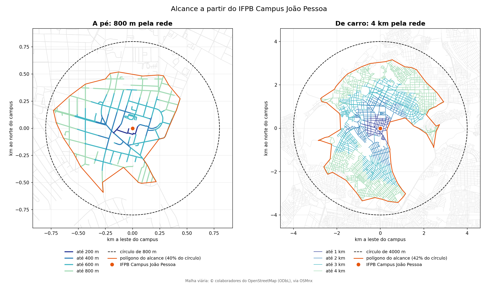
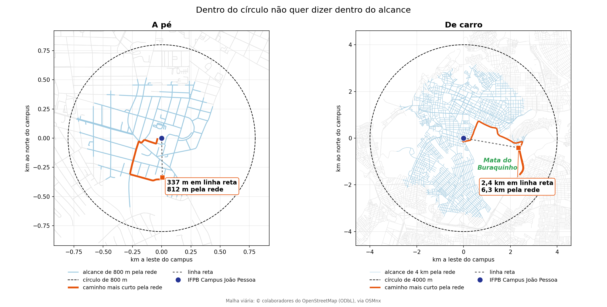
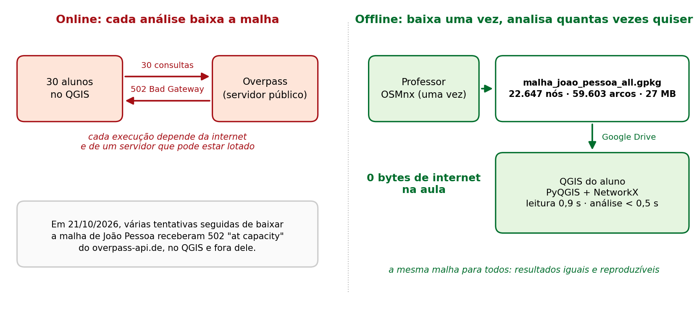
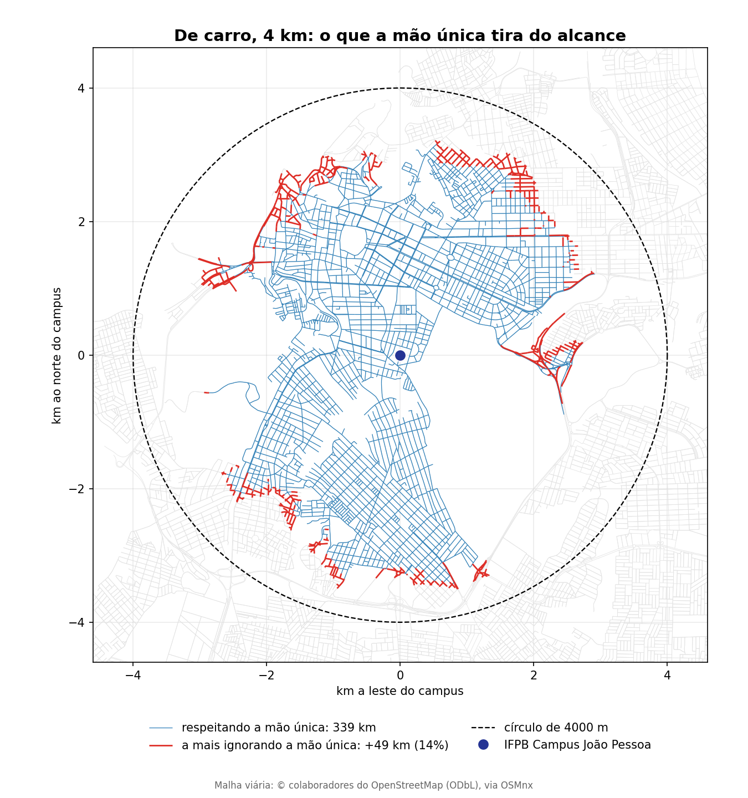
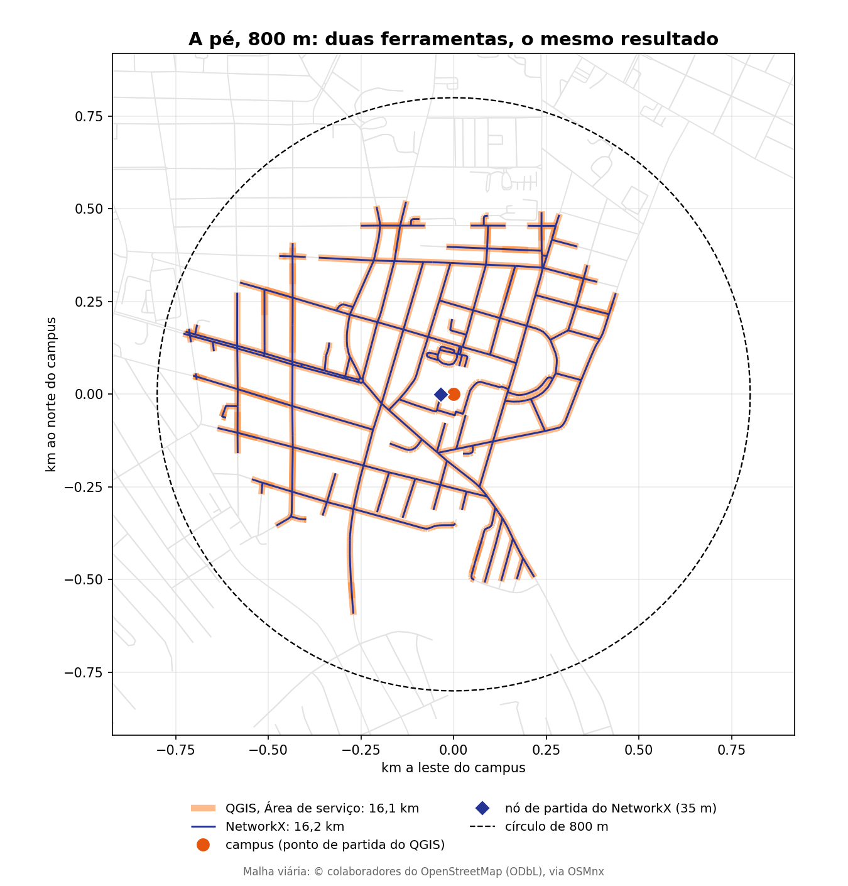

# Análise de acessibilidade: até onde se chega a partir do IFPB (800 m a pé × 4 km de carro)

> **Exercício prático do minicurso:** Automatizando o QGIS com Python e IA
> **Área temática:** análise de redes, mobilidade urbana e acessibilidade
> **Ferramentas:** QGIS 3.44, PyQGIS e NetworkX (análise, offline); OSMnx (download da malha, feito uma vez); IA generativa

---

### 📋 Visão geral do exercício

Para avaliar o alcance de um equipamento público, como uma escola, um hospital ou um campus, é comum desenhar um buffer circular em linha reta (*distância euclidiana*). Mas **pessoas e veículos não andam em linha reta**: eles seguem a malha viária, com quarteirões, barreiras físicas, sentidos de tráfego (mão única) e restrições de acesso.

Neste exercício, você vai calcular a **área de serviço** (*service area*, ou isodistância) a partir do **IFPB Campus João Pessoa**, ou seja, quais ruas e avenidas são alcançáveis:

* 🚶 **A pé:** até **800 m** (~10 minutos de caminhada a 4,8 km/h).
* 🚗 **De carro:** até **4 km**, respeitando a mão única das vias.

```
┌────────────────────────┐     ┌────────────────────────┐     ┌────────────────────────┐
│ 1. DADOS OFFLINE       │ ──> │ 2. ANÁLISE DE REDES    │ ──> │ 3. VALIDAÇÃO           │
│ • malha em GeoPackage  │     │ • PyQGIS + NetworkX    │     │ • linha reta × rede    │
│ • nós e arcos          │     │ • Dijkstra com limite  │     │ • efeito da mão única  │
│ • sem depender da API  │     │ • corte das ruas       │     │ • comparação com QGIS  │
└────────────────────────┘     └────────────────────────┘     └────────────────────────┘
```

**Ao final deste exercício, você será capaz de:**

1. diferenciar **distância euclidiana** (buffer) de **distância pela rede** (*network distance*);
2. montar um fluxo **offline e reprodutível**: baixar os dados uma vez e não depender de servidores públicos a cada análise;
3. montar e consultar **grafos dirigidos com peso** (*directed weighted graphs*) com o **NetworkX**;
4. filtrar as vias por **modo de transporte** (pedestre × automóvel) e tratar o **sentido de circulação** (`oneway`);
5. validar o resultado do script com o algoritmo nativo **Área de serviço** do *Processing Framework* do QGIS.



### O que deve ser entregue

1. `alcance_ifpb.gpkg`, com as camadas `alcance_faixas` (um anel por faixa de distância, com os km de vias), `alcance_poligonos` (polígono do alcance e círculo de cada análise) e `campus`.
2. `alcance_ifpb.png`, os dois mapas lado a lado.
3. A comparação com a ferramenta nativa **Área de serviço** do QGIS.

Tudo em `dados_curso/alcance_ifpb/resultados/`.

---

## 1. Fundamentação: análise de redes e acessibilidade urbana

### 1.1 Linha reta (buffer) × área de serviço (isodistância)

No planejamento urbano, a ideia de **cidade caminhável** (*walkable city*) costuma usar **~800 m** (10 minutos a pé) como raio de influência em volta de escolas, estações e serviços.

```
   [ Buffer circular ]                        [ Área de serviço ]
   distância euclidiana                       distância pelas ruas
            │                                          │
            ▼                                          ▼
   supõe um plano sem obstáculos              segue a rede: quarteirões,
                                              muros, mão única e acessos
```

* **O que o buffer erra:** ele supõe que o pedestre atravessa prédios, terrenos fechados, rios e matas.
* **O que a rede mostra:** o alcance real segue as ruas. Barreiras como a **Mata do Buraquinho**, em João Pessoa, ou quadras longas sem travessia forçam desvios e reduzem bastante a área acessível.



Dois exemplos reais, calculados neste exercício:

* **A pé:** um ponto a **337 m** ao sul do campus, em linha reta, está a **812 m** pela rede, fora do alcance de 800 m. Não há passagem direta pelo lado sul do terreno; é preciso dar a volta pelo oeste.
* **De carro:** um ponto a **2,4 km** a leste, do outro lado da Mata do Buraquinho, está a **6,3 km** pela rede.

---

### 1.2 A malha como grafo: nós e arcos dirigidos

Uma malha viária é modelada como um **grafo** $G = (V, E)$:

* **Nós** ($V$): cruzamentos e pontas de rua. Cada nó tem coordenadas (`x`, `y`) e um identificador do OpenStreetMap (`osmid`).
* **Arcos** ($E$): trechos de rua que ligam dois nós, **de `u` para `v`**. Cada arco guarda o comprimento em metros (`length`), o tipo de via (`highway`) e o sentido de circulação (`oneway`).

```
    [ nó u ] ───────────── arco u → v ─────────────> [ nó v ]
  (cruzamento 1)        comprimento: 120 m        (cruzamento 2)
```

> ⚠️ **Mão única e mão dupla:**
> Numa rua de **mão dupla**, a camada tem **dois arcos**: um de `u` para `v` e outro de `v` para `u`. Numa rua de **mão única**, só **um** (`u → v`, no sentido do tráfego). Se o cálculo para carro ignorar essa orientação, o veículo "anda na contramão" e o alcance sai maior do que o real.

---

### 1.3 Online × offline: por que baixar uma vez só

APIs públicas como o **Overpass** (do OpenStreetMap) são recursos compartilhados, com limite de uso e sujeitos a sobrecarga. Na preparação deste exercício, em 21/10/2026, várias tentativas seguidas de baixar a malha de João Pessoa receberam `502 Bad Gateway … server is currently at capacity`, no QGIS e fora dele.



| Dimensão | Online (direto na API) | Offline (recomendado) |
| :--- | :--- | :--- |
| **Execução** | cada aluno baixa a malha na aula | o professor baixa a malha **uma vez**, com o OSMnx |
| **Conexão** | internet estável para todos, ao mesmo tempo | **0 bytes** de internet durante a aula |
| **Velocidade** | minutos, quando o servidor responde | **~0,9 s** para ler a malha e **< 0,5 s** por análise |
| **Reprodutibilidade** | o OSM muda todo dia | GeoPackage fixo: resultados iguais para toda a turma |

A malha é baixada com o script [`apoio/osmnx/malha_urbana_osmnx.py`](../../apoio/osmnx/malha_urbana_osmnx.py), com a rede **`all`** (todas as vias). Os alunos recebem o arquivo pronto pelo [Google Drive do curso](../../dados_curso/README.md).

> **Pré-requisito:** o NetworkX no Python do QGIS. Confira no Console Python com `import networkx`. Se der erro, veja a seção 6.1 do *Guia OSMnx + QGIS no Windows* (PDF no Google Drive do curso). O OSMnx **não** precisa estar instalado no QGIS: ele só é usado para baixar a malha.

---

## 2. Os dados e as regras de cada modo

O arquivo `malha_joao_pessoa_all.gpkg` (27 MB) reúne a malha viária do município num **GeoPackage** com 4 camadas, em **EPSG:4326**:

1. `nodes` (22.647 nós): cruzamentos e pontas de rua.
2. `edges` (33.577 trechos): uma linha por trecho de rua, para o mapa.
3. `arcos` (59.603 arcos): uma linha por **sentido de circulação**, para o roteamento.
4. `limite`: o polígono do município de João Pessoa.

As contas fecham: 7.551 trechos de mão única (1 arco cada) + 26.026 de mão dupla (2 arcos cada) = 59.603 arcos.

> **Por que a camada `arcos`?** O *Guia OSMnx + QGIS no Windows* avisa (seção 8.1): gravado com `directed=False`, o grafo perde o sentido das vias, e uma rota pode entrar na contramão. A camada `arcos` guarda o grafo **dirigido**. Para o carro, é ela que garante a mão única.

### Regras de filtragem por modo de transporte

O campo `highway` da camada `arcos` diz o tipo de via (`residential`, `footway`, `primary`, `service`…). Quando o OSMnx junta trechos de tipos diferentes, ele grava uma **lista como texto**, por exemplo `['footway', 'residential']`.

```
   ┌────────────────────────────────────────────────────────────────────────┐
   │                        FILTRAGEM POR MODO                              │
   ├────────────────────────────────────┬───────────────────────────────────┤
   │ 🚶 A PÉ                            │ 🚗 DE CARRO                       │
   │ • basta UM dos tipos do trecho ser │ • TODOS os tipos do trecho têm de │
   │   de pedestre (residential,        │   ser de automóvel                │
   │   footway, path, steps, primary…)  │ • ficam de fora calçadões         │
   │ • autoestradas e ciclovias ficam   │   (footway), escadarias, trilhas  │
   │   de fora                          │   e vias de serviço (service)     │
   │ • IGNORA a mão única               │ • RESPEITA a mão única (oneway=1) │
   └────────────────────────────────────┴───────────────────────────────────┘
```

Nos dois modos, os arcos com `access` = `private` (2.315) ou `no` (151) ficam de fora. Um trecho `['footway', 'residential']` entra a pé, mas não de carro.

---

## 3. Inspeção manual no QGIS

1. Arraste a camada `arcos` do arquivo `malha_joao_pessoa_all.gpkg` para o mapa do QGIS.
2. Abra a **Tabela de atributos** e confira os campos:
   * `u`, `v`: nós de início e de fim do arco (o arco vai de `u` para `v`);
   * `length`: comprimento geodésico do trecho, em **metros**, calculado pelo OSMnx;
   * `highway`: tipo de via (às vezes, uma lista);
   * `oneway`: `1` = mão única, `0` = mão dupla;
   * `access`: restrição de acesso (`private` e `no` ficam de fora).
3. Use a simbologia **Seta (Arrow)** para ver o sentido dos arcos numa rua de mão única e numa de mão dupla.

---

## 4. Automação com PyQGIS, NetworkX e IA

### 4.1 O prompt

```text
Atue como especialista em PyQGIS e análise de redes.
Escreva um script Python para o Console do QGIS 3.44 que calcule a área de
serviço (isodistância) a partir do IFPB Campus João Pessoa
(-34.87354, -7.13574), sem usar internet e sem OSMnx.

1. Entrada: GeoPackage 'malha_joao_pessoa_all.gpkg', gerado pelo OSMnx, com
   as camadas 'nodes' (osmid, x, y) e 'arcos' (u, v, length, highway, oneway,
   access) em EPSG:4326. Na camada 'arcos', cada feição é um sentido de
   circulação, desenhada de u para v. 'highway' pode ser uma lista gravada
   como texto, por exemplo "['footway', 'residential']".
2. Grafo (NetworkX): leia as camadas com QgsVectorLayer, reprojete as
   geometrias para EPSG:31985 (SIRGAS 2000 / UTM 25S) e monte dois
   nx.MultiDiGraph():
   a) a pé: basta um dos tipos do trecho ser de pedestre; a mão única não
      vale (acrescente o arco de volta só nos trechos de mão única);
   b) de carro: todos os tipos do trecho têm de ser de automóvel; respeite
      a mão única.
   Nos dois, exclua access = 'private' ou 'no'.
3. Partida: ligue o campus ao nó mais próximo dentro da maior componente
   fortemente conexa (strongly connected component).
4. Isodistância: use nx.single_source_dijkstra_path_length com cutoff:
   a pé, faixas de 200, 400, 600 e 800 m; de carro, 1, 2, 3 e 4 km.
   Corte as ruas no limite exato de cada faixa e conte cada rua uma vez só
   (na mão dupla, a ida e a volta são a mesma rua).
5. Saída: km de vias por faixa, polígono do alcance (concaveHull) comparado
   com o círculo de mesmo raio, e comparação com native:serviceareafrompoint.
Comentários em português.
```

### 4.2 A lógica do script (`alcance_ifpb.py`)

A versão revisada é [`alcance_ifpb.py`](alcance_ifpb.py). Os trechos centrais:

**Montar o grafo de cada modo.** A mão dupla já tem os dois arcos na camada; a pé, só a mão única ganha o arco de volta.

```python
def montar_grafo(arcos, analise, mao_unica):
    grafo = nx.MultiDiGraph()
    for i, a in enumerate(arcos):
        if a["access"] in ACESSO_PROIBIDO:
            continue
        if analise["mao_unica"]:
            # carro: todos os tipos do trecho têm de ser de automóvel
            if not a["tipos"] <= analise["vias"]:
                continue
        elif not a["tipos"] & analise["vias"]:
            continue  # a pé: basta um tipo por onde se anda
        grafo.add_edge(a["u"], a["v"], key=i, length=a["length"], arco=i)
        if a["oneway"] and not mao_unica:
            # a volta usa a geometria invertida (índice negativo)
            grafo.add_edge(a["v"], a["u"], key=-i - 1, length=a["length"], arco=-i - 1)
    ...
```

**Partir do campus e calcular as distâncias.** O nó de partida sai da maior componente fortemente conexa: de lá se chega a toda a rede. O Dijkstra devolve a distância pela rede até cada nó alcançável (é o mesmo cálculo do `nx.ego_graph(..., distance="length")`).

```python
principal = max(nx.strongly_connected_components(grafo), key=len)
origem, snap = no_mais_proximo(nos, principal, ponto)
distancias = nx.single_source_dijkstra_path_length(
    grafo, origem, cutoff=raio, weight="length")
aneis, km, total = faixas_de_alcance(grafo, arcos, distancias, faixas)
```

**Cortar as ruas nas faixas.** Um ponto a `s` metros do início do arco `u → v` está a `dist[u] + s` do campus. Um nó a 700 m "sobra" 100 m para os 800 m a pé: a rua que sai dele é percorrida só até 100 m. A função `faixas_de_alcance()` faz esse corte **por trecho físico**: junta a ida e a volta da mesma rua, soma o que se alcança por cada ponta e nunca conta a rua duas vezes.

> **Nota: o que conferir no código**
>
> | Trecho | Por que é assim |
> | --- | --- |
> | `nx.MultiDiGraph()` | **Multi**: pode haver duas ruas diferentes entre os mesmos nós. **Di**: o sentido importa |
> | `a["tipos"] <= analise["vias"]` (carro) × `a["tipos"] & analise["vias"]` (a pé) | todos os tipos × pelo menos um tipo |
> | geometrias em EPSG:31985 | o corte das ruas e o polígono saem em metros |
> | `strongly_connected_components` | evita partir de uma rua sem saída de mão única |
> | contagem por trecho físico | ida e volta da mesma rua não somam duas vezes |

### 4.3 Rodar o script

Abra `alcance_ifpb.py` no **Editor do Console Python** do QGIS, ajuste `MALHA` e `PASTA_SAIDA` e clique em **Executar script**. Saída esperada:

```text
[1] 22647 nós e 59603 arcos lidos de malha_joao_pessoa_all.gpkg em 0.9 s, sem internet

[1] A pé: grafo com 21713 nós e 64134 arcos
[2] Partida no nó 4666479308, a 35 m do campus
[3] 137 nós a até 800 m pela rede (0.0 s)
[4] 16.2 km de vias alcançadas; ponto mais distante a 747 m em linha reta
      polígono do alcance: 0.81 km² = 40% do círculo de 800 m (2.01 km²)
[5] QGIS (Área de serviço): 16.1 km × NetworkX 16.2 km (-0.2%)

[1] De carro: grafo com 18173 nós e 46262 arcos
[2] Partida no nó 799966499, a 80 m do campus
[3] 2953 nós a até 4000 m pela rede (0.1 s)
[4] 339.4 km de vias alcançadas; ponto mais distante a 3520 m em linha reta
      polígono do alcance: 20.92 km² = 42% do círculo de 4000 m (50.25 km²)
      ignorando a mão única: 388.3 km (+49.0 km, 14% a mais)
[5] QGIS (Área de serviço): 339.1 km × NetworkX 339.4 km (-0.1%)

[6] Resultados em …/alcance_ifpb/resultados/alcance_ifpb.gpkg
      Mapas: …/alcance_ifpb/resultados/alcance_ifpb.png
```

---

## 5. Validação e leitura dos resultados

### 5.1 O alcance real: 800 m a pé × 4 km de carro

| Faixa a pé | km de vias | Faixa de carro | km de vias |
| --- | ---: | --- | ---: |
| até 200 m | 0,4 | até 1 km | 17,8 |
| 200 a 400 m | 2,2 | 1 a 2 km | 51,9 |
| 400 a 600 m | 6,6 | 2 a 3 km | 113,2 |
| 600 a 800 m | 7,0 | 3 a 4 km | 156,5 |
| **total** | **16,2** | **total** | **339,4** |

| | A pé, 800 m | De carro, 4 km |
| --- | ---: | ---: |
| círculo | 2,01 km² | 50,25 km² |
| polígono do alcance | 0,81 km² | 20,92 km² |
| **polígono ÷ círculo** | **40%** | **42%** |

* **O que a proporção mede:** numa malha em grade perfeita, o alcance pela rede seria um losango dentro do círculo, com ~64% da área dele. Os **40% a 42%** em volta do IFPB refletem os quarteirões longos, o próprio terreno do campus e, de carro, a **Mata do Buraquinho**, o vazio a sudeste no mapa.
* **Verificação de coerência:** nenhum ponto alcançado fica além do raio em linha reta (747 m < 800 m; 3520 m < 4000 m). A rede nunca é mais curta que a reta.

---

### 5.2 O efeito da mão única para o carro

O script refaz a análise de carro **ignorando** a mão única, só para comparar:



* **Respeitando a mão única:** **339,4 km** de vias.
* **Ignorando a mão única:** **388,3 km** de vias, **49 km (14%) a mais**.
* **Leitura:** os trechos em vermelho só seriam alcançados andando na contramão. Eles se concentram nas bordas do alcance, onde o caminho permitido é mais longo. Ignorar o `oneway` superestima a acessibilidade de carro.

---

### 5.3 Validação cruzada: NetworkX × QGIS

O QGIS tem a mesma análise pronta: **Caixa de Ferramentas de Processamento → Análise de redes → Área de serviço (a partir de ponto)** (*Network analysis → Service area (from point)*, `native:serviceareafrompoint`). Para conferir à mão:

1. Reprojete a camada `arcos` para **EPSG:31985** (*Reprojetar camada*).
2. Abra a **Área de serviço (a partir de ponto)**: tipo de caminho = **Mais curto**; ponto inicial = clique no campus; custo = **800** (a pé) ou **4000** (carro).
3. Em **Parâmetros avançados**, a **Direção padrão** decide o sentido. Para o carro, use **Direção para frente** (*Forward direction*): cada arco já está desenhado no sentido do tráfego, então "para frente" é exatamente a mão única. A pé, use **Ambas as direções** (*Both directions*).

O script faz isso automaticamente (`COMPARAR_COM_QGIS = True`), sobre os mesmos arcos usados no grafo:



| Modo e distância | NetworkX (script) | QGIS nativo | Diferença |
| :--- | :---: | :---: | :---: |
| 🚶 A pé (800 m) | **16,2 km** | **16,1 km** | −0,2% |
| 🚗 De carro (4 km) | **339,4 km** | **339,1 km** | −0,1% |

> 💡 **Duas implementações independentes, a mesma resposta.**
> A pequena diferença vem principalmente do **ponto de partida**: o QGIS parte do ponto da rua mais próximo do campus, e o script parte do **nó** mais próximo (a 35 m a pé e a 80 m de carro). A concordância não prova que o script está certo em tudo, mas mostra que ele reproduz uma ferramenta já testada.

> **Como o QGIS foi medido.** A Área de serviço devolve a ida e a volta de uma rua de mão dupla como **duas linhas sobrepostas**. Somar o comprimento delas contaria a rua duas vezes. O script mede pela área de uma faixa de 1 m em volta das linhas, que conta cada rua uma vez só.

---

## 6. Armadilhas comuns em análise de redes

| Erro comum (seu ou da IA) | Sintoma | Causa | Solução |
| :--- | :--- | :--- | :--- |
| **Medir comprimento em EPSG:4326** | valores minúsculos, em "graus" | usar `$length` ou `.length()` com coordenadas geográficas | usar o `length` do OSMnx ou reprojetar para um SRC métrico (EPSG:31985) |
| **Partir de uma rua sem saída** | alcance quase vazio a partir do campus | o nó de partida está numa rua sem saída de mão única | escolher o nó mais próximo dentro da **maior componente fortemente conexa** |
| **Contar a mesma rua duas vezes** | km de vias inflados (de 1% a 19%, conforme a faixa) | somar as geometrias de ida e de volta, que se sobrepõem | contar por **trecho físico**, juntando ida e volta |
| **Ignorar a mão única no carro** | alcance de carro 14% maior | tratar a rede como não dirigida (`directed=False`) | usar a camada `arcos` e um `MultiDiGraph` |
| **Usar o mesmo filtro para os dois modos** | carro passando por calçadões, ou pedestre sem as escadarias | não diferenciar `highway` por modo | regras separadas: "algum tipo" a pé, "todos os tipos" de carro |

> **A IA não valida por você.** A primeira versão deste script unia as geometrias de todos os pedaços e media o comprimento da união. Deu 17,5 km a pé, um número plausível, mas a soma das faixas dava 18,9 km. A pista veio de uma conferência simples, **a soma das partes tem de dar o todo**. Contando por trecho físico, o valor certo é **16,2 km**.

---

## 7. Desafios

1. **Em minutos.** A camada `arcos` já tem `travel_time` (segundos, calculado pelo OSMnx a partir da velocidade de cada tipo de via). Troque o peso para `travel_time` e calcule o alcance de **10 minutos de carro**. A pé, use 4,8 km/h: 5, 10 e 15 minutos.
2. **Outro ponto de partida.** Troque `CENTRO` por outro lugar de João Pessoa (a Reitoria do IFPB, uma estação, sua casa) e compare a proporção polígono ÷ círculo. Onde a rede é mais "caminhável"?
3. **O que está a até 10 minutos?** Conte quantas paradas de ônibus ficam a até 800 m pela rede. Dica: ligue cada parada ao nó mais próximo e leia a distância em `distancias`.
4. **Outra cidade, uma vez.** Baixe com `malha_urbana_osmnx.py` a malha de Cabedelo e calcule o alcance do IFPB Campus Cabedelo. Se o alcance de 4 km sair do município, o script avisa: o que fazer?

---

## 8. Para levar

> 💡 **A IA escreve o script em minutos, e o NetworkX calcula o alcance em milissegundos.** Mas são os fundamentos de geoprocessamento que garantem que o resultado está certo: a diferença entre a distância em linha reta e a distância pela rede, o uso de um sistema de coordenadas métrico e o efeito das restrições de tráfego. **Conferir o resultado continua sendo responsabilidade sua.**
