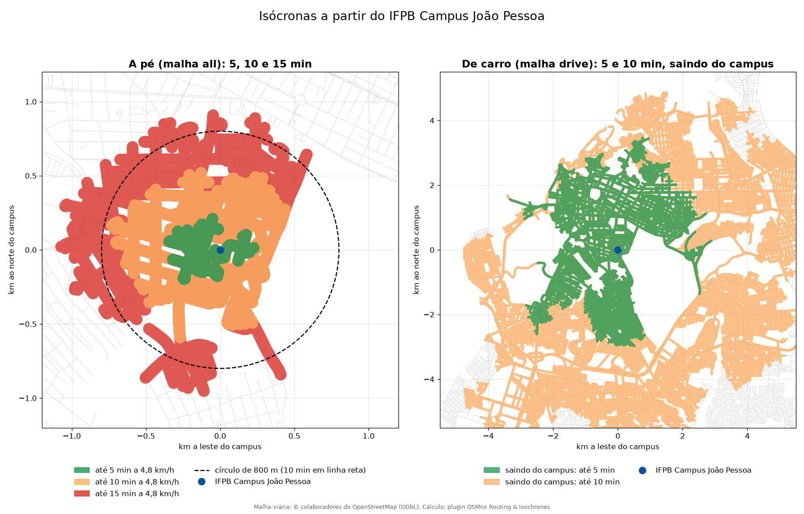
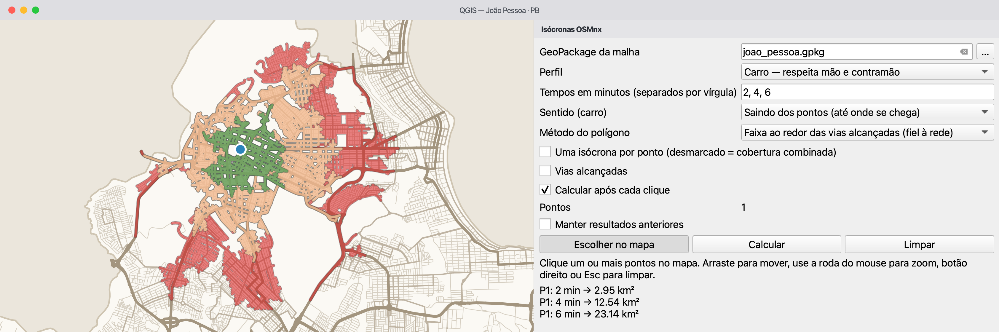
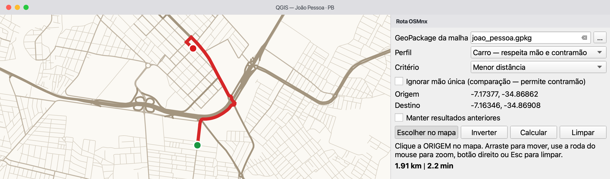
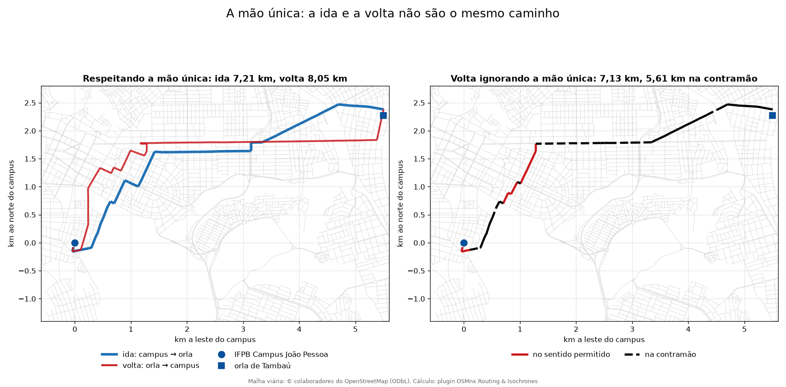

<!-- navegação -->
[⬅️ ⛰️ Perfil da PB-200](../perfil_pb200/perfil_pb200.md) · [🏠 Início](../../README.md) · [🔥 Focos de queimadas ➡️](../queimadas_pb/queimadas_pb.md)

# Até onde se chega a partir do IFPB: isócronas com o plugin OSMnx Routing & Isochrones

## 🧭 1. A proposta da aula

Para avaliar o alcance de um equipamento público, como uma escola, um hospital ou um campus, é comum desenhar um **círculo em linha reta** (um buffer). Mas **pessoas e veículos não andam em linha reta**: seguem as ruas, contornam quarteirões e barreiras e, de carro, respeitam a mão única.

Nesta aula, calculamos as **isócronas** do **IFPB Campus João Pessoa**, as áreas que se alcançam em alguns minutos pelas ruas, com o plugin **[OSMnx Routing & Isochrones](https://marcellobenigno.github.io/osmnx-routing-isochrones/pt-br/)**:

- 🚶 **a pé:** 5, 10 e 15 minutos, a 4,8 km/h (10 minutos = **800 m**);
- 🚗 **de carro:** 5 e 10 minutos, respeitando a mão única.

A pergunta que guia a atividade:

> **Até onde se chega, de verdade, a partir do campus em 10 minutos, e quanto o círculo em linha reta engana?**



### 🎯 Objetivos de aprendizagem

Ao final da aula, a turma será capaz de:

1. **diferenciar** a distância em linha reta (buffer) do alcance pela rede (isócrona);
2. **reconhecer** uma malha viária como um **grafo dirigido**: nós, arcos e o sentido de cada arco;
3. **escolher** o tipo de rede adequado a cada modo (`all` a pé, `drive` de carro);
4. **interpretar** o efeito da mão única: saindo × chegando e a ida × a volta;
5. **reproduzir** com `processing.run` o que foi feito com cliques e **validar** o plugin com a ferramenta nativa **Área de serviço** do QGIS.

---

## 💡 2. Fundamentação

### 2.1 Linha reta (buffer) × pelas ruas (isócrona)

No planejamento urbano, a ideia de **cidade caminhável** (*walkable city*) costuma usar **~800 m**, ou 10 minutos a pé, como raio de influência em volta de escolas, estações e serviços.

```
   [ Buffer circular ]                        [ Isócrona ]
   distância euclidiana                       tempo pelas ruas
            │                                          │
            ▼                                          ▼
   supõe um plano sem obstáculos              segue a rede: quarteirões,
                                              muros, mão única e acessos
```

> *"O círculo é o alcance de um pássaro: ele voa em linha reta por cima de muros e prédios. A isócrona é o alcance de quem anda pela calçada: precisa dar a volta no quarteirão e não atravessa a Mata do Buraquinho."*

Uma **isócrona** (do grego *iso*, igual, e *chronos*, tempo) é a área que se alcança **no mesmo tempo**. A pé, o plugin usa velocidade constante: 10 minutos a 4,8 km/h são exatamente os 800 m da cidade caminhável. De carro, cada rua tem a sua velocidade (seção 2.4).

### 2.2 A malha como grafo: nós e arcos com sentido

Uma malha viária é modelada como um **grafo**: um conjunto de **nós** ligados por **arcos**:

- **nós**: cruzamentos e pontas de rua, com coordenadas e um identificador do OpenStreetMap (`osmid`);
- **arcos**: trechos de rua que ligam dois nós, **de `u` para `v`**, com o comprimento em metros (`length`), o tipo de via (`highway`) e o sentido (`oneway`).

```
    [ nó u ] ───────────── arco u → v ─────────────> [ nó v ]
  (cruzamento 1)        comprimento: 120 m        (cruzamento 2)
```

O plugin roteia sobre a camada de **arcos**, que tem um registro por sentido de circulação. O carro só usa os arcos que existem; o pedestre anda nos dois sentidos.

### 2.3 Baixar uma vez, analisar offline

O plugin precisa de internet **só para baixar** a malha (Nominatim + Overpass, serviços públicos do OpenStreetMap). Depois que o GeoPackage está salvo, isócronas e rotas rodam no computador, sem serviço de roteamento nem chave de API.

| | Online (direto na API) | Offline (o que fazemos) |
| :--- | :--- | :--- |
| **Execução** | cada aluno baixa a malha na aula | o professor baixa a malha **uma vez** |
| **Conexão** | internet estável para todos, ao mesmo tempo | **0 bytes** de internet durante a aula |
| **Servidor** | o Overpass pode recusar: em 21/10/2026, várias tentativas receberam `502 Bad Gateway … at capacity` | não depende dele |
| **Reprodutibilidade** | o OSM muda todo dia | GeoPackage fixo: resultados iguais para toda a turma |

### 2.4 Os dados: uma malha para cada modo

Duas malhas de João Pessoa, as duas em **EPSG:4326**:

| GeoPackage | Como foi baixado | Nós | Arcos (de mão única) | Uso |
| --- | --- | ---: | ---: | --- |
| `malha_joao_pessoa_all.gpkg` | OSMnx, rede **`all`** (todas as vias), com [`malha_urbana_osmnx.py`](../../apoio/osmnx/malha_urbana_osmnx.py) | 22.647 | 59.603 (7.551) | 🚶 a pé |
| `malha_joao_pessoa_drive.gpkg` | o próprio plugin, rede **`drive`** (vias de carro) | 15.819 | 42.749 (5.455) | 🚗 de carro |

> ⚠️ **O tipo de rede é uma decisão de análise.** O plugin **não filtra as vias por perfil**: quem decide por onde se anda ou se dirige é a rede escolhida no download. Na malha `all`, o carro passaria por calçadões, vias de serviço e acessos privados; na `drive`, o pedestre ficaria sem calçadas, escadarias e caminhos.

Medido nesta aula (10 minutos a partir do campus):

| | malha `all` | malha `drive` |
| --- | ---: | ---: |
| 🚶 a pé | **0,87 km²** | 0,74 km² (faltam calçadas e caminhos) |
| 🚗 de carro | 62,2 km² (inclui vias por onde o carro não passa) | **57,5 km²** |

**A velocidade de cada rua.** De carro, o tempo de cada trecho é `travel_time = comprimento ÷ velocidade`. A velocidade vem da etiqueta `maxspeed` do OSM quando ela existe; senão, de um padrão por tipo de via (por exemplo, `residential` 30 km/h, `primary` 60 km/h). Em João Pessoa, só **4,3%** dos trechos têm `maxspeed`: a maior parte dos tempos de carro é **estimada**, para trânsito livre, sem semáforos nem congestionamento.

---

## 🛠️ 3. Trilha prática guiada

### 📦 Instalação do Plugin OSMnx Routing & Isochrones

1. Instale o **OSMnx no Python do QGIS** (*Complementos → Console Python*), reinicie o QGIS e instale o plugin **OSMnx Routing & Isochrones** pelo *Gerenciador de complementos* (marque *Mostrar também os complementos experimentais*). O passo a passo está na [página de instalação do plugin](https://marcellobenigno.github.io/osmnx-routing-isochrones/pt-br/#install).
   
2. Baixe os dados do drive (`dados_curso/alcance_ifpb/`) com as duas malhas. A `drive` foi baixada com *Caixa de Ferramentas → OSMnx Routing & Isochrones → 1. Baixar malha viária (OSM)*, lugar `João Pessoa, Paraíba, Brasil`, tipo `drive`.

---

### 📍 Atividade 1: conferir as malhas (7 min)

**Objetivo:** ver o que há dentro dos GeoPackages antes de calcular qualquer coisa.

1. Na Caixa de Ferramentas, abra **OSMnx Routing & Isochrones → 2. Inspecionar GeoPackage da malha** e rode-o sobre `malha_joao_pessoa_all.gpkg`. O relatório HTML abre no navegador.
2. No **Diagnóstico de roteamento**, localize:
   - a **fonte do sentido**: a camada `arcos`, o grafo dirigido gravado no download;
   - o **preenchimento de `maxspeed`**: 4,3%.
3. Repita com `malha_joao_pessoa_drive.gpkg` e compare o número de nós e de arcos.
4. Arraste a camada `arcos` para o mapa e, em **Propriedades da camada → Simbologia**, troque a linha simples por **Seta** (*Arrow*). Aproxime o mapa do campus e compare uma rua de mão única com uma de mão dupla.

> 💬 **Pausa para reflexão com a turma:**
> - *Por que uma rua de mão dupla aparece com duas setas sobrepostas?*
> - *O que quer dizer, para as isócronas de carro, que só 4,3% das ruas têm limite de velocidade?*

<details>
<summary>Respostas esperadas</summary>

- Porque a camada `arcos` guarda **um arco por sentido**: a mão dupla tem a ida (`u → v`) e a volta (`v → u`), com a mesma geometria em sentidos opostos.
- Que quase todos os tempos de carro vêm de **velocidades padrão** por tipo de via. A isócrona de carro é uma estimativa para trânsito livre, não a previsão de uma viagem real.

</details>

---

### 📍 Atividade 2: isócronas a pé, clicando no mapa (8 min)

**Objetivo:** calcular o alcance a pé e compará-lo com o círculo de 800 m.

1. Na barra de ferramentas, clique em **Isócronas no mapa**. O painel abre ao lado do mapa.
2. Preencha:
   - **GeoPackage da malha:** `malha_joao_pessoa_all.gpkg`;
   - **Perfil:** Pedestre;
   - **Tempos em minutos:** `5, 10, 15`.
3. Clique no campus. As isócronas aparecem do verde ao vermelho, e o painel lista a área de cada faixa.



*O painel de isócronas (captura da documentação do plugin, com outros tempos e o perfil Carro).*

4. Leia o resultado com a turma:

| Tempo a pé | Área | Vias alcançadas |
| --- | ---: | ---: |
| até 5 min (400 m) | 0,17 km² | 2,7 km |
| até 10 min (800 m) | 0,87 km² | 18,3 km |
| até 15 min (1.200 m) | 1,82 km² | 38,6 km |

5. Compare a isócrona de 10 minutos com o círculo: um buffer de 800 m em volta do campus tem **2,01 km²**. A isócrona tem **0,87 km²**, ou **43% do círculo**.

> 🗣️ **Como explicar para a turma:**
> *"O círculo promete que tudo ali dentro está a 10 minutos a pé. Pelas ruas, menos da metade está. A diferença é o preço dos quarteirões longos, do próprio terreno do campus e da Mata do Buraquinho."*

6. No painel, troque o **Método do polígono** para **Envoltória côncava** e compare. O contorno fica mais suave, mas o interior inclui quadras e terrenos que a rede não alcança.

> 💬 **Pausa para reflexão:** *a isócrona de 10 minutos cabe toda dentro do círculo de 800 m. Isso é coincidência?*

<details>
<summary>Resposta esperada</summary>

Não. A rede **nunca** é mais curta que a linha reta: se um ponto está a 800 m pela rede, está a no máximo 800 m em linha reta. As pontas que parecem passar um pouco do círculo, no mapa, são a **faixa de 40 m** que o plugin desenha em volta das vias para formar o polígono. É uma verificação de coerência simples.

</details>

---

### 📍 Atividade 3: de carro, a mão única (8 min)

**Objetivo:** ver o efeito da mão única em dois lugares: nas isócronas e nas rotas.

**Saindo × chegando.**

1. No painel de isócronas, troque a malha para `malha_joao_pessoa_drive.gpkg`, o **Perfil** para **Carro** e os tempos para `5, 10`. Marque **Manter resultados anteriores**.
2. Calcule com **Sentido: Saindo dos pontos** e, depois, com **Chegando aos pontos**.

| Tempo de carro | Saindo do campus | Chegando ao campus |
| --- | ---: | ---: |
| até 5 min | 15,0 km² | 15,5 km² (+3%) |
| até 10 min | 57,5 km² | 58,2 km² (+1%) |

> 🗣️ **Como explicar para a turma:**
> *"'Saindo' responde: até onde eu chego daqui? 'Chegando' responde: de onde as pessoas chegam aqui? A pé, as duas perguntas têm a mesma resposta. De carro, não: a mão única faz o caminho de ida diferente do de volta."*

**A ida e a volta.**

3. Clique em **Rota no mapa**. Use a malha `drive`, **Perfil: Carro**, **Critério: Menor distância**. Clique no campus (origem) e na orla de Tambaú (destino), e depois em **Inverter**.



*O painel de rotas (captura da documentação do plugin, com outro trajeto).*

4. Marque **Ignorar mão única** e calcule de novo. Os trechos feitos na contramão aparecem tracejados.

| Trajeto | Respeitando a mão única | Ignorando a mão única |
| --- | --- | --- |
| ida: campus → orla | 7,21 km, 10,3 min | 7,13 km, **0,83 km na contramão** |
| volta: orla → campus | 8,05 km, 10,7 min | 7,13 km, **5,61 km na contramão** |



> 💬 **Pausa para reflexão:** *ignorando a mão única, a volta encurta só 0,9 km. Então ignorar o sentido das ruas é um erro pequeno?*

<details>
<summary>Resposta esperada</summary>

Não. A distância muda pouco, mas a rota fica **ilegal**: 5,61 dos 7,13 km da volta (79%) são feitos na contramão. Sem a mão única, a volta é praticamente a ida percorrida ao contrário, pelas avenidas de pista dupla, em que cada pista é de mão única. O resultado parece razoável no número e está errado no mapa.

</details>

---

### 📍 Atividade 4: do clique ao código, e a conferência (7 min)

**Objetivo:** repetir a análise com `processing.run` e conferir o plugin com uma ferramenta independente.

Os painéis servem para explorar clicando. Os mesmos cálculos estão na Caixa de Ferramentas (**3. Menor caminho** e **4. Isócronas**) e, portanto, no Python, no **Executar como processo em lote** e no **Modelador Gráfico**.

1. Abra [`alcance_ifpb_plugin.py`](alcance_ifpb_plugin.py) no **Editor do Console Python** do QGIS.
2. Ajuste `PASTA` para a sua pasta `dados_curso/alcance_ifpb/` e clique em **Executar script**.
3. Em cerca de 15 segundos, as isócronas a pé e de carro aparecem no mapa e o console imprime os números das atividades 2 e 3.
4. Leia com a turma a última etapa, a **conferência**. O script roda a **Área de serviço (a partir de ponto)** nativa do QGIS (`native:serviceareafrompoint`) com 800 m nos dois sentidos, sobre a mesma camada `arcos`, e compara os km de vias alcançadas:

| Medida (a pé, 10 min = 800 m) | km de vias |
| :--- | ---: |
| plugin, contando cada rua uma vez | **16,8** |
| QGIS nativo, contando cada rua uma vez | **17,1** (o plugin dá −1,7%) ✅ |
| campo `roads_km` do plugin | **18,3** (+9%) ⚠️ |

> 💡 **Por que o plugin e o QGIS não dão exatamente igual?** Por causa do ponto de partida: o plugin parte do **nó** da rede mais próximo do campus; o QGIS parte do ponto da rua mais próximo. Duas implementações independentes que concordam em 2% dão confiança ao resultado.

> ⚠️ **E o `roads_km`?** O campo soma o comprimento da **união das linhas** alcançadas. Quando uma rua é alcançada inteira por uma ponta e cortada pela outra, o pedaço cortado fica *quase* em cima da rua inteira, e a união não reconhece a sobreposição: a rua é contada duas vezes. Medir pela área de uma faixa de 1 m em volta das linhas conta cada rua uma vez só. O campo `area_km2` do polígono não é afetado.

> 💬 **Pausa para reflexão:** *o plugin é do próprio professor, está publicado e tem testes automáticos. Precisava mesmo conferir?*

<details>
<summary>Resposta esperada</summary>

Sim. Os testes mostram que o código faz o que o autor pensou; a conferência com uma ferramenta independente mostra se o que ele pensou está certo. Foi ela que achou os 9% a mais no `roads_km`. Ferramenta pronta, de terceiros ou nossa, também é código, e código precisa ser conferido.

</details>

---

## 🎓 4. Fechamento: checagem de aprendizagem

### 💬 Check-out oral

Peça que a turma complete as frases:

1. *"Um buffer de 800 m superestima o alcance de 10 minutos a pé porque…"*
2. *"Para estudar o carro, baixei a malha `drive`, e não usei a `all`, porque…"*
3. *"Ignorar a mão única é um erro grave, mesmo quando a distância quase não muda, porque…"*

<details>
<summary>Respostas esperadas</summary>

1. … supõe que se anda em linha reta, atravessando quarteirões, muros e a Mata do Buraquinho. Pelas ruas, a isócrona de 10 minutos cobre só 43% do círculo.
2. … o plugin não filtra as vias por perfil: na malha `all`, o carro passaria por calçadões, vias de serviço e acessos privados, e o alcance sairia maior (62,2 km² em vez de 57,5 km² em 10 minutos).
3. … a rota fica ilegal: na volta da orla para o campus, 79% do caminho seria feito na contramão.

</details>

### 🏁 Mensagem final

> *"O plugin calcula em segundos o que antes pedia um script inteiro, e a IA escreve o `processing.run` em minutos. Mas são os fundamentos de geoprocessamento que garantem que o resultado está certo: a diferença entre a linha reta e a rede, o tipo de rede de cada modo e o efeito da mão única. Conferir o resultado continua sendo responsabilidade sua, inclusive quando a ferramenta é sua."*

---

## 💻 5. Aprofundamento técnico: o script, o plugin por dentro e a IA

### 5.1 O fluxo do exercício

```
┌────────────────────────┐     ┌────────────────────────┐     ┌────────────────────────┐
│ 1. DADOS OFFLINE       │ ──> │ 2. PLUGIN              │ ──> │ 3. VALIDAÇÃO           │
│ • malha all (a pé)     │     │ • painéis no mapa      │     │ • linha reta × rede    │
│ • malha drive (carro)  │     │ • processing.run       │     │ • saindo × chegando    │
│ • sem depender da API  │     │ • isócronas e rotas    │     │ • plugin × QGIS nativo │
└────────────────────────┘     └────────────────────────┘     └────────────────────────┘
```

### 5.2 O script (`alcance_ifpb_plugin.py`)

Cada algoritmo do plugin tem um id estável (`osmnx_routing:isochrones`, `osmnx_routing:shortest_path`…), e os parâmetros de lista recebem a **posição** da opção (0, 1, …). Os trechos centrais, copiados do script:

**As isócronas.** `runAndLoadResults` carrega as camadas já com o estilo do plugin, do verde ao vermelho:

```python
CARRO, A_PE = 0, 1
SAINDO, CHEGANDO = 0, 1

def isocronas(malha, perfil, minutos, nome, sentido=SAINDO):
    """Roda o algoritmo de isócronas do plugin e carrega o resultado no mapa."""
    res = processing.runAndLoadResults("osmnx_routing:isochrones", {
        "NETWORK": malha, "PROFILE": perfil, "POINT": CAMPUS,
        "DIRECTION": sentido, "MINUTES": minutos,
        "WALK_SPEED": VELOCIDADE_A_PE,
        "OUTPUT": "TEMPORARY_OUTPUT", "ROADS": "TEMPORARY_OUTPUT"})
```

**A rota.** O algoritmo devolve os números prontos, `DISTANCE_KM`, `TIME_MIN` e `WRONG_WAY_M`:

```python
def rota(origem, destino, ignorar_mao_unica):
    """Menor caminho de carro pela distância; devolve km, minutos e contramão."""
    res = processing.run("osmnx_routing:shortest_path", {
        "NETWORK": MALHA_DRIVE, "PROFILE": CARRO, "CRITERION": 0,
        "ORIGIN": origem, "DESTINATION": destino,
        "IGNORE_ONEWAY": ignorar_mao_unica, "OUTPUT": "TEMPORARY_OUTPUT"})
    return res["DISTANCE_KM"], res["TIME_MIN"], res["WRONG_WAY_M"]
```

**A conferência.** A Área de serviço nativa precisa de metros: a camada `arcos` é reprojetada para EPSG:31985 antes. Os km são medidos pela faixa de 1 m, que conta cada rua uma vez:

```python
nativo = processing.run("native:serviceareafrompoint", {
    "INPUT": arcos_utm, "STRATEGY": 0,      # 0 = mais curto (distância)
    "DEFAULT_DIRECTION": 2,                 # 2 = ambas as direções (a pé)
    "START_POINT": CAMPUS, "TRAVEL_COST2": 800,
    "OUTPUT_LINES": "TEMPORARY_OUTPUT"})["OUTPUT_LINES"]
km_plugin, km_nativo = km_de_vias(vias_plugin), km_de_vias(nativo)
```

**Saída esperada no console:**

```text
[1] A pé, malha 'all', saindo do campus
         5 min:  0.17 km² |   2.7 km de vias
        10 min:  0.87 km² |  18.3 km de vias
        15 min:  1.82 km² |  38.6 km de vias
      10 min a 4.8 km/h = 800 m: isócrona 0.87 km² = 43% do círculo de 800 m (2.01 km²)

[2] De carro, malha 'drive'
         5 min: saindo  15.0 km² | chegando  15.5 km² (+3%)
        10 min: saindo  57.5 km² | chegando  58.2 km² (+1%)

[3] Rota de carro: campus ↔ orla de Tambaú (menor distância)
      ida  : 7.21 km, 10.3 min | ignorando a mão única: 7.13 km, com 0.83 km na contramão
      volta: 8.05 km, 10.7 min | ignorando a mão única: 7.13 km, com 5.61 km na contramão

[4] Conferência: plugin × Área de serviço do QGIS (a pé, 800 m)
      plugin: 16.8 km × QGIS nativo: 17.1 km (-1.7%)
      campo roads_km do plugin: 18.3 km (+9% sobre a faixa de 1 m)
```

> **Nota: o que conferir no código**
>
> | Trecho | Por que é assim |
> | --- | --- |
> | `MALHA_ALL` a pé, `MALHA_DRIVE` de carro | o plugin não filtra vias por perfil: a rede é a escolha |
> | `"PROFILE": A_PE` com `"WALK_SPEED": 4.8` | 10 min a 4,8 km/h = 800 m, o mesmo raio da conferência |
> | `"DEFAULT_DIRECTION": 2` na Área de serviço | a pé, a mão única não vale |
> | reprojeção para EPSG:31985 antes da Área de serviço | o custo de 800 tem de estar em metros |
> | `km_de_vias()` pela faixa de 1 m | ida e volta da mesma rua não somam duas vezes |

### 5.3 O plugin por dentro

O plugin é construído sobre o **OSMnx** (download e grafo) e o **NetworkX** (menores caminhos). O que ele faz a cada isócrona:

1. **Lê o GeoPackage uma vez por sessão** e monta os grafos: o dirigido (carro) e um em que todo arco de mão única ganha o inverso (pedestre). O segundo cálculo sobre a mesma malha reaproveita os grafos.
2. **Liga o ponto ao nó mais próximo**, num SRC métrico local (aqui, EPSG:31985). De carro, só concorrem os nós da **maior componente fortemente conexa**, de onde se chega a qualquer lugar e se volta, respeitando a mão; assim, sempre existe rota.
3. **Roda o Dijkstra com limite** (`nx.multi_source_dijkstra_path_length(..., cutoff=...)`), pelo `travel_time` (carro) ou pelo `length` convertido em minutos (pedestre). "Chegando aos pontos" roda o mesmo cálculo sobre o **grafo invertido**.
4. **Corta o último arco** de cada caminho em proporção ao tempo que sobra e desenha uma **faixa de 40 m** em volta das vias alcançadas (ou a envoltória côncava dos nós).

O script [`alcance_ifpb.py`](alcance_ifpb.py), a versão anterior deste exercício, faz o mesmo cálculo **sem o plugin**, só com PyQGIS e NetworkX, em cerca de 450 linhas. Vale lê-lo para ver cada uma dessas etapas escrita à mão. Ele dá **16,2 km** de vias a pé em 800 m, contra 16,8 km do plugin, porque filtra as vias por modo: tira acessos privados, ciclovias e vias expressas, que o plugin, sem filtro por perfil, mantém.

### 5.4 A IA não valida por você, nem o plugin

A primeira versão do script NetworkX media as vias pela união das geometrias e deu **17,5 km** a pé, um número plausível. A pista veio de uma conferência simples: a soma das faixas não dava o todo. O campo `roads_km` do plugin repete o mesmo método e infla o total em 9%. Separando as vias alcançadas pelo plugin:

| Vias alcançadas em 10 min a pé | União das linhas | Faixa de 1 m |
| --- | ---: | ---: |
| trechos alcançados inteiros | 13,97 km | 13,91 km |
| trechos cortados no limite | 4,71 km | 4,64 km |
| **todos juntos** | **18,30 km** | **16,82 km** |

Separados, os dois métodos concordam; juntos, a união conta duas vezes 1,5 km de ruas em que o pedaço cortado fica quase em cima da rua inteira. A lição é a mesma das outras aulas: **a soma das partes tem de dar o todo**, e quem confere é você.

### 5.5 O prompt usado com a IA

```text
Atue como especialista em PyQGIS.
Escreva um script para o Console Python do QGIS 3.44 que use o plugin
"OSMnx Routing & Isochrones" (já instalado) para calcular o alcance a partir
do IFPB Campus João Pessoa (-34.87354, -7.13574), sem internet.

1. Entradas: 'malha_joao_pessoa_all.gpkg' (a pé) e
   'malha_joao_pessoa_drive.gpkg' (de carro), GeoPackages em EPSG:4326.
2. Isócronas com processing.runAndLoadResults("osmnx_routing:isochrones"):
   a) a pé (PROFILE=1), 5, 10 e 15 min a 4,8 km/h; compare a área da de
      10 min com o círculo de 800 m;
   b) de carro (PROFILE=0), 5 e 10 min, saindo (DIRECTION=0) e chegando
      (DIRECTION=1) ao campus.
   Os parâmetros de lista recebem a posição da opção (0, 1, …).
3. Rota com processing.run("osmnx_routing:shortest_path"), de carro, menor
   distância, do campus à orla de Tambaú (-34.8237, -7.1154) e de volta,
   com IGNORE_ONEWAY False e True; imprima DISTANCE_KM, TIME_MIN e
   WRONG_WAY_M.
4. Conferência: native:serviceareafrompoint sobre a camada 'arcos'
   reprojetada para EPSG:31985, 800 m, ambas as direções. Compare os km de
   vias com os da isócrona a pé de 10 min, contando cada rua uma vez só
   (área de uma faixa de 1 m em volta das linhas ÷ 1 m).
Comentários em português.
```

> 💡 O item 4 termina com "contando cada rua uma vez só": é a lição da seção 5.4 virando instrução. Quando a conferência acha um erro, o prompt seguinte deve dizer como evitá-lo.

---

## 🛡️ 6. Resolução de problemas e dicionário

### ⚠️ Armadilhas comuns

| Sintoma | Causa | Como corrigir |
| :--- | :--- | :--- |
| **algoritmos desativados, "Bibliotecas Python ausentes"** | o OSMnx não está no Python do QGIS | instalar com o comando da [página do plugin](https://marcellobenigno.github.io/osmnx-routing-isochrones/pt-br/#install) e reiniciar o QGIS |
| **`Error: Algorithm osmnx_routing:isochrones not found`** no script | o plugin não está instalado ou ativo | ativar em *Complementos → Gerenciar e instalar complementos* |
| **isócronas a pé pequenas demais** | a malha é `drive`: não tem calçadas nem caminhos | usar a malha `all` (ou `walk`) a pé |
| **isócronas de carro grandes demais** | a malha é `all`: o carro passa por calçadões e vias de serviço | usar a malha `drive` de carro |
| **rota começa longe do clique** | o clique foi ligado a um nó da rede principal; o log avisa acima de 150 m | ler o aviso; clicar mais perto de uma rua da rede |
| **"… km da malha viária"** | o ponto está a mais de 5 km da rede, ou numa camada com o SRC errado | clicar dentro da área baixada; conferir o SRC |
| **km de vias inflados** | o `roads_km` mede a união das linhas (seção 5.4) | medir pela área de uma faixa de 1 m |
| **comprimentos minúsculos, em "graus"** | `$length` medido em EPSG:4326 | reprojetar para um SRC métrico (EPSG:31985) |
| **`502 Bad Gateway … at capacity`** ao baixar a malha | o servidor Overpass está sobrecarregado | baixar uma vez, fora da aula, e trabalhar offline (seção 2.3) |

### 📖 Dicionário para estudantes

- **Buffer:** área a uma distância fixa em linha reta de um objeto; aqui, o círculo em volta do campus.
- **Isócrona:** área estimada como alcançável dentro de um limite de tempo, pela rede e pelo perfil escolhidos.
- **Área de serviço (isodistância):** o mesmo conceito, medido em distância em vez de tempo.
- **Grafo dirigido:** cada arco tem um sentido (de `u` para `v`); é o que representa a mão única.
- **Dijkstra:** o algoritmo clássico que acha o menor caminho de um nó até todos os outros.
- **Componente fortemente conexa:** um pedaço do grafo em que se vai de qualquer nó a qualquer outro, respeitando os sentidos.
- **Envoltória côncava:** contorno que se ajusta a um conjunto de pontos; representa os dados, mas não garante acesso a todo o interior.
- **OSMnx:** biblioteca Python que baixa a malha viária do OpenStreetMap já como grafo.
- **NetworkX:** biblioteca Python para criar e analisar grafos.
- **Overpass / Nominatim:** os serviços públicos do OpenStreetMap que entregam os dados do mapa e localizam lugares pelo nome.

---

## 🚀 7. Desafios para depois da aula

1. **Cobertura combinada.** Crie uma camada de pontos com três lugares de João Pessoa (o campus, a Reitoria do IFPB e uma escola) e rode **4. Isócronas** com *Uma isócrona por ponto* desmarcado. Cada rua recebe o tempo do ponto que a alcança mais rápido **pela rede**: compare com o ponto mais próximo em linha reta.
2. **De onde se chega ao hospital?** Escolha um hospital e calcule a isócrona de carro de 10 minutos **chegando ao ponto**. Por que, para uma ambulância, essa é a pergunta certa?
3. **Em lote.** Clique com o botão direito em **4. Isócronas → Executar como processo em lote** e calcule, numa só execução, as isócronas a pé de 10 minutos de vários pontos.
4. **Outra cidade.** Baixe com o plugin a malha `walk` de Cabedelo e calcule as isócronas a pé do IFPB Campus Cabedelo. Compare a proporção isócrona ÷ círculo com a de João Pessoa: onde a rede é mais "caminhável"?

---

<!-- navegação -->
[⬅️ ⛰️ Perfil da PB-200](../perfil_pb200/perfil_pb200.md) · [🏠 Início](../../README.md) · [🔥 Focos de queimadas ➡️](../queimadas_pb/queimadas_pb.md)
