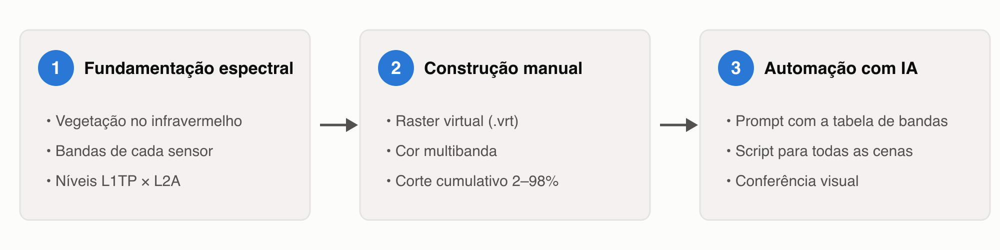
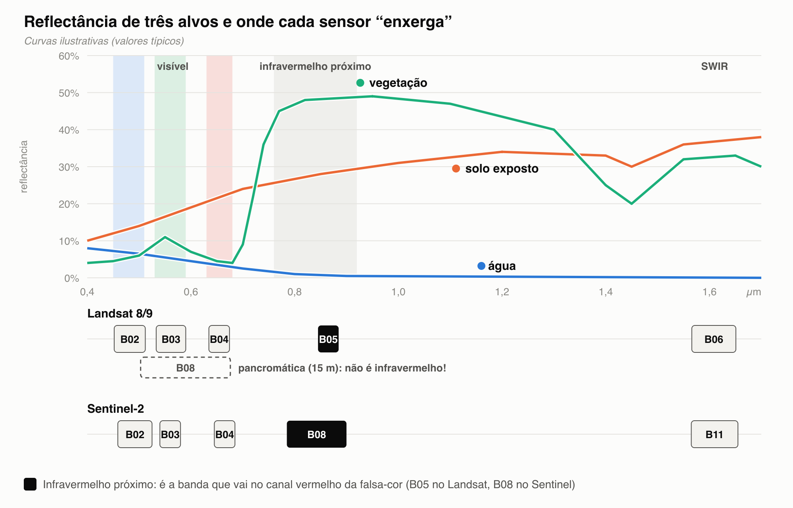
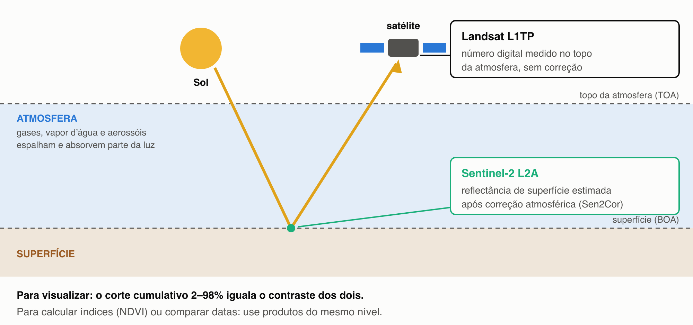
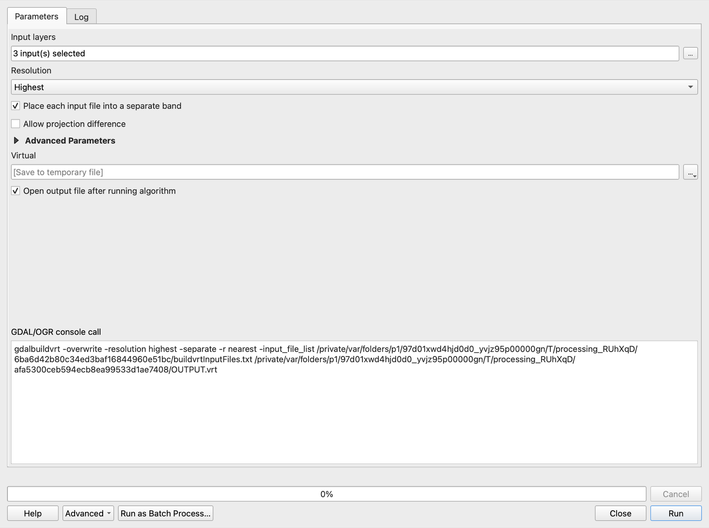
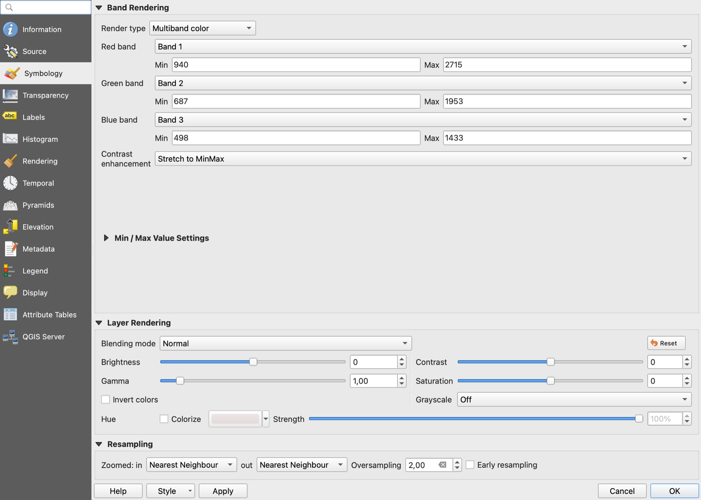
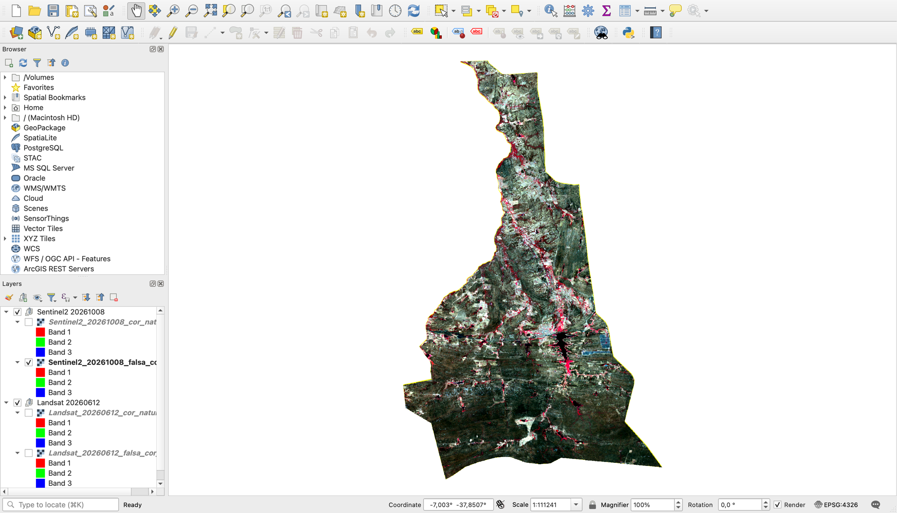
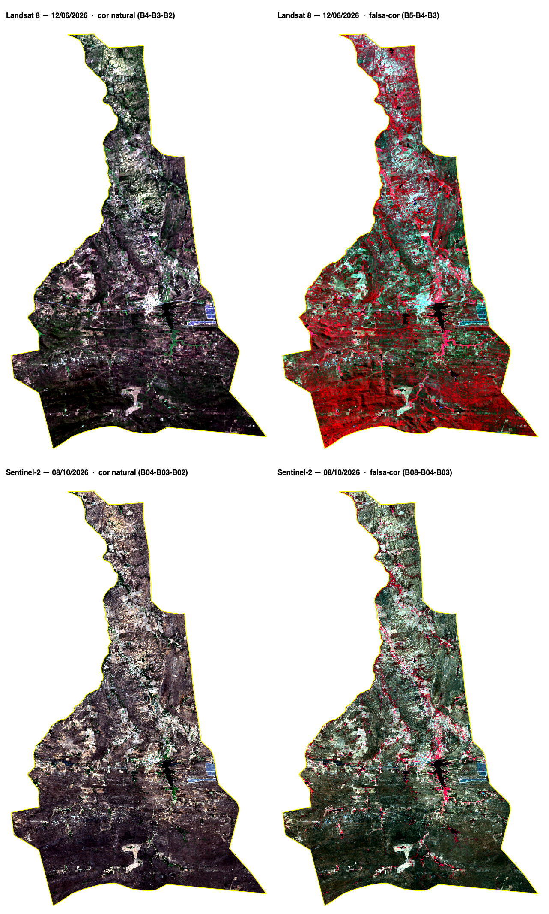

<!-- navegação -->
[🏠 Início](../../README.md)

# Automatizando Composições RGB de Landsat e Sentinel no QGIS



## Contexto

Google Earth Engine, Planet e afins já entregam imagens prontas para ver. Mesmo assim, no dia a dia da consultoria, o pedido costuma ser outro: **"preciso da imagem da área, em cor natural e falsa-cor, no projeto do QGIS, para o mapa do relatório"**. E o ponto de partida é uma pasta com uma dúzia de arquivos `B01.tif`, `B02.tif`…

Cada arquivo é **uma banda**: uma "foto" da mesma área numa faixa do espectro. Uma **composição RGB** escolhe três bandas e as pinta de vermelho, verde e azul.

## O que deve ser entregue

Quatro camadas no projeto, num grupo por cena:

| Camada | Bandas (R-G-B) |
| --- | --- |
| `Landsat_20260612_cor_natural` | B04-B03-B02 |
| `Landsat_20260612_falsa_cor_nir` | B05-B04-B03 |
| `Sentinel2_20261008_cor_natural` | B04-B03-B02 |
| `Sentinel2_20261008_falsa_cor_nir` | B08-B04-B03 |

Requisitos: cada composição é um **raster virtual (`.vrt`)**, sem cópia das bandas; Sentinel na **resolução mais alta** (10 m); contraste com **corte cumulativo de 2–98%**.

## Dados

| Pasta | Satélite / nível | Data | Época |
| --- | --- | --- | --- |
| `dados_curso/composicao_rgb/LC08_L1TP_216065_…/` | Landsat 8 / L1TP | 12/06/2026 | fim das chuvas |
| `dados_curso/composicao_rgb/S2A_MSIL2A_20261008T125321_…/` | Sentinel-2A / L2A | 08/10/2026 | auge da seca |
| `dados_curso/composicao_rgb/area_interese.geojson` | polígono da área de interesse | — | — |

> As bandas já vêm **recortadas** pelo polígono (as cenas completas somam 1,7 GB; os recortes, 27 MB), mantendo a grade original dos pixels.

## Roteiro

| Parte | O que fazemos | Tempo |
| --- | --- | --- |
| [1 — Por que a falsa-cor funciona](#parte-1--por-que-a-falsa-cor-funciona) | Resposta espectral, bandas de cada sensor, L1TP × L2A | 4 min |
| [2 — Na mão, uma vez](#parte-2--na-mão-uma-vez) | Construir raster virtual + simbologia multibanda | 7 min |
| [3 — Com a IA](#parte-3--com-a-ia) | Um script monta as quatro composições de uma vez | 6 min |
| [4 — Onde a IA erra](#parte-4--onde-a-ia-erra) | Bandas trocadas, resolução, contraste | 3 min |

> As capturas de tela estão com o QGIS 3.44 em inglês; no texto aparecem os nomes em português e, entre parênteses, em inglês.

---

## Parte 1 — Por que a falsa-cor funciona

A vegetação **absorve** o azul e o vermelho (fotossíntese) e **reflete muito** o infravermelho próximo (NIR). Solo e água, não. Por isso:

- **Cor natural** (vermelho, verde, azul): a área "como o olho vê".
- **Falsa-cor NIR** (NIR, vermelho, verde): o NIR vai no canal vermelho, e a **vegetação viva fica vermelha**.



O problema: **cada satélite numera as bandas de um jeito**.

| Faixa | Landsat 8/9 | Sentinel-2 |
| --- | --- | --- |
| Azul · Verde · Vermelho | B02 · B03 · B04 (30 m) | B02 · B03 · B04 (10 m) |
| **Infravermelho próximo** | **B05** (30 m) | **B08** (10 m) |
| Pancromática | B08 (15 m) | — |

> ⚠️ **Atenção:** a `B08` do Landsat é a **pancromática**, não o infravermelho. Falsa-cor é **B5-4-3 no Landsat** e **B8-4-3 no Sentinel**.

As duas cenas também estão em **níveis de processamento** diferentes:



---

## Parte 2 — Na mão, uma vez

Vamos montar a **cor natural do Sentinel**. É exatamente isto que o script vai repetir.

### 2.1 Juntar as três bandas num raster virtual

1. Abra **Raster → Miscelânea → Construir raster virtual (Raster → Miscellaneous → Build Virtual Raster)**.
2. Em **Camadas de entrada (Input layers)**, clique em `…` → **Adicionar arquivo(s)** e escolha, **nesta ordem**, `B04.tif`, `B03.tif` e `B02.tif` da pasta do Sentinel.
3. Em **Resolução (Resolution)**, escolha **Mais alta (Highest)**.
4. Marque **Colocar cada arquivo de entrada em uma banda separada (Place each input file into a separate band)**.
5. Clique em **Executar (Run)**.



> **Nota: por que raster virtual?** O `.vrt` é um arquivo de poucos KB que só **aponta** para as bandas originais. Nada é copiado: é instantâneo e não enche o disco.

### 2.2 Pintar as bandas de vermelho, verde e azul

1. Botão direito na camada **`Virtual`** → **Propriedades (Properties) → Simbologia (Symbology)**.
2. Em **Tipo de renderização (Render type)**, escolha **Cor multibanda (Multiband color)**.
3. Confira: **Vermelho = Banda 1**, **Verde = Banda 2**, **Azul = Banda 3**.
4. Abra **Configurações de valores mín./máx. (Min / Max Value Settings)** → **Corte cumulativo da contagem (Cumulative count cut)**, **2–98%**.
5. Clique em **OK**.



> **Entendendo o corte de 2–98%**
>
> O QGIS ignora os 2% de pixels mais escuros e os 2% mais claros do **histograma** ao esticar o contraste. Sem isso, um telhado branco ou um açude escuro "decide" o contraste da cena inteira, e a imagem fica apagada.

> ⚠️ **Atenção:** se a vegetação aparecer azulada ou arroxeada, as bandas entraram fora de ordem. Não refaça o raster virtual: troque as bandas no passo 3.

Agora imagine repetir isso para a falsa-cor, de novo para o Landsat, e a cada nova imagem. É hora do script.

---

## Parte 3 — Com a IA

### 3.1 O prompt

```text
Escreva um script para o Editor do Console Python do QGIS 3.44 que monte
composições RGB de imagens Landsat 8/9 e Sentinel-2.

- Uma pasta de dados (variável no topo) tem uma subpasta por cena, com o
  nome original (LC08_L1TP_..., S2A_MSIL2A_...). Dentro, um arquivo por
  banda: B02.tif, B03.tif...
- Identifique o sensor pelo início do nome (LC08/LC09 = Landsat;
  S2A/S2B/S2C = Sentinel) e a data pelo nome da cena.
- Use EXATAMENTE estas bandas (R, G, B), num dicionário no topo:
    Landsat:  cor_natural B04-B03-B02 | falsa_cor_nir B05-B04-B03
    Sentinel: cor_natural B04-B03-B02 | falsa_cor_nir B08-B04-B03
- Para cada composição, crie um raster virtual com gdal:buildvirtualraster,
  uma banda por arquivo (SEPARATE), resolução mais alta, na pasta da cena.
- Carregue com cor multibanda (1, 2, 3) e corte cumulativo 2–98%, num grupo
  por cena, com o nome sensor_data_composicao.
- Se faltar alguma banda, avise e pule; não interrompa o script.
```

> **Dica:** o prompt **entrega a tabela de bandas** em vez de perguntar "quais são as bandas da falsa-cor?". É o tipo de "conhecimento" que a IA erra com toda a confiança (veja a Parte 4).

### 3.2 Rodar no QGIS

1. Abra o **Console Python** (`Ctrl+Alt+P`) → **Mostrar editor (Show Editor)**.
2. Cole o script da IA (ou abra [`composicoes_rgb.py`](composicoes_rgb.py), a versão revisada).
3. Em `PASTA_DADOS`, informe o **caminho completo** da pasta `dados_curso/composicao_rgb`, por exemplo: `Path(r"C:\minicurso\dados_curso\composicao_rgb")`.
4. Clique em **Executar script (Run Script)**.

```text
  [SUCESSO] Landsat_20260612_cor_natural (B04-B03-B02)
  [SUCESSO] Landsat_20260612_falsa_cor_nir (B05-B04-B03)
  [SUCESSO] Sentinel2_20261008_cor_natural (B04-B03-B02)
  [SUCESSO] Sentinel2_20261008_falsa_cor_nir (B08-B04-B03)
```



> **Nota: o que conferir no script da IA**
>
> - As bandas estão num **dicionário por sensor**, e não "fixas" no meio do código?
> - `SEPARATE` ligado? Sem ele, as três bandas viram um mosaico de **uma** banda só.
> - `RESOLUTION` é **1**? No `gdal:buildvirtualraster`, **0 = média**, 1 = mais alta, 2 = mais baixa.
> - O contraste usa `QgsRasterMinMaxOrigin.CumulativeCut`? Calcular "2% e 98% da amplitude" (`mín + 2% × (máx − mín)`) **não** é corte cumulativo, e a imagem sai escura.

### 3.3 Conferência rápida



| Alvo | Cor natural | Falsa-cor NIR |
| --- | --- | --- |
| Vegetação | verde-escuro a marrom | **vermelha** |
| Água | preta | preta |
| Cidade e solo exposto | cinza-claro e bege | ciano e branco |

Agora compare as duas datas na **falsa-cor**:

- **Landsat, junho** (fim das chuvas): vermelho por quase toda a área: a caatinga está com folhas.
- **Sentinel, outubro** (seca): o vermelho **sobra só nas matas ciliares**: a caatinga perdeu as folhas.

Na cor natural, a diferença quase não aparece; na falsa-cor, salta aos olhos. 🎉

> ⚠️ **Atenção: L1TP e L2A não estão na mesma escala.** Para **visualizar**, o corte de 2–98% resolve. Para **calcular** índices como o NDVI ou comparar datas, use produtos do mesmo nível (no Landsat, o `L2SP`).

---

## Parte 4 — Onde a IA erra

Todos estes erros **geram uma imagem**, e é por isso que passam despercebidos.

| Erro típico | Como aparece | Como pegar |
| --- | --- | --- |
| **`B08` do Landsat como infravermelho** | vegetação sem vermelho, imagem acinzentada | a `B08` do Landsat é a pancromática; use `B05` |
| **Falsa-cor do Landsat aplicada ao Sentinel** (`B05-B04-B03`) | a vegetação quase não fica vermelha | a `B05` do Sentinel é *red edge*; use `B08`. Dê a tabela no prompt |
| **Sem `SEPARATE`** | uma camada cinza, de **uma** banda | **Propriedades → Informações**: o VRT precisa ter 3 bandas |
| **`RESOLUTION: 0`** achando que é "a mais alta" | Sentinel borrado quando entram bandas de 20 m ou 60 m | 0 = média; use **1** |
| **Contraste pela amplitude, e não pelo histograma** | imagem escura e lavada, mesmo "com contraste" | `QgsRasterMinMaxOrigin.CumulativeCut` |
| **Copiar as bandas para um GeoTIFF novo** | gigabytes duplicados a cada composição | peça raster virtual (`.vrt`) |

> **A IA não valida por você.** O script rodar não garante que a composição está certa: quem confere se a vegetação está vermelha na falsa-cor é você.

---

## Arquivos deste exercício

```
modulos/composicao_rgb/
├── composicao_rgb.md            ← este roteiro
└── composicoes_rgb.py           ← Parte 3: as quatro composições de uma vez

imgs/composicao_rgb/             ← infográficos e capturas de tela
dados_curso/composicao_rgb/      ← dados (baixe do Google Drive)
├── area_interese.geojson        ← polígono da área de interesse
├── LC08_L1TP_216065_…/          ← bandas do Landsat 8 (recortadas)
├── S2A_MSIL2A_…/                ← bandas do Sentinel-2 (recortadas)
└── cenas_completas/             ← cenas originais, sem recorte (1,7 GB, opcional)
```

---

<!-- navegação -->
[🏠 Início](../../README.md)
