# Exercício 1 — Arrumando a casa: de shapefiles bagunçados a um GeoPackage padronizado

> Primeiro exercício do minicurso **Automatizando o QGIS com Python e IA**.
> Antes de automatizar qualquer análise, os dados precisam estar **organizados, padronizados e confiáveis**. Neste exercício você vai receber três arquivos "de verdade", cheios de problemas, e vai transformá-los em uma única camada limpa. Faremos isso **à mão**, depois **com Python** e por fim **com a ajuda de uma IA**.

## Contexto

Uma equipe de consultoria ambiental está delimitando as **áreas de estudo para levantamento de espécies de aves do Sertão Paraibano**. O trabalho foi dividido entre várias pessoas e, no fim, chegaram à sua mesa três shapefiles:

| Arquivo | Quem fez |
| --- | --- |
| `ÁREAS DE ESTUDO.shp` | primeira versão da equipe |
| `ÁREAS DE ESTUDO (2).shp` | uma "cópia" feita por alguém para continuar o trabalho |
| `area_estuto_josé.shp` | a parte do José |

Os três representam **o mesmo trabalho, com o mesmo objetivo**. Sua tarefa, como analista de geoprocessamento, é entregar **uma única base oficial**.

## O que deve ser entregue

Um GeoPackage `areas_especies_sertao.gpkg` com **uma única camada**, `area_estudo`, que siga este **dicionário de dados**:

| Campo | Tipo | Conteúdo | Exemplo |
| --- | --- | --- | --- |
| `descricao` | texto (100) | Nome da área, com grafia padronizada | `Área prioritária 1` |
| `area_ha` | decimal (12,2) | Área da geometria em hectares, **calculada** | `6934.72` |
| `municipios` | texto (254) | Municípios intersectados, separados por vírgula, **calculados** a partir da camada `municipios` do IBGE | `Catingueira, Olho D'água` |

Requisitos:

- CRS **EPSG:31984 — SIRGAS 2000 / UTM 24S**;
- nomes de campo em **minúsculas, sem acento, separados por underline** (*snake_case*);
- **nenhum campo desnecessário**;
- **áreas repetidas descartadas**: uma única feição para cada polígono.

## Dados

| Dado | Onde está |
| --- | --- |
| Os três shapefiles | `dados_curso/dados_vetoriais/entrada/` |
| Camada `municipios` (IBGE, EPSG:4326) | `minicurso_dados.gpkg` — veja [`dados_curso/README.md`](../../dados_curso/README.md) |

## Roteiro

| Parte | O que fazemos | Tempo |
| --- | --- | --- |
| [1 — Diagnóstico](#parte-1--diagnóstico-o-que-há-de-errado-com-esses-arquivos) | Abrir os arquivos e listar **todos** os problemas, antes de mexer em qualquer coisa | 15 min |
| [2 — Por que isso acontece?](#parte-2--por-que-isso-acontece) | As causas reais da bagunça e como evitá-la | 10 min |
| [3 — Padronização de campos](#parte-3--padronização-de-campos-as-regras-do-jogo) | Convenções de nome, tipos, valores e o dicionário de dados | 10 min |
| [4 — Solução manual no QGIS](#parte-4--solução-manual-no-qgis) | Atribuir projeção → Mesclar → Excluir duplicadas → Refatorar campos | 20 min |
| [5 — Automatizando com Python](#parte-5--automatizando-com-python) | Diagnóstico e solução em scripts reaproveitáveis | 15 min |
| [6 — A IA a serviço da organização dos dados](#parte-6--a-ia-a-serviço-da-organização-dos-dados) | Como pedir, o que conferir e onde a IA erra | 20 min |

> As capturas de tela estão com o QGIS 3.44 em inglês; no texto aparecem os nomes em português e, entre parênteses, em inglês.

---

## Parte 1 — Diagnóstico: o que há de errado com esses arquivos?

**Regra número 1 da organização de dados: não corrija o que você ainda não entendeu.** Antes de abrir qualquer ferramenta de processamento, vamos fazer um "exame clínico" das três camadas.

### 1.1 Carregar as camadas

Arraste os três `.shp` de `dados_curso/dados_vetoriais/entrada/` e a camada `municipios` do `minicurso_dados.gpkg` para o mapa.

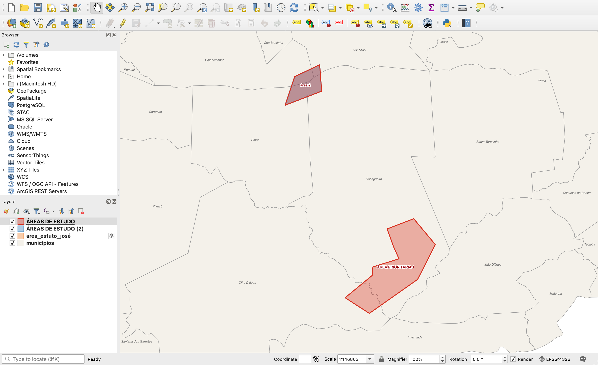

Repare em três coisas:

1. **Só aparecem dois polígonos**, mas cada arquivo tem duas feições — onde estão as outras?
2. A camada `area_estuto_josé` tem um **ícone de interrogação** ao lado do nome, no painel Camadas.
3. A "área 2" aparece num tom **arroxeado**: é o vermelho do arquivo 1 *por cima* do azul do arquivo 2. Ou seja, **há polígonos empilhados**.

### 1.2 O ícone de interrogação: camada sem CRS

Botão direito em `area_estuto_josé` → **Propriedades (Properties) → Informações (Information)**. No fim da página, o CRS é **Unknown** (desconhecido): o arquivo `.prj` simplesmente **não existe** na pasta.

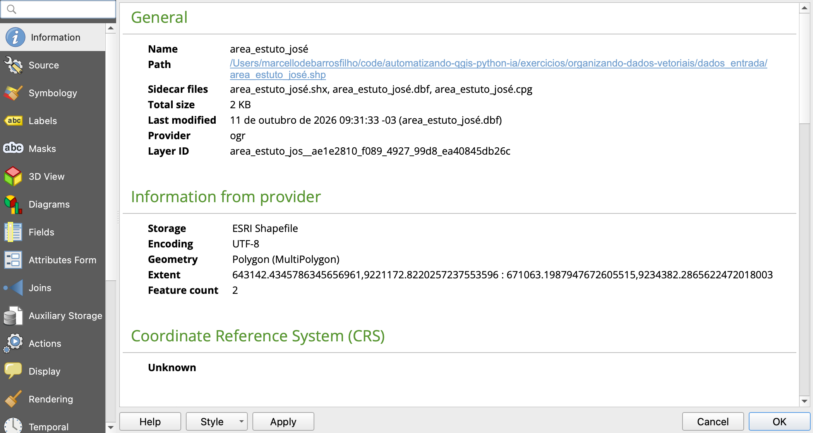

Sem `.prj`, o QGIS não sabe onde essas coordenadas ficam na Terra. Mas a própria página dá a pista: a **extensão** vai de `643142, 9221172` a `671063, 9234382`. Números dessa ordem — centenas de milhares no X, ~9 milhões no Y — são típicos de **UTM no hemisfério sul**; e o Sertão da Paraíba fica no **fuso 24**. Conclusão: o arquivo está em **SIRGAS 2000 / UTM 24S (EPSG:31984)** — e isso se confirma porque as coordenadas são *idênticas* às de `ÁREAS DE ESTUDO (2)`, que tem `.prj` em EPSG:31984.

> **Armadilha extra.** Os arquivos `.qmd` (metadados do QGIS) de `area_estuto_josé` e de `ÁREAS DE ESTUDO (2)` dizem que o CRS é **WGS 84**. É falso: o metadado foi copiado de outro arquivo e nunca atualizado. **Metadado errado é pior que metadado nenhum** — confie nas coordenadas, não no que está escrito.

### 1.3 As tabelas de atributos

Abra a tabela de atributos de cada camada (`F6`):

**`ÁREAS DE ESTUDO`** (EPSG:4326)

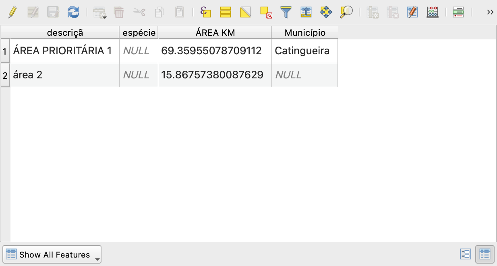

**`ÁREAS DE ESTUDO (2)`** (EPSG:31984)

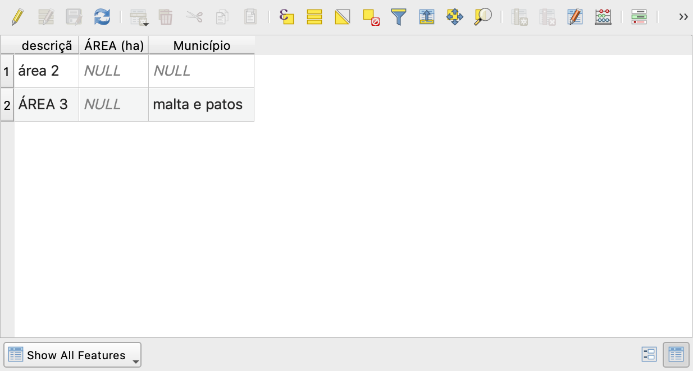

**`area_estuto_josé`** (sem CRS)

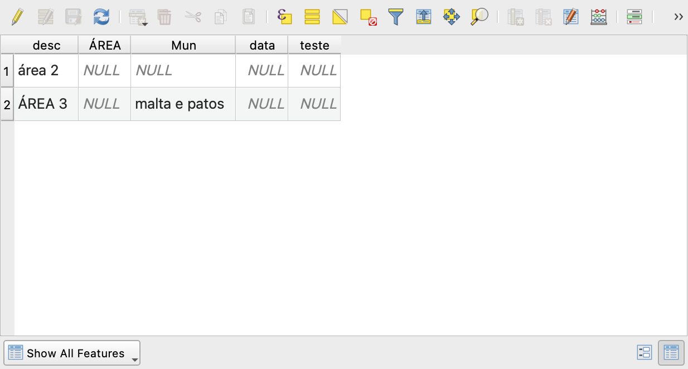

E a estrutura dos campos, em **Propriedades → Campos (Fields)**:

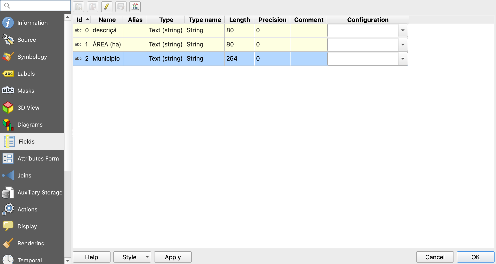

### 1.4 O laudo: catálogo de problemas

Junte tudo o que você viu. Este é o "laudo" que justifica cada passo da solução — **escreva o seu antes de ler o nosso**.

| # | Categoria | Problema | Onde |
| --- | --- | --- | --- |
| 1 | Arquivos | Nomes com **acento, espaço, maiúsculas e parênteses** (`ÁREAS DE ESTUDO (2).shp`) — quebram scripts, URLs e alguns sistemas | todos |
| 2 | Arquivos | **Erro de digitação** e **nome de pessoa** no nome do arquivo (`area_estuto_josé`) | José |
| 3 | Arquivos | **Versionamento pelo nome** do arquivo: `(2)` não diz *o que* mudou, *quem* mudou nem *qual* é a versão válida | (2) |
| 4 | CRS | **Três situações diferentes**: WGS 84 geográfico, SIRGAS 2000 / UTM 24S e **nenhum** CRS | todos |
| 5 | CRS | **Metadados `.qmd` contraditórios** com os dados (dizem WGS 84) | (2), José |
| 6 | Campos | Nome **truncado**: `descriçã` (o shapefile limita nomes a 10 bytes — veja o quadro abaixo) | 1, (2) |
| 7 | Campos | **O mesmo conceito com nomes diferentes**: `descriçã` × `desc`; `Município` × `Mun`; `ÁREA KM` × `ÁREA (ha)` × `ÁREA` | todos |
| 8 | Campos | Nomes com **maiúsculas, acentos, espaços e parênteses** (`ÁREA (ha)`) | todos |
| 9 | Tipos | **Área guardada como texto** (`String`): não dá para somar, ordenar nem filtrar por valor | todos |
| 10 | Unidades | Cada arquivo usa uma **unidade diferente** para área: `KM` (na verdade km²), `ha`, e sem unidade | todos |
| 11 | Valores | **Grafia inconsistente**: `ÁREA PRIORITÁRIA 1`, `área 2`, `ÁREA 3` | todos |
| 12 | Valores | Lista de municípios **em texto livre**: `malta e patos` (minúsculas, separador "e") | (2), José |
| 13 | Valores | **Informação incompleta ou errada**: a Área prioritária 1 diz só `Catingueira`, mas 16,5% dela fica em **Olho D'água** (veremos no resultado) | 1 |
| 14 | Valores | Campos de área e município **vazios** na maioria das feições — valor digitado à mão não acompanha a geometria | todos |
| 15 | Lixo | Campos **sem uso**: `espécie` (vazio), `data` (vazio), `teste` (vazio) | 1, José |
| 16 | Geometria | **A mesma área repetida três vezes** ("área 2" está nos três arquivos) e "ÁREA 3" duas vezes | todos |

São **6 feições** que, no fim, representam apenas **3 áreas**.

> **Por que `descrição` virou `descriçã`?** O formato shapefile guarda os atributos num arquivo `.dbf` (dBase, dos anos 1980), que limita o nome de cada campo a **10 bytes** — não 10 *letras*. Em UTF-8, letras acentuadas ocupam **2 bytes**: `d-e-s-c-r-i` (6) + `ç` (2) + `ã` (2) = 10 bytes. O `o` final não coube. É por isso que vemos `descriçã` e não `descrição` — e é um dos motivos para **não usar shapefile** como formato de trabalho. No GeoPackage, nomes de campo não têm esse limite.

---

## Parte 2 — Por que isso acontece?

Nada no laudo acima é raro. Qualquer pessoa que trabalhe com geoprocessamento já recebeu (ou produziu!) arquivos assim. Entender as **causas** é o que impede que o problema volte no próximo projeto.

### As causas

| Causa | Como aparece nos nossos arquivos |
| --- | --- |
| **Falta de planejamento** | Ninguém definiu, *antes* de começar, quais campos a camada teria, com que nomes, tipos e unidades. Cada pessoa inventou os seus: `ÁREA KM`, `ÁREA (ha)`, `ÁREA`. |
| **Equipe com pouco conhecimento de SIG** | Não saber a diferença entre *atribuir* e *reprojetar* um CRS, não perceber que o `.prj` sumiu, guardar área como texto, digitar a área à mão em vez de calculá-la. |
| **Metodologia incorreta** | Valores que deveriam ser **calculados** (área, municípios) foram **digitados**. Resultado: vazios, desatualizados quando a geometria muda e, às vezes, errados (Olho D'água esquecido). |
| **Divisão de tarefas por arquivo** | "Cada um faz o seu shapefile e depois a gente junta." Cada arquivo nasce com uma estrutura diferente, e duas pessoas acabam digitalizando **a mesma área** (as duplicatas). |
| **Muitos arquivos e versionamento pelo nome** | `ÁREAS DE ESTUDO (2)`, `_final`, `_final_v2`, `_agora_vai`... Ninguém sabe qual é a versão oficial, e cópias carregam metadados velhos (os `.qmd` mentirosos). |
| **Formato inadequado** | Shapefile: 10 bytes por nome de campo, um arquivo por camada (+4 a 6 arquivos auxiliares), o `.prj` pode se perder ao copiar, sem tipos de data/hora completos, limite de 2 GB. |
| **Falta de revisão (controle de qualidade)** | Ninguém conferiu CRS, campos e sobreposições antes de entregar. O problema só aparece quando alguém precisa *usar* os dados. |
| **Pressa e comunicação ruim** | "Depois eu arrumo." O campo `teste` e o `data` vazio são cicatrizes desse "depois". |

### Como prevenir (o que fazer no próximo projeto)

1. **Escreva o dicionário de dados antes de digitalizar** (como a tabela da seção [O que deve ser entregue](#o-que-deve-ser-entregue)). Uma página basta.
2. **Distribua um modelo (template)**, não uma folha em branco: um GeoPackage vazio com a camada já criada, no CRS certo, com os campos certos. Todo mundo copia o modelo — ou, melhor ainda, todos editam a **mesma** camada.
3. **Calcule, não digite.** No QGIS, em **Propriedades → Formulário de atributos (Attributes Form)**, dê ao campo `area_ha` o **valor padrão** `round($area / 10000, 2)` e marque **Aplicar valor padrão na atualização (Apply default value on update)**: a área se recalcula sozinha a cada edição da geometria.
4. **Restrinja os valores.** Use **Mapa de valores (Value Map)** ou **Lista de valores (Value Relation)** para campos com opções fixas, e **restrições** (não nulo, único) onde fizer sentido.
5. **Um lugar só para a versão oficial**: um GeoPackage numa pasta compartilhada, um banco PostGIS ou um projeto no QField/Mergin — e não dez cópias por e-mail.
6. **Divida o trabalho por região ou por atributo, não por arquivo.** Todos editam a mesma camada; cada um cuida de uma parte.
7. **Revise antes de entregar** com uma lista de verificação curta (CRS, campos, nulos, duplicatas, geometrias válidas). Melhor ainda: com um script, como faremos na Parte 5.

---

## Parte 3 — Padronização de campos: as regras do jogo

Padronizar não é só "deixar bonito". É garantir que **pessoas e programas** consigam ler os dados sem ambiguidade — hoje e daqui a dois anos.

### 3.1 Nomes de campos

| Regra | ❌ Evite | ✅ Prefira | Por quê |
| --- | --- | --- | --- |
| Tudo em minúsculas | `Município` | `municipio` | Alguns bancos (PostgreSQL) diferenciam maiúsculas e exigem aspas |
| Sem acentos e sem `ç` | `descrição`, `espécie` | `descricao`, `especie` | Acentos viram bytes extras, quebram scripts, encodings e o limite do `.dbf` |
| Sem espaços nem símbolos | `ÁREA (ha)` | `area_ha` | Espaço e parênteses obrigam a usar aspas em toda expressão e SQL |
| Palavras separadas por `_` | `areaHa`, `AreaHa` | `area_ha` | *snake_case*: legível e padrão em Python e SQL |
| Unidade no nome | `area` | `area_ha`, `extensao_km` | Ninguém precisa adivinhar se é m², ha ou km² |
| Nomes descritivos e completos | `Mun`, `desc` | `municipios`, `descricao` | Abreviações viram enigmas (`desc` = descrição ou descendente?) |
| Começar por letra | `2020_pop` | `pop_2020` | Nomes iniciados por número são inválidos em muitos sistemas |
| Singular × plural com intenção | `municipio` com vários nomes | `municipios` | O plural avisa que o campo guarda uma lista |
| Nada de "lixo" | `teste`, `campo1`, `novo` | — | Se não está no dicionário de dados, não fica |

### 3.2 Tipos de dados

- **Número é número.** `area_ha` é *decimal* (real/double), nunca texto. Com texto, `"100" < "20"` é verdadeiro (ordem alfabética) e não dá para somar.
- **Data é data** (`Date`), no formato ISO `AAAA-MM-DD`, nunca `"11/10/26"` em texto.
- **Códigos são texto** quando têm zeros à esquerda ou não fazem sentido em contas (código IBGE, CEP).

### 3.3 Valores

- **Grafia consistente**: escolha um padrão e aplique em todas as feições. Aqui usaremos *primeira letra maiúscula*: `Área prioritária 1`, `Área 2`, `Área 3`.
- **Listas com um separador único**: `Malta, Patos` — nunca `malta e patos` numa feição e `Malta/Patos` em outra.
- **Valores derivados da geometria são calculados**, nunca digitados (área, perímetro, municípios, coordenadas).
- **`NULL` significa "não se aplica / desconhecido"** — não use `0`, `-`, `"sem info"` ou espaço em branco.

### 3.4 O mapeamento "de-para"

O coração da padronização é uma tabela que diz, para cada arquivo de origem, **qual campo vira qual campo** no esquema final:

| Campo final | `ÁREAS DE ESTUDO` | `ÁREAS DE ESTUDO (2)` | `area_estuto_josé` | Tratamento |
| --- | --- | --- | --- | --- |
| `descricao` | `descriçã` | `descriçã` | `desc` | `trim` + primeira letra maiúscula |
| `area_ha` | ~~`ÁREA KM`~~ | ~~`ÁREA (ha)`~~ | ~~`ÁREA`~~ | **recalculado** da geometria |
| `municipios` | ~~`Município`~~ | ~~`Município`~~ | ~~`Mun`~~ | **recalculado** por interseção |
| *(descartados)* | `espécie` | — | `data`, `teste` | vazios / sem uso |

> Repare que **não aproveitamos** nenhum valor digitado de área ou município. Eles estão vazios, em unidades diferentes ou errados — recalcular é mais rápido e mais confiável do que conferir um a um.

---

## Parte 4 — Solução manual no QGIS

O diagnóstico está feito; agora é colocar a mão na massa. São **quatro ferramentas** da **Caixa de Ferramentas de Processamento** (`Ctrl+Alt+T`), sempre nesta ordem:

```
area_estuto_josé ──► Atribuir projeção ──┐
ÁREAS DE ESTUDO ─────────────────────────┼──► Mesclar ──► Excluir duplicadas ──► Refatorar campos ──► area_estudo (.gpkg)
ÁREAS DE ESTUDO (2) ─────────────────────┘   (→ 31984)
```

### 4.1 Atribuir o CRS que falta

1. Abra **Geral para vetores (Vector general) → Atribuir projeção (Assign projection)**.
2. Em **Camada de entrada**, escolha **`area_estuto_josé`**.
3. Em **CRS atribuído**, escolha **EPSG:31984 – SIRGAS 2000 / UTM zone 24S**.
4. Clique em **Executar**.

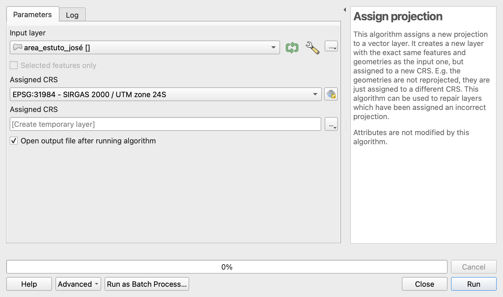

Pronto: a área do José aparece no lugar certo, e as duplicatas ficam evidentes. Na figura, cada rótulo indica o arquivo de origem: a **área 2 está empilhada três vezes** e a **ÁREA 3, duas**.

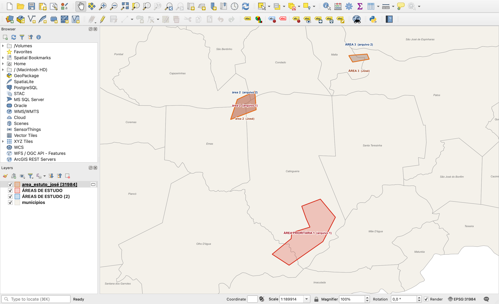

> ⚠️ **Atenção: atribuir ≠ reprojetar.** É o erro mais comum de todos.
>
> - **Atribuir projeção** *não mexe nas coordenadas*; só diz ao QGIS “estes números estão em EPSG:31984”. Use quando o CRS está **ausente ou errado**.
> - **Reprojetar camada** *recalcula as coordenadas* de um CRS conhecido para outro. Use quando o CRS está **certo**, mas você precisa de outro.
>
> Reprojetar uma camada sem CRS (ou com o CRS errado) só transforma coordenadas erradas em outras coordenadas erradas.

### 4.2 Mesclar as três camadas, já no CRS de destino

1. Abra **Geral para vetores → Mesclar camadas vetoriais (Merge vector layers)**.
2. Em **Camadas de entrada (Input layers)**, marque **`ÁREAS DE ESTUDO`**, **`ÁREAS DE ESTUDO (2)`** e a camada gerada no passo 4.1 (a versão do José **com CRS**, não o `area_estuto_josé` original).
3. Em **CRS de destino (Destination CRS)**, escolha **EPSG:31984**.
4. Deixe marcado **Adicionar informação da camada de origem (Add source layer information)**.
5. Clique em **Executar**.
6. Abra a tabela de atributos da camada **`Merged`** (`F6`).

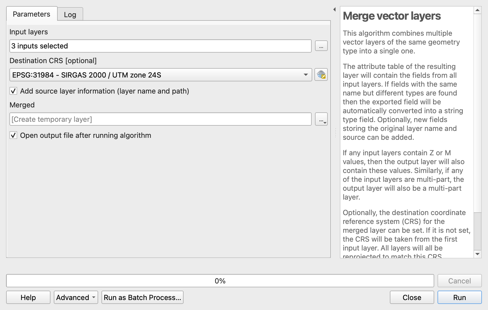

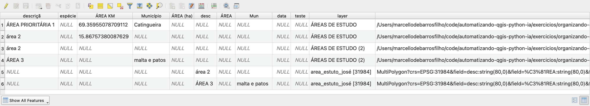

> **Nota: por que a tabela ficou “espalhada”?** Cada arquivo usava nomes de campo diferentes, então o Mesclar cria **uma coluna para cada variação**: o nome da área está em `descriçã` nas linhas 1–4 e em `desc` nas linhas 5–6. É a prova visual do problema de padronização, que o passo 4.4 resolve. As colunas `layer` e `path` registram a origem de cada feição: úteis para conferir, mas não ficam no resultado.
>
> O **CRS de destino** faz o Mesclar reprojetar sozinho o arquivo em WGS 84; não é preciso um passo separado de reprojeção.

### 4.3 Excluir as geometrias duplicadas

1. Abra **Geral para vetores → Excluir geometrias duplicadas (Delete duplicate geometries)**.
2. Em **Camada de entrada**, escolha **`Merged`**.
3. Clique em **Executar**.
4. Confira no **Log**: **3 duplicatas removidas, 3 feições mantidas**. A saída se chama **`Cleaned`**.

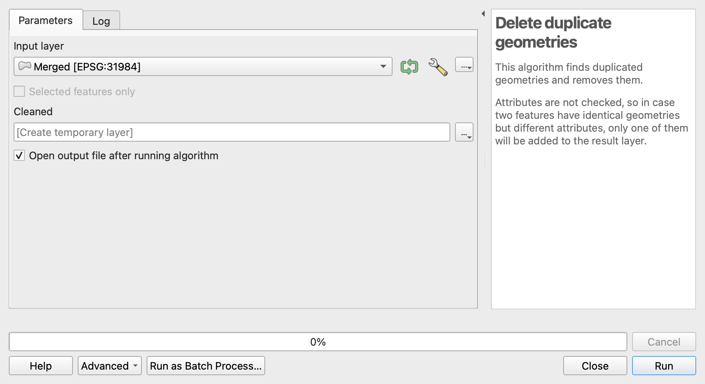

> **Nota: como a ferramenta decide?** Ela mantém a **primeira** ocorrência de cada geometria e descarta as demais. Aqui as duplicatas são **exatamente iguais** (mesmo depois da reprojeção, a diferença é zero).
>
> **Para pensar:**
> - E se alguém tivesse redesenhado a área 2 à mão, com vértices ligeiramente diferentes? O algoritmo **não** as consideraria duplicadas. Nesse caso, compare por sobreposição (ex.: áreas que coincidem em mais de 95%) ou use antes **Ajustar geometrias à camada (Snap geometries to layer)**.
> - Quando as duplicatas têm **atributos diferentes**, decidir qual manter é uma **decisão técnica** (a mais recente? a mais completa?), não uma escolha da ferramenta. Aqui não importa, porque vamos recalcular tudo.

### 4.4 Refatorar os campos e salvar no GeoPackage

1. Abra **Tabela de vetores (Vector table) → Refatorar campos (Refactor fields)**.
2. Em **Camada de entrada**, escolha **`Cleaned`**.
3. Na tabela **Mapeamento de campos**, selecione todas as linhas e apague-as.
4. Clique em **Adicionar novo campo** três vezes e preencha conforme a tabela abaixo (copie a expressão de cada linha para a coluna **Expressão**).
5. Em **Refatorado (Refactored)**, clique em `…` → **Salvar no GeoPackage (Save to GeoPackage)**: arquivo `dados_curso/dados_vetoriais/resultados/areas_especies_sertao.gpkg`, nome da camada **`area_estudo`**.
6. Clique em **Executar**.

| Nome | Tipo | Tamanho | Precisão | Expressão |
| --- | --- | ---: | ---: | --- |
| `descricao` | Text (string) | 100 | 0 | `upper(left(trim(coalesce("descriçã", "desc")), 1)) \|\| lower(substr(trim(coalesce("descriçã", "desc")), 2))` |
| `area_ha` | Decimal (double) | 12 | 2 | `round(area($geometry) / 10000, 2)` |
| `municipios` | Text (string) | 254 | 0 | `array_to_string(array_sort(overlay_intersects('municipios', "nome")), ', ')` |

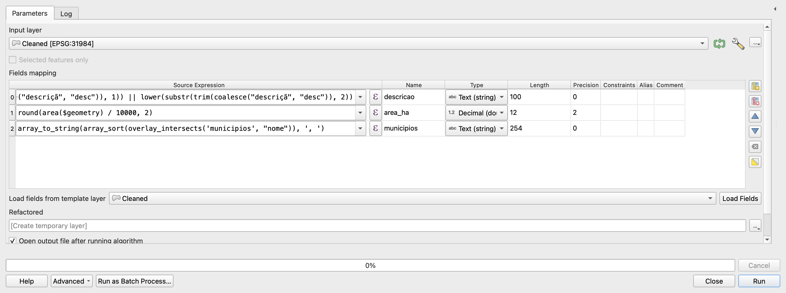

> **Entendendo as expressões**
>
> - **`descricao`**: `coalesce("descriçã", "desc")` pega o primeiro valor não nulo entre as duas colunas; é assim que juntamos o mesmo conceito guardado com nomes diferentes. `trim` tira os espaços sobrando, `upper(left(..., 1))` deixa a 1ª letra maiúscula e `lower(substr(..., 2))` deixa o resto minúsculo: `ÁREA PRIORITÁRIA 1` → `Área prioritária 1`.
> - **`area_ha`**: `area($geometry)` é a área **plana** no CRS da camada (UTM, em m²); dividir por 10 000 dá hectares. Por que não `$area`? Porque `$area` usa o **elipsoide** configurado no projeto, e o resultado mudaria de um computador para outro. Em UTM a diferença é pequena (a área prioritária 1 tinha `69.3596` km² no campo original, calculado no elipsoide; nós obtivemos `69.3472` km², ‑0,02%), mas **saber qual cálculo você está usando** faz parte de um dado bem documentado.
> - **`municipios`**: `overlay_intersects('municipios', "nome")` faz a **interseção espacial** com a camada `municipios` do projeto e devolve a lista com o `nome` de cada município tocado. Ela reprojeta sozinha, mesmo com a camada `municipios` em outro CRS. `array_sort` põe em ordem alfabética e `array_to_string(..., ', ')` transforma a lista no texto `Catingueira, Olho D'água`.

> **Dica:** `overlay_intersects` também conta municípios que a área toca **por poucos metros**, o que acontece quando os limites não batem perfeitamente. Se isso for um problema, informe uma área mínima de sobreposição: `overlay_intersects('municipios', "nome", min_overlap:=10000)` (10 000 m² = 1 ha).

### 4.5 Conferência rápida

Abra a tabela de atributos de **`area_estudo`**. Você deve ver exatamente **3 feições**:

| descricao | area_ha | municipios |
| --- | ---: | --- |
| Área prioritária 1 | 6 934,72 | Catingueira, Olho D'água |
| Área 2 | 1 586,32 | Cajazeirinhas, Catingueira, Condado, Emas |
| Área 3 | 442,28 | Malta, Patos |

Bateu? Parabéns: seis feições bagunçadas viraram três feições limpas e confiáveis. 🎉

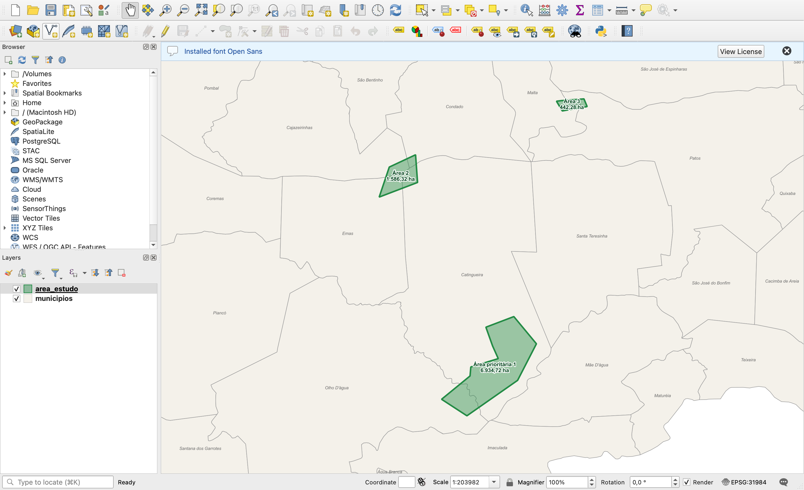

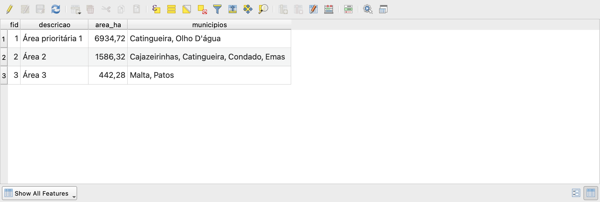

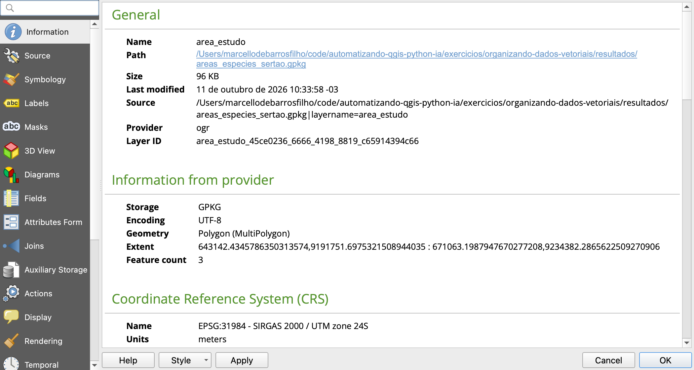

> **Nota: o que o resultado revela.** Compare com o laudo da Parte 1:
>
> - A **Área prioritária 1** estava cadastrada apenas em **Catingueira**, mas a interseção mostra que **1 147 ha (16,5%) estão em Olho D'água**. O dado digitado estava *errado*, não só despadronizado.
> - A **Área 2**, que não tinha município nenhum, toca **quatro** municípios.
> - `malta e patos` virou `Malta, Patos`, com a grafia oficial do IBGE.

#### Lista de verificação (use em todo projeto)

- [ ] Uma única camada, no formato e com o nome pedidos (`areas_especies_sertao.gpkg` → `area_estudo`)
- [ ] CRS da camada = EPSG:31984 (**Propriedades → Informações**)
- [ ] Apenas os campos do dicionário de dados, com nomes e tipos corretos
- [ ] Nenhum `NULL` em campo obrigatório
- [ ] Número de feições esperado (6 de entrada → 3 de saída) e nenhuma duplicata
- [ ] Geometrias válidas (**Vetor → Ferramentas de geometria → Verificar validade**)
- [ ] Valores conferidos por amostragem (meça uma área com a ferramenta de medição; confira um município no mapa)

### Resumo do fluxo manual

| # | Ferramenta na interface | Resolve os problemas | ID do algoritmo (Python) |
| --- | --- | --- | --- |
| 1 | Atribuir projeção (→ EPSG:31984) | 4 | `native:assignprojection` |
| 2 | Mesclar camadas vetoriais (CRS de destino 31984) | 1, 2, 3, 4 | `native:mergevectorlayers` |
| 3 | Excluir geometrias duplicadas | 16 | `native:deleteduplicategeometries` |
| 4 | Refatorar campos (com expressões) → GeoPackage | 5–15 | `native:refactorfields` |

---

## Parte 5 — Automatizando com Python

Três arquivos dá para fazer à mão. E se fossem **trinta** — um por técnico de campo, um por município, um por campanha? É aí que o script compensa: o mesmo procedimento, aplicado a qualquer quantidade de arquivos, sempre do mesmo jeito.

### 5.1 Diagnóstico automático

O script [`diagnostico_camadas.py`](diagnostico_camadas.py) percorre **todos os shapefiles de uma pasta** e imprime, para cada um, CRS, número de feições, extensão, campos com tipo e valores preenchidos, além de um **nome padronizado sugerido** para cada campo. Ajuste `PASTA` e rode no Editor do Console Python (`Ctrl+Alt+P` → *Mostrar editor*):

```text
=== area_estuto_josé.shp  →  sugestão: area_estuto_jose.shp
    CRS: ?? SEM CRS | feições: 2 | extensão: 643142.43,9221172.82 : 671063.20,9234382.29
    desc         String   → desc         valores: ['área 2', 'ÁREA 3']
    ÁREA         String   → area         valores: VAZIO
    Mun          String   → mun          valores: ['malta e patos']
    data         Date     → data         valores: VAZIO
    teste        Integer64 → teste        valores: VAZIO

=== ÁREAS DE ESTUDO (2).shp  →  sugestão: areas_de_estudo_2.shp
    CRS: EPSG:31984 | feições: 2 | extensão: 643142.43,9221172.82 : 671063.20,9234382.29
    descriçã     String   → descrica     valores: ['área 2', 'ÁREA 3']
    ÁREA (ha)    String   → area_ha      valores: VAZIO
    Município    String   → municipio    valores: ['malta e patos']

=== ÁREAS DE ESTUDO.shp  →  sugestão: areas_de_estudo.shp
    CRS: EPSG:4326 | feições: 2 | extensão: -37.70,-7.31 : -37.51,-6.99
    descriçã     String   → descrica     valores: ['área 2', 'ÁREA PRIORITÁRIA 1']
    espécie      String   → especie      valores: VAZIO
    ÁREA KM      String   → area_km      valores: ['15.86757380087629', '69.35955078709112']
    Município    String   → municipio    valores: ['Catingueira']
```

A função que gera as sugestões é curta e reaproveitável em qualquer projeto:

```python
import re
import unicodedata

def snake_case(nome):
    """'ÁREA (ha)' → 'area_ha';  'Município' → 'municipio'."""
    sem_acento = (unicodedata.normalize("NFKD", nome)
                  .encode("ascii", "ignore").decode("ascii"))
    return re.sub(r"[^a-z0-9]+", "_", sem_acento.lower()).strip("_")
```

> **Repare no limite da automação "burra":** `descriçã` virou `descrica`, e `Mun` virou `mun`. A função remove acentos e símbolos, mas **não entende significado**: não sabe que faltou um `o`, nem que `Mun` e `Município` são a mesma coisa. Esse "entendimento" — juntar sinônimos e corrigir truncamentos — é exatamente onde uma IA ajuda (Parte 6). E a decisão final continua sendo sua.

### 5.2 A solução completa

O script [`solucao_area_estudo.py`](solucao_area_estudo.py) refaz a Parte 4 inteira. A ideia central é que **o mapeamento de-para da Parte 3 vira um dicionário Python** — para incluir um quarto arquivo, basta acrescentar uma linha:

```python
CAMADAS = {
    "ÁREAS DE ESTUDO.shp":     {"descricao": "descriçã", "crs_se_ausente": None},
    "ÁREAS DE ESTUDO (2).shp": {"descricao": "descriçã", "crs_se_ausente": None},
    "area_estuto_josé.shp":    {"descricao": "desc",     "crs_se_ausente": "EPSG:31984"},
}
```

Para cada arquivo, o script **atribui o CRS se ele faltar**, **reprojeta** e **refatora** para um único campo `descricao` já padronizado. Por isso o Mesclar recebe camadas com a **mesma estrutura**, e não aquela tabela "espalhada" da Parte 4:

```python
for arquivo, cfg in CAMADAS.items():
    camada = QgsVectorLayer(str(ENTRADA / arquivo), arquivo, "ogr")

    if not camada.crs().isValid():
        camada = processing.run("native:assignprojection", {
            "INPUT": camada, "CRS": cfg["crs_se_ausente"],
            "OUTPUT": "TEMPORARY_OUTPUT"})["OUTPUT"]

    camada = processing.run("native:reprojectlayer", {
        "INPUT": camada, "TARGET_CRS": CRS_DESTINO,
        "OUTPUT": "TEMPORARY_OUTPUT"})["OUTPUT"]

    camada = processing.run("native:refactorfields", {
        "INPUT": camada,
        "FIELDS_MAPPING": [
            campo("descricao", TEXTO, 100, 0, capitalizar(cfg["descricao"])),
        ],
        "OUTPUT": "TEMPORARY_OUTPUT"})["OUTPUT"]
    padronizadas.append(camada)
```

Depois: `native:mergevectorlayers` → `native:fixgeometries` → `native:deleteduplicategeometries` → `native:refactorfields` gravando direto no GeoPackage, com as mesmas expressões de `area_ha` e `municipios` da Parte 4. Ajuste `PASTA` e `GPKG_DADOS` no topo e execute. Saída esperada:

```text
[OK]  ÁREAS DE ESTUDO.shp: 2 feições
[OK]  ÁREAS DE ESTUDO (2).shp: 2 feições
[CRS] area_estuto_josé.shp: sem .prj → atribuindo EPSG:31984
[OK]  area_estuto_josé.shp: 2 feições
[DUP] 3 duplicata(s) removida(s), 3 feição(ões) mantida(s)

area_estudo: 3 feições, EPSG:31984, campos ['fid', 'descricao', 'area_ha', 'municipios']
  Área 3                  442.28 ha  Malta, Patos
  Área 2                 1586.32 ha  Cajazeirinhas, Catingueira, Condado, Emas
  Área prioritária 1     6934.72 ha  Catingueira, Olho D'água
```

> O campo `fid` é a chave primária que o GeoPackage cria automaticamente — ele não conta como campo de atributo.

> **Dica:** você não precisa decorar os parâmetros. Rode a ferramenta uma vez pela interface e use **Avançado (Advanced) → Copiar como comando Python (Copy as Python Command)**, ou consulte **Processamento → Histórico**. Para o Refatorar campos, isso devolve o `FIELDS_MAPPING` prontinho.

---

## Parte 6 — A IA a serviço da organização dos dados

Organizar dados é um trabalho de **reconhecer padrões e ler intenções** ("`Mun` quer dizer município", "`descriçã` é `descrição` truncado", "estes números parecem UTM") — justamente o tipo de tarefa em que modelos de linguagem são bons. Mas a IA **não enxerga seus arquivos**, **não sabe o que é verdade no seu projeto** e **inventa com confiança** quando falta informação. O jeito produtivo de usá-la é:

> **Você fornece o diagnóstico e as regras → a IA propõe o mapeamento e escreve o código → você confere e decide.**

### 6.1 Onde a IA ajuda neste problema

| Tarefa | Exemplo de uso |
| --- | --- |
| **Ler o diagnóstico e apontar problemas** | Colar a saída do `diagnostico_camadas.py` e pedir um laudo como o da Parte 1 |
| **Propor o dicionário de dados e o de-para** | Juntar sinônimos (`desc`/`descriçã`, `Mun`/`Município`), sugerir tipos e unidades |
| **Escrever expressões QGIS** | "Expressão que deixa só a primeira letra maiúscula" / "lista de municípios que intersectam a feição" |
| **Escrever e explicar o script PyQGIS** | Gerar o `solucao_area_estudo.py` a partir do de-para |
| **Interpretar erros** | Colar o *traceback* completo e pedir a causa |
| **Revisar o resultado** | Pedir uma lista de verificações automáticas (nulos, CRS, duplicatas) |
| **Documentar** | Gerar o texto de metadados (resumo, linhagem, CRS) da camada final |

### 6.2 Boas práticas para este tipo de prompt

1. **Mande a estrutura, não os dados.** Cole o inventário (nomes de campos, tipos, CRS, extensão, alguns valores de exemplo) — não o arquivo inteiro. É mais curto, mais preciso e **evita expor dados sensíveis** (localização de espécies ameaçadas, dados de clientes) a um serviço externo.
2. **Defina o esquema de destino explicitamente.** Não peça "organize os campos"; diga *quais* campos, tipos, unidades e convenção de nome você quer. Sem isso, a IA inventa um esquema "razoável" — e diferente a cada conversa.
3. **Dê o contexto técnico:** versão do QGIS, onde o código vai rodar (Console Python), CRS de destino, nome das camadas auxiliares (`municipios`, campo `nome`).
4. **Separe "o que fazer" de "como fazer".** Primeiro peça o **diagnóstico e o de-para** e revise. Só depois peça o código. Se o mapeamento estiver errado, o código mais bonito do mundo produz lixo.
5. **Exija que a IA justifique suposições.** Especialmente sobre CRS: "se faltar CRS, diga qual você supõe e **por quê** (com base nas coordenadas)". Nunca aceite um EPSG "chutado".
6. **Peça código determinístico, não edição de valores pela IA.** Prefira "escreva uma expressão/script que padronize a grafia" a "corrija estes valores para mim". O script é **reproduzível** e auditável; a resposta de chat, não.
7. **Peça verificações no próprio código:** contagem de feições antes e depois, duplicatas removidas, CRS final, campos finais.
8. **Restrinja a API:** "use `processing.run` com algoritmos `native:`; não use APIs do QGIS 2 (`processing.runalg`, `QgsMapLayerRegistry`)".
9. **Itere em pedaços:** uma etapa por vez, rodando cada uma antes de pedir a próxima.

### 6.3 Prompt 1 — Diagnóstico e de-para

```text
Você é especialista em geoprocessamento e qualidade de dados geoespaciais.

Recebi três shapefiles que deveriam representar o mesmo trabalho (áreas de
estudo de aves no Sertão da Paraíba) e preciso consolidá-los numa única camada.
Abaixo está o inventário dos arquivos (CRS, extensão, campos, tipos e valores):

<cole aqui a saída do diagnostico_camadas.py>

Esquema de destino (camada "area_estudo", EPSG:31984):
- descricao (texto): nome da área, grafia "Primeira letra maiúscula"
- area_ha (decimal, 2 casas): área calculada da geometria, em hectares
- municipios (texto): municípios intersectados, separados por ", "

Tarefas:
1. Liste todos os problemas encontrados, agrupados por categoria (arquivos,
   CRS, nomes de campos, tipos, unidades, valores, geometria).
2. Para o arquivo sem CRS, diga qual CRS você supõe e justifique com base nas
   coordenadas da extensão.
3. Monte uma tabela de-para: para cada campo de destino, qual campo de cada
   arquivo o alimenta, e quais campos devem ser descartados.
4. Diga quais valores devem ser recalculados em vez de reaproveitados, e por quê.

Não escreva código ainda. Se alguma informação for ambígua, pergunte.
```

**O que conferir na resposta:** a IA identificou que `descriçã` é um nome truncado? Percebeu que `ÁREA KM` provavelmente é km²? Justificou o EPSG:31984 pelas coordenadas, e não "porque é o mais comum"? Notou que os `.qmd` não aparecem no inventário (e, portanto, ela não tem como saber que estão errados)?

### 6.4 Prompt 2 — Gerar o script

```text
Ótimo. Agora escreva um script para o Editor do Console Python do QGIS 3.44
que implemente esse de-para.

Requisitos:
- Os shapefiles estão em ENTRADA = Path("..."); o de-para deve ficar num
  dicionário no topo do script, para eu poder acrescentar novos arquivos.
- Se um arquivo não tiver CRS, use native:assignprojection (NÃO reprojete).
- Reprojete tudo para EPSG:31984, mescle, corrija geometrias e remova
  geometrias duplicadas.
- Use native:refactorfields para gerar o esquema final. area_ha com
  area($geometry)/10000 (área plana em UTM). municipios com
  overlay_intersects na camada "municipios" (campo "nome"), em ordem alfabética.
- Grave em GeoPackage: areas_especies_sertao.gpkg, camada "area_estudo".
- Saídas intermediárias em "TEMPORARY_OUTPUT", comentários em português.
- Imprima: feições por arquivo, duplicatas removidas, CRS e campos finais.
- Use apenas processing.run com algoritmos "native:"; nada de API do QGIS 2.
```

### 6.5 Prompts curtos e úteis

```text
Escreva uma expressão do QGIS que transforme 'ÁREA PRIORITÁRIA 1' e
' área 2 ' em 'Área prioritária 1' e 'Área 2'.
```

```text
Na expressão abaixo, o que acontece se a área tocar um município só por
alguns metros na borda? Como ignorar sobreposições menores que 1 ha?
array_to_string(array_sort(overlay_intersects('municipios', "nome")), ', ')
```

```text
Explique a diferença entre native:assignprojection e native:reprojectlayer
e dê um exemplo de dano causado por usar o errado.
```

```text
Escreva uma função PyQGIS que receba uma camada e imprima um relatório de
qualidade: CRS, contagem de feições, campos com NULL, geometrias inválidas e
geometrias duplicadas. Não altere a camada.
```

### 6.6 Onde a IA costuma errar (e como pegar o erro)

| Erro típico | Como aparece | Como pegar |
| --- | --- | --- |
| **Reprojetar em vez de atribuir** | `native:reprojectlayer` numa camada sem CRS | A camada vai parar no lugar errado (ou não sai do lugar); confira no mapa |
| **"Chutar" o CRS** | "Vou assumir EPSG:4326" para coordenadas em metros | Compare a extensão com a faixa típica do CRS (graus: −180 a 180; UTM sul: ~160 000–840 000 / ~1 000 000–10 000 000) |
| **IDs e parâmetros inventados** | `native:mergelayers`, `"FIELDS"` no refactor | `processing.algorithmHelp("native:refactorfields")` é a fonte da verdade |
| **API de versão antiga** | `processing.runalg`, `QgsMapLayerRegistry` (QGIS 2) | Diga a versão do QGIS no prompt; leia a mensagem de erro |
| **`$area` em camada geográfica** | Área em "graus quadrados" ou dependente do elipsoide do projeto | Calcule em CRS métrico e compare com a ferramenta de medição |
| **Remover duplicatas "por atributo"** | `drop duplicates` pelo campo `descricao` | Duas áreas diferentes podem ter o mesmo nome! Duplicata é **geometria** igual |
| **Aproveitar valores digitados** | Converter `ÁREA KM` de texto para número e multiplicar por 100 | Pergunte: este valor é confiável? Pode ser recalculado? |
| **Esquecer feições** | Script roda sem erro, mas sai com 2 feições em vez de 3 | Sempre confira **contagens** antes e depois de cada etapa |

> **A IA não valida por você.** Rodar sem erro não significa estar certo. A validação é a lista de verificação da Parte 4 — e ela é responsabilidade de quem assina o trabalho.

### 6.7 Além do chat: assistentes que executam

Ferramentas mais recentes (assistentes de código "agênticos", como o Claude Code, o Copilot em modo agente e similares) conseguem **ler os arquivos e executar comandos** no seu computador — por exemplo, rodar `ogrinfo` para inspecionar os shapefiles, executar o script com o Python do QGIS e conferir a saída. Este próprio tutorial foi preparado assim: o diagnóstico, os números e as capturas de tela foram produzidos executando o QGIS de verdade.

Isso acelera muito o ciclo *diagnosticar → corrigir → conferir*, mas as regras continuam as mesmas: **dados sensíveis exigem cuidado**, trabalhe sempre em uma **cópia** dos dados originais, e **revise cada mudança** antes de aceitá-la.

---

## Desafios

1. **Um quarto arquivo.** Crie um shapefile `areas_maria.shp` com uma área nova e outra que repete a "Área 3", usando nomes de campo à sua escolha (`Descricao`, `Area_m2`...). Acrescente uma linha no dicionário `CAMADAS` do script e rode de novo. O resultado deve ter 4 feições.
2. **Duplicatas "quase iguais".** Edite a "área 2" em uma das cópias, movendo um vértice alguns metros. O `deleteduplicategeometries` ainda a remove? Proponha (ou peça à IA) uma solução baseada em percentual de sobreposição.
3. **Template para a próxima campanha.** Crie um GeoPackage vazio com a camada `area_estudo` no esquema final e configure no formulário: `area_ha` e `municipios` como **valores padrão** recalculados na atualização, e `descricao` como **não nulo**. Digitalize uma área nova e veja os campos se preencherem sozinhos.
4. **Ferramenta na Caixa de Ferramentas.** Transforme o `solucao_area_estudo.py` numa ferramenta de processamento com parâmetros (pasta de entrada, CRS, GeoPackage de saída), como em [`05_processing_script_tool.py`](../pb200/05_processing_script_tool.py), do módulo PB-200. Use a IA para a conversão e valide com os mesmos dados.
5. **Metadados.** Preencha os metadados da camada final em **Propriedades → Metadados**: título, resumo, linhagem (de quais arquivos veio e o que foi feito) e contato. Peça à IA um primeiro rascunho da linhagem a partir do laudo da Parte 1.

---

## Arquivos deste exercício

```
modulos/dados_vetoriais/
├── README.md                  ← este roteiro
├── diagnostico_camadas.py     ← Parte 5.1: inventário de uma pasta de shapefiles
└── solucao_area_estudo.py     ← Parte 5.2: solução completa em PyQGIS

imgs/dados_vetoriais/          ← capturas de tela do passo a passo
dados_curso/dados_vetoriais/   ← dados (baixe do Google Drive)
├── entrada/                   ← os três shapefiles problemáticos (não altere!)
└── resultados/                ← areas_especies_sertao.gpkg (gerado)
```


