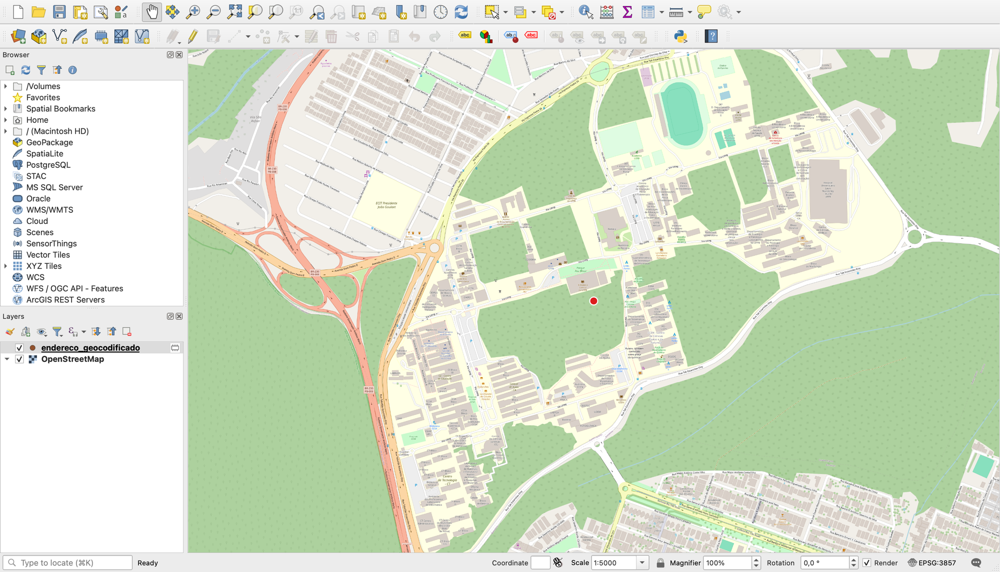
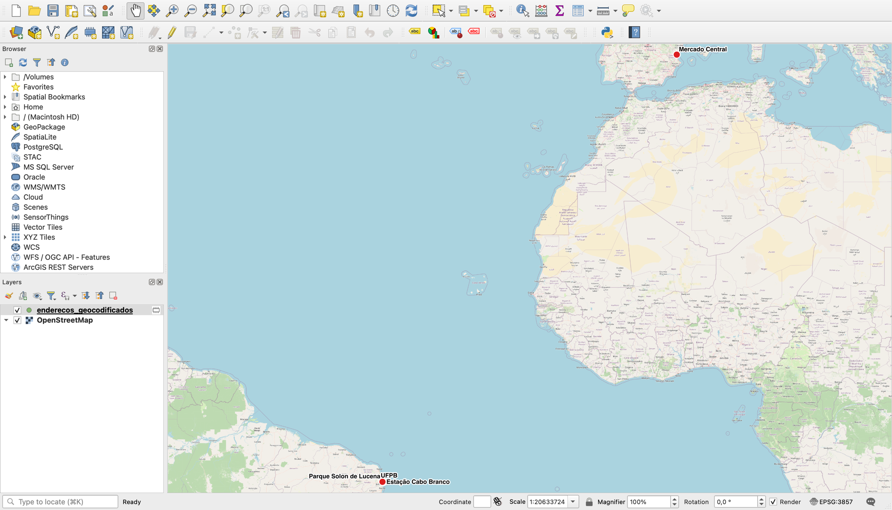
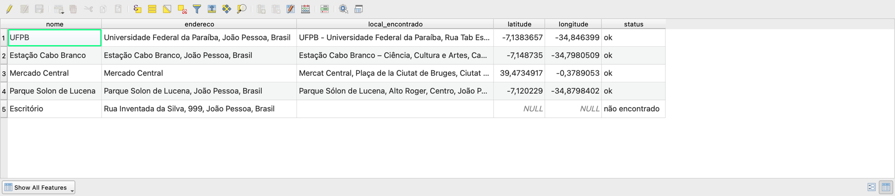

<!-- navegação -->
[⬅️ 📘 Introdução](../introducao/introducao.md) · [🏠 Início](../../README.md) · [🛣️ Duplicação da PB-200 ➡️](../pb200/pb200.md)

# Do endereço ao ponto: Geocodificação no QGIS com IA

> Exercício do minicurso **Automatizando o QGIS com Python e IA**.
> Você vai transformar uma lista de endereços em pontos no mapa **sem escrever o código**: você descreve o que quer, a IA escreve o script, o QGIS executa e você confere o resultado.



## Contexto

A equipe vai fazer uma saída de campo em João Pessoa e recebeu uma planilha com os locais de visita: nome e endereço, nada de coordenadas. Para planejar a rota no QGIS, cada endereço precisa virar um **ponto**.

Esse processo se chama **geocodificação** (*geocoding*): endereço → coordenadas. O caminho inverso, coordenadas → endereço, é a **geocodificação reversa**.

Vamos usar o **Nominatim**, o serviço de busca do **OpenStreetMap**: é gratuito e não exige cadastro nem chave.

## O que deve ser entregue

1. Uma camada `endereco_geocodificado` com **um** ponto (Parte 2).
2. Uma camada `enderecos_geocodificados` com **todas** as linhas do CSV e os campos `nome`, `endereco`, `local_encontrado`, `latitude`, `longitude` e `status` (Parte 3).

Requisitos:

- CRS **EPSG:4326** (latitude/longitude, como o serviço devolve);
- **nenhuma linha descartada**: endereço não encontrado entra na tabela, sem ponto, com `status = não encontrado`;
- **no máximo uma consulta por segundo** (regra do Nominatim).

## Dados

| Dado | Onde está |
| --- | --- |
| 5 locais de João Pessoa (`nome;endereco`, separados por `;`) | `dados_curso/geocodificacao/enderecos.csv` |

## Roteiro

| Parte | O que fazemos | Tempo |
| --- | --- | --- |
| [1 — Geocodificação em 2 minutos](#parte-1--geocodificação-em-2-minutos) | O que o serviço devolve e o que ele **não** garante | 3 min |
| [2 — Um endereço](#parte-2--um-endereço) | Pedir o script à IA, rodar e conferir o ponto | 7 min |
| [3 — Uma lista de endereços](#parte-3--uma-lista-de-endereços) | Do CSV à camada, sem perder nenhuma linha | 7 min |
| [4 — Onde a geocodificação (e a IA) erra](#parte-4--onde-a-geocodificação-e-a-ia-erra) | Os erros que rodam sem dar erro | 3 min |

---

## Parte 1 — Geocodificação em 2 minutos

O serviço recebe um texto e devolve a **melhor correspondência** que encontrar nos dados do OpenStreetMap:

| Você pergunta | O serviço devolve |
| --- | --- |
| `Universidade Federal da Paraíba, João Pessoa, Brasil` | o campus da UFPB, em João Pessoa ✅ |
| `Avenida Epitácio Pessoa, João Pessoa` | **um ponto** da avenida, não a avenida inteira |
| `Mercado Central` | o Mercado Central de **Valência, na Espanha** ❌ |

Três ideias para guardar:

1. **O resultado é um palpite, não a verdade.** Quanto mais completo o endereço (município, estado, país), melhor o palpite.
2. **A precisão varia**: pode ser o prédio, a rua, o bairro ou só o município.
3. **"Achou" não quer dizer "achou certo"**: o terceiro exemplo foi encontrado, só que no país errado.

> ⚠️ **Atenção: regras do Nominatim público.** No máximo **1 consulta por segundo**, aplicação identificada no cabeçalho `User-Agent` e crédito ao OpenStreetMap ao publicar mapas. Para milhares de endereços, use outro provedor ou uma instalação própria. Política completa: <https://operations.osmfoundation.org/policies/nominatim/>

---

## Parte 2 — Um endereço

### 2.1 O prompt


```text
Escreva um script para o Editor do Console Python do QGIS 3.44 que
geocodifique UM endereço com o Nominatim do OpenStreetMap.

- O endereço fica numa variável no topo do script, fácil de trocar.
- Use apenas a biblioteca padrão (urllib, json): nada de pip ou requests.
- Identifique a aplicação no User-Agent, como pede a política do Nominatim.
- Se não houver resultado, avise na barra de mensagens do QGIS e não
  crie nada. Nunca invente coordenadas.
- Se houver, crie uma camada de pontos temporária em EPSG:4326 chamada
  "endereco_geocodificado", com os campos endereco, local_encontrado
  (o display_name do serviço), latitude e longitude.
- Adicione a camada ao projeto e aproxime o mapa do ponto.
- Imprima o local encontrado e as coordenadas.
Comentários curtos, em português.
```

> **Nota: o que conferir na resposta**
>
> - Monta a URL com `urlencode` (que trata espaços e acentos)?
> - Tem `User-Agent` na requisição?
> - Testa se a lista de resultados está **vazia** antes de usar o primeiro item?
> - Cria o ponto com `QgsPointXY(longitude, latitude)`, nessa ordem? (veja a nota abaixo)

### 2.2 Rodar no QGIS

1. Abra o **Console Python** (`Ctrl+Alt+P`) e clique em **Mostrar editor (Show Editor)**.
2. Cole o script da IA (ou abra [`geocodificar_endereco.py`](geocodificar_endereco.py), a versão revisada).
3. Clique em **Executar script (Run Script)**.

Saída esperada no console:

```text
Local encontrado: UFPB - Universidade Federal da Paraíba, Rua Tab Estanislau Eloy, Castelo Branco, João Pessoa, ...
Latitude: -7.1383657 | Longitude: -34.846399
```

O ponto aparece no campus da UFPB (imagem do início deste roteiro). Agora troque o endereço por um que você conheça e rode de novo.

> **Entendendo a ordem das coordenadas**
>
> O serviço responde "latitude, longitude", mas o QGIS pensa em **X, Y**, e X é a **longitude**:
>
> ```python
> QgsPointXY(longitude, latitude)   # X = longitude, Y = latitude
> ```
>
> Inverter a ordem é o erro clássico. Com os números da UFPB, o ponto vai parar no meio do Atlântico Sul.

---

## Parte 3 — Uma lista de endereços

### 3.1 O prompt

Continue **na mesma conversa**: a IA já tem o script da Parte 2 como base.

```text
Agora adapte o script para geocodificar uma LISTA de endereços de um CSV.

O arquivo é separado por ";", em UTF-8, com este cabeçalho e exemplo:
nome;endereco
UFPB;Universidade Federal da Paraíba, João Pessoa, Brasil

- Caminho do CSV, nome da coluna de endereço e separador em variáveis
  no topo do script.
- Espere 1 segundo entre consultas e não repita a consulta de um
  endereço que já apareceu (cache em um dicionário).
- Crie a camada "enderecos_geocodificados" (EPSG:4326) com todas as
  colunas do CSV + local_encontrado, latitude, longitude e status.
- status: "ok", "não encontrado" ou a mensagem de erro de conexão.
- Linha sem resultado entra na camada SEM geometria. Nenhuma linha
  pode ser descartada.
- No fim, imprima quantos endereços foram geocodificados.
```

> **Dica:** mande o **cabeçalho e uma linha de exemplo**, não a planilha inteira. É o suficiente para a IA, e você não expõe endereços de clientes ou de pessoas a um serviço externo.

### 3.2 Rodar no QGIS

1. Abra o script da IA no editor (ou a versão revisada, [`geocodificar_lista.py`](geocodificar_lista.py)).
2. Em `ARQUIVO_CSV`, informe o **caminho completo** de `dados_curso/geocodificacao/enderecos.csv`, por exemplo: `Path(r"C:\minicurso\dados_curso\geocodificacao\enderecos.csv")`.
3. Clique em **Executar script (Run Script)** e acompanhe o console: uma linha por endereço, uma por segundo.

```text
1/5  ok               Universidade Federal da Paraíba, João Pessoa, Brasil
2/5  ok               Estação Cabo Branco, João Pessoa, Brasil
3/5  ok               Mercado Central
4/5  ok               Parque Solon de Lucena, João Pessoa, Brasil
5/5  não encontrado   Rua Inventada da Silva, 999, João Pessoa, Brasil

4 de 5 endereços geocodificados. Confira os demais na tabela de atributos (campo status).
```

Quatro de cinco: parece ótimo. Agora olhe o mapa:



### 3.3 Conferência rápida

Abra a tabela de atributos de **`enderecos_geocodificados`** (`F6`):



| nome | status | Onde caiu | Veredito |
| --- | --- | --- | --- |
| UFPB | ok | João Pessoa | ✅ |
| Estação Cabo Branco | ok | João Pessoa | ✅ |
| Mercado Central | ok | **Valência, Espanha** | ❌ endereço ambíguo |
| Parque Solon de Lucena | ok | João Pessoa | ✅ |
| Escritório | não encontrado | sem ponto | ✅ registrado, nada inventado |

Corrija o CSV: troque `Mercado Central` por `Mercado Central, João Pessoa, Brasil` e rode de novo. Os quatro pontos ficam em João Pessoa, e o escritório continua como **não encontrado**, como deve ser. 🎉

> ⚠️ **Atenção: `status = ok` não quer dizer "certo".** O script só sabe que o serviço respondeu. Quem sabe se a resposta faz sentido é você: **olhe o mapa** e leia a coluna `local_encontrado`.

> **Nota:** a camada é **temporária** (ícone ao lado do nome). Para guardá-la, clique com o botão direito → **Exportar → Salvar feições como (Export → Save Features As)** → GeoPackage.

---

## Parte 4 — Onde a geocodificação (e a IA) erra

Todos estes erros **rodam sem mensagem de erro**. Sempre faça a conferência dos resultados!

| Erro típico | Como aparece | Como pegar |
| --- | --- | --- |
| **Latitude e longitude invertidas** | ponto no oceano ou em outro continente | `QgsPointXY(longitude, latitude)`; olhe o mapa |
| **Endereço ambíguo** | `status = ok`, mas o ponto está em outra cidade ou outro país | sempre inclua município, estado e país; leia o `local_encontrado` |
| **Coordenadas inventadas** | a IA preenche `0, 0` quando não acha: pontos no Golfo da Guiné | exija no prompt: "sem resultado, sem geometria" |
| **Linhas descartadas** | o CSV tem 50 linhas, a camada tem 47 | compare as contagens; peça "nenhuma linha pode ser descartada" |
| **Consultas em rajada** | erro `HTTP 429` ou bloqueio do serviço | pausa de 1 s e cache de endereços repetidos |

> **A IA não valida por você.** Ela escreveu um script que roda; quem garante que **os pontos estão no lugar certo** é quem confere o mapa.

---

## Arquivos deste exercício

```
modulos/geocodificacao/
├── geocodificacao.md                  ← este roteiro
├── geocodificar_endereco.py           ← Parte 2: um endereço
└── geocodificar_lista.py              ← Parte 3: lista de endereços (CSV)

imgs/geocodificacao/                   ← capturas de tela
dados_curso/geocodificacao/            ← dados (baixe do Google Drive)
└── enderecos.csv                      ← 5 locais de João Pessoa
```

---

<!-- navegação -->
[⬅️ 📘 Introdução](../introducao/introducao.md) · [🏠 Início](../../README.md) · [🛣️ Duplicação da PB-200 ➡️](../pb200/pb200.md)
