<!-- navegação -->
[⬅️ 🛣️ Duplicação da PB-200](../pb200/pb200.md) · [🏠 Início](../../README.md) · [⛰️ Perfil da PB-200 ➡️](../perfil_pb200/perfil_pb200.md)

# Grade interativa SRTM/TOPODATA

> Exercício do minicurso **Automatizando o QGIS com Python e IA**.
> Você vai partir **apenas de um link** — um mapa na web — e, conversando com uma IA, chegar a uma grade no QGIS em que **basta clicar numa célula para baixar e abrir o modelo de elevação** daquela região. Sem procurar arquivo em site, sem copiar URL, sem arrastar `.tif` para o mapa.

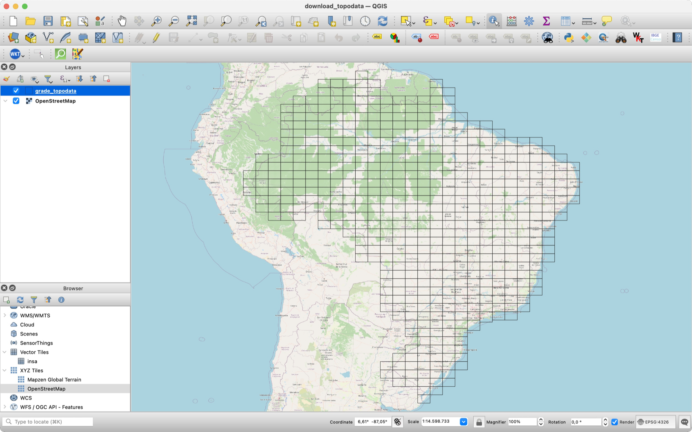

## Contexto

O [TOPODATA](http://www.dsr.inpe.br/topodata/) (INPE) oferece dados geomorfométricos de todo o Brasil — altitude, declividade, orientação, curvaturas… — derivados do SRTM, com resolução de 1″ (~30 m). Os dados são divididos em **556 folhas** de 1° de latitude × 1,5° de longitude, e cada folha de altitude é um GeoTIFF de ~70 MB em média (até ~105 MB).

O problema prático: para baixar uma folha, é preciso **saber o código dela** (`07S375`, `05S42_`…). O jeito comum é abrir um mapa índice no navegador, descobrir o código, montar a URL, baixar, salvar numa pasta e carregar no QGIS. Para uma folha, tudo bem. Para vinte, é uma tarde perdida.

Existe um mapa índice pronto na web: **https://map4s3.com.br/maps/topodata/**. Ele mostra a grade, mas a grade está **dentro do código da página**, e não num arquivo para baixar. Vamos tirá-la de lá e transformá-la em uma ferramenta dentro do QGIS.

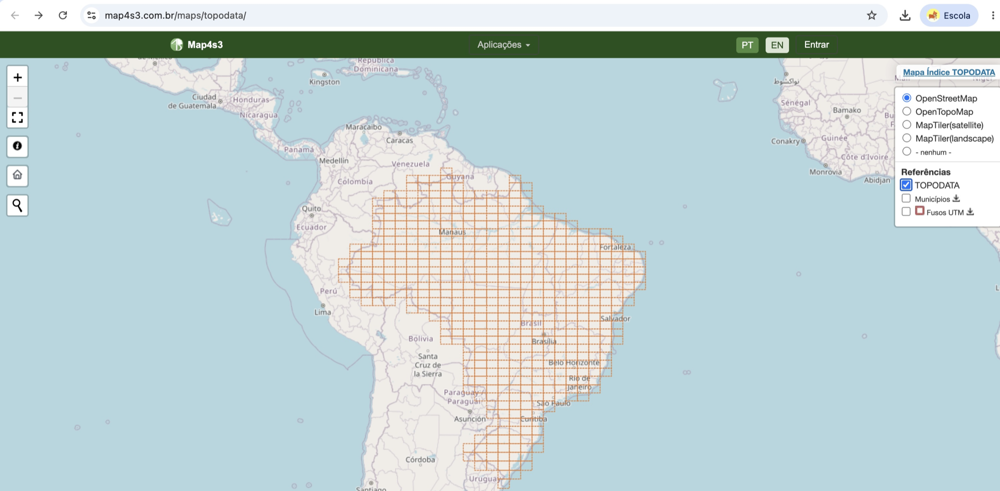

## O que deve ser entregue

1. `dados_curso/grade_topodata/grade_topodata.geojson` — a grade com as 556 células, em **EPSG:4326**, com o atributo `scene` (código da folha).
2. Uma **ação de clique** na camada: clicou numa célula → escolhe a pasta → baixa (ou reaproveita) o GeoTIFF → carrega no projeto.
3. Uma **ação para várias células selecionadas**, com barra de progresso e relatório final.

Requisitos das duas ações:

- o usuário **escolhe a pasta de destino**;
- se o arquivo **já existir** na pasta e for um raster válido, ele é **reaproveitado** (não baixa de novo);
- se o raster **já estiver no projeto**, não é adicionado duas vezes;
- download incompleto ou cancelado **não deixa arquivo quebrado** na pasta.

## Roteiro

| Parte | O que fazemos | Tempo |
| --- | --- | --- |
| [1 — De onde vem a grade?](#parte-1--de-onde-vem-a-grade-a-ia-inspeciona-a-página) | A IA inspeciona o código-fonte da página e acha o arquivo de dados | 10 min |
| [2 — Do JavaScript ao GeoJSON](#parte-2--do-javascript-ao-geojson) | A IA converte o `.js` em GeoJSON, com os atributos certos | 15 min |
| [3 — Como o INPE nomeia os arquivos](#parte-3--a-regra-do-endereço-de-download) | Descobrir (e testar!) a regra que liga `scene` à URL | 10 min |
| [4 — Ação de clique](#parte-4--ação-de-clique-uma-célula) | Script Python da ação para uma célula | 20 min |
| [5 — Ação para várias células](#parte-5--ação-para-várias-células-selecionadas) | Script Python para a seleção, com progresso e relatório | 15 min |

> As capturas de tela estão com o QGIS 3.44 em inglês; no texto aparecem os nomes em português e, entre parênteses, em inglês.

---

## Parte 1 — De onde vem a grade? A IA inspeciona a página

Um mapa web (Leaflet, OpenLayers…) precisa receber a geometria de algum lugar: um arquivo `.geojson`, um serviço WFS, uma API, ou um **arquivo JavaScript com os dados embutidos**. A primeira tarefa é descobrir qual.

### 1.1 O primeiro pedido (e por que ele não basta)

```text
Leia o código-fonte da página https://map4s3.com.br/maps/topodata/
e extraia a grade GeoJSON do mapa índice TOPODATA.
```

Na conversa que originou este exercício, a IA **não conseguiu** ler o JavaScript da página pelo chat: as ferramentas de navegação dos chatbots costumam receber só o HTML "cru", não executam o JavaScript e às vezes recusam arquivos `.js`. Em vez de inventar uma resposta, ela pediu ajuda — e esse é o comportamento que queremos.

### 1.2 Ajude a IA: mande o código-fonte

No navegador, abra a página, clique com o botão direito → **Exibir código-fonte da página** (`Ctrl+U`), copie tudo e cole no chat (ou salve como `.txt` e anexe):

```text
Este é o código-fonte HTML da página https://map4s3.com.br/maps/topodata/
(um mapa Leaflet com a grade de articulação do TOPODATA).

<cole aqui o HTML>

Identifique de onde o mapa carrega os polígonos da grade: arquivo
.geojson, serviço WFS, API ou dados embutidos em algum script.
Liste os endereços completos dos candidatos e justifique.
Não invente URLs: use apenas o que está no código.
```

A resposta aponta o suspeito principal, carregado por uma tag `<script>`:

```html
<script type="text/javascript"
        src="https://cdn.map4s3.com.br/js/maps/topodata/topodata-dataset.js"></script>
```

### 1.3 Confirme com os próprios olhos

Abra esse endereço numa aba. O conteúdo é um GeoJSON **atribuído a uma variável JavaScript**:

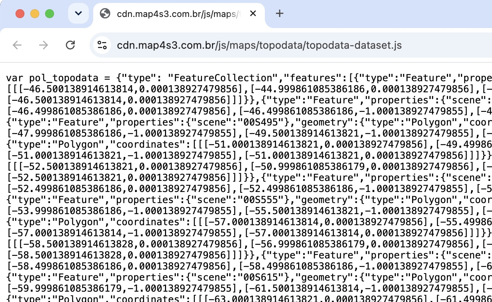

```text
var pol_topodata = {"type": "FeatureCollection","features":[{"type":"Feature","properties":{"scene":"00S465"},"geometry":{"type":"Polygon", ...
```

> **Plano B: o DevTools.** Se o dado não estivesse no HTML, a pista estaria na aba **Network (Rede)** das ferramentas do desenvolvedor (`F12`): recarregue a página, filtre por **Fetch/XHR** e por **JS**, e procure respostas com `FeatureCollection`. Peça à IA um trecho de código para o **Console** do navegador que liste os recursos carregados — foi o que ela sugeriu na conversa original.

---

## Parte 2 — Do JavaScript ao GeoJSON

### 2.1 O prompt

Abra o endereço do arquivo no navegador, salve com **Salvar como…** (`Ctrl+S`) e anexe ao chat:

```text
Anexei o arquivo topodata-dataset.js, que alimenta o mapa índice do TOPODATA.

Converta os POLÍGONOS da grade em um arquivo GeoJSON:
- nome: grade_topodata.geojson
- CRS: WGS 84 (EPSG:4326)
- preserve TODOS os atributos originais, sem renomear; em especial o campo
  "scene" (código da folha, ex.: 07S375), que será usado por uma ação no
  QGIS para montar a URL de download de cada célula
- não altere, arredonde nem reconstrua as coordenadas
- confira e me informe: quantidade de feições, tipos de geometria,
  extensão (min/max de lon e lat) e se há códigos "scene" repetidos
```

**Por que tanto detalhe?**

- **"Os polígonos"** — o arquivo tem **duas** variáveis: `pol_topodata` (556 polígonos) e `pt_topodata` (556 pontos, usados para os rótulos no mapa). Sem dizer o que você quer, a IA pode juntar tudo numa camada de geometria mista, ou pegar a errada.
- **"Preserve o `scene`"** — este é o requisito que faz o resto do exercício funcionar. A ação do QGIS (Parte 4) lê `[% "scene" %]`; se a IA "melhorar" o nome para `codigo` ou `folha`, a ação quebra.
- **"Não altere as coordenadas"** — repare que os vértices são `-46.500138914…` e não `-46.5`. É meio pixel de 1″ (0,000139°): a grade acompanha a **borda externa dos pixels** do raster. Uma IA "caprichosa" arredondaria isso sem avisar.
- **"Confira e informe"** — números que você consegue checar no QGIS.

Saída esperada: **556 polígonos**, extensão de **−75° a −34,5°** de longitude e **−34° a 6°** de latitude, nenhum `scene` repetido.

### 2.2 Você nem precisava da IA para isto (mas precisava saber disso)

O conteúdo depois do `=` **já é GeoJSON**. Toda a conversão cabe em poucas linhas — e é um ótimo exercício pedir à IA para explicar este código. Ajuste `SAIDA` e rode no Editor do Console Python do QGIS: o script salva o GeoJSON e já carrega a grade no mapa.

```python
import json, re
from pathlib import Path
from urllib.request import urlopen

from qgis.core import QgsProject, QgsVectorLayer

URL = "https://cdn.map4s3.com.br/js/maps/topodata/topodata-dataset.js"
SAIDA = Path.home() / "grade_topodata.geojson"   # ajuste o caminho
texto = urlopen(URL).read().decode("utf-8")

# Cada "var nome = {...};" vira um objeto Python
decoder = json.JSONDecoder()
dados = {m.group(1): decoder.raw_decode(texto, m.end())[0]
         for m in re.finditer(r"var\s*(\w+)\s*=\s*", texto)}

print({nome: len(d["features"]) for nome, d in dados.items()})
# {'pol_topodata': 556, 'pt_topodata': 556}

with open(SAIDA, "w", encoding="utf-8") as f:
    json.dump(dados["pol_topodata"], f)
print("Salvo em", SAIDA)

# Carrega a grade no projeto
grade = QgsVectorLayer(str(SAIDA), "grade_topodata", "ogr")
if grade.isValid():
    QgsProject.instance().addMapLayer(grade)
    iface.setActiveLayer(grade)
    iface.zoomToActiveLayer()
    print("Camada carregada:", grade.featureCount(), "feições,", grade.crs().authid())
else:
    print("Não foi possível carregar", SAIDA)
```

> ⚠️ **Atenção: use sempre caminho completo.** No QGIS, a "pasta atual" do Python não é a pasta do projeto. No Windows ela costuma ser a pasta de instalação do QGIS (`C:\Program Files\QGIS …`), onde não se pode gravar. Um `open("grade_topodata.geojson", "w")` falha com `PermissionError` (ou, no macOS, `Read-only file system`).

### 2.3 Conferir no QGIS

Se você usou o script da 2.2, a grade já está no mapa. Se não, arraste `dados_curso/grade_topodata/grade_topodata.geojson` para o mapa. Coloque um OpenStreetMap ao fundo (resultado na primeira imagem deste roteiro) e confira:

- **Propriedades → Informações:** 556 feições, EPSG:4326, extensão como acima;
- **Tabela de atributos:** campo `scene` preenchido em todas as linhas;
- a grade cobre o Brasil e **não** está deslocada em relação ao litoral.

---

## Parte 3 — A regra do endereço de download

A ação precisa transformar `scene` numa URL. Os arquivos estão no servidor do INPE / Brazil Data Cube:

```text
https://data.inpe.br/bdc/data/topodata/v001/{pasta}/{folha}/{scene}ZN.tif
```

| scene | pasta (`scene[:3]`) | folha (`scene[3:]`) | URL |
| --- | --- | --- | --- |
| `07S375` | `07S` | `375` | `…/v001/07S/375/07S375ZN.tif` |
| `05S42_` | `05S` | `42_` | `…/v001/05S/42_/05S42_ZN.tif` |

Detalhes que importam:

- **`ZN` é o plano de informação de altimetria** — o MDE refinado, em metros, referenciado ao geoide EGM96. Os demais planos seguem o mesmo padrão, trocando só o sufixo (veja a tabela abaixo).
- **O `_` faz parte do código.** Quando a longitude tem só dois dígitos (`42` → 42°), o código é completado com `_` para ter sempre 6 caracteres. **Metade das células (276 de 556)** é assim.
- **Não há separador antes de `ZN`.** `07S375ZN.tif`, e não `07S375_ZN.tif`.

#### Os planos de informação do TOPODATA

| Sufixo | Plano de informação | Unidade / classes |
| --- | --- | --- |
| `ZN` | Altimetria numérica (MDE) — dado primário, do qual os demais derivam | metros (EGM96) |
| `SN` | Declividade numérica | % |
| `SA` · `SB` · `SC` | Declividade em classes | 4 classes (Marques 1971/Lepsch 1991) · 7 classes A–G (Lepsch 1991) · 6 classes (EMBRAPA 1999) |
| `ON` | Orientação de vertentes numérica | graus (0°–360°) |
| `OC` | Orientação de vertentes em octantes | N, NE, E, SE, S, SW, W, NW |
| `VN` | Curvatura vertical numérica (perfil: côncavo/convexo) | °/m |
| `V3` · `V5` | Curvatura vertical em classes | 3 ou 5 classes |
| `HN` | Curvatura horizontal numérica (convergente/divergente) | °/m |
| `H3` · `H5` | Curvatura horizontal em classes | 3 ou 5 classes |
| `FT` | Forma do terreno (curvatura vertical × horizontal) | 9 classes |
| `DD` | Delineamento de microbacias (talvegues e divisores) | apoio à digitalização da drenagem |

---

## Parte 4 — Ação de clique: uma célula

Agora a grade ganha um botão: clicou numa célula, o modelo de elevação aparece no mapa. São três passos: **gerar o script**, **criar a ação** e **usar**.

### 4.1 Gerar o script com a IA

1. Na mesma conversa das Partes 1 a 3, cole o prompt abaixo.
2. Copie o código da resposta.
3. Confira os pontos da nota **"O que conferir no código"**, logo abaixo.
4. Salve como `acao_baixar_celula.py`. A versão revisada está em [`acao_baixar_celula.py`](acao_baixar_celula.py).

```text
Escreva o código de uma AÇÃO do tipo Python para o QGIS 3.44
(Propriedades da camada → Ações), na camada "grade_topodata".

Ao clicar numa célula:
1. Leia o código da folha com '[% "scene" %]' e valide com a regex
   r"\d{2}[NS]\d{2,3}_?" (há códigos como 07S375 e 05S42_).
2. Monte a URL:
   https://data.inpe.br/bdc/data/topodata/v001/{scene[:3]}/{scene[3:]}/{scene}ZN.tif
   Nome do arquivo: {scene}ZN.tif
3. Peça a pasta de destino com QFileDialog (padrão: ~/TOPODATA) e lembre
   a última pasta escolhida com QgsSettings.
4. Se o raster já estiver carregado no projeto (mesmo caminho), apenas
   ative a camada e avise.
5. Se o arquivo já existir na pasta e for um raster válido (gdal.Open,
   fechando o dataset em seguida), carregue sem baixar.
6. Senão, baixe com urllib para um arquivo temporário ".part", com
   QProgressDialog e botão Cancelar; confira se o tamanho baixado bate com
   o Content-Length; valide como raster com gdal.Open, feche o dataset
   (ds = None) e só então renomeie para o nome final.
7. Carregue no projeto com o nome da célula.
8. Em qualquer saída (erro, cancelamento), apague o ".part". Mostre erros
   com QMessageBox, incluindo a URL usada.

Use apenas a biblioteca padrão e a API do QGIS (nada de requests).
Comentários em português.
```

> **Nota: o que conferir no código**
>
> | Trecho | Por que é assim |
> | --- | --- |
> | download em `arquivo.tif.part` e `temporario.replace(arquivo)` no fim | se a internet cair no meio, o arquivo final nunca fica pela metade |
> | `tamanho_baixado != tamanho_total` | o servidor pode fechar a conexão sem erro; só o tamanho denuncia |
> | `raster_valido()` (`gdal.Open`) **antes** de renomear | um 404 pode vir como página HTML salva com extensão `.tif` |
> | `ds = None` em `raster_valido()` | fecha o arquivo: no Windows, um arquivo aberto não pode ser renomeado nem apagado (`PermissionError: [WinError 32]`). Um `QgsRasterLayer` de teste deixaria o `.part` aberto |
> | `finally: apagar_seguro(temporario)` | limpa o `.part` mesmo se der erro ou cancelamento, sem que uma falha ao apagar esconda o erro real |
> | `renomear_com_tentativas()` | no Windows, antivírus e pastas de rede podem segurar o arquivo por um instante: tenta de novo antes de desistir |
> | comparação por `Path(fonte).resolve()` | evita carregar duas vezes o mesmo arquivo escrito com caminhos diferentes |

### 4.2 Criar a ação na camada

1. Clique com o botão direito em **`grade_topodata`** → **Propriedades (Properties)** → **Ações (Actions)**.
2. Clique em **+** (Adicionar nova ação).
3. Em **Tipo (Type)**, escolha **Python**.
4. Em **Descrição (Description)**, digite `Baixar TOPODATA (altitude)`.
5. Em **Nome curto (Short name)**, digite `TOPODATA`.
6. Em **Escopos (Action scopes)**, marque **Tela (Canvas)** e **Feição (Feature)**.
7. Em **Texto da ação (Action text)**, cole o conteúdo de `acao_baixar_celula.py`.
8. Clique em **OK** e, de novo, em **OK**.

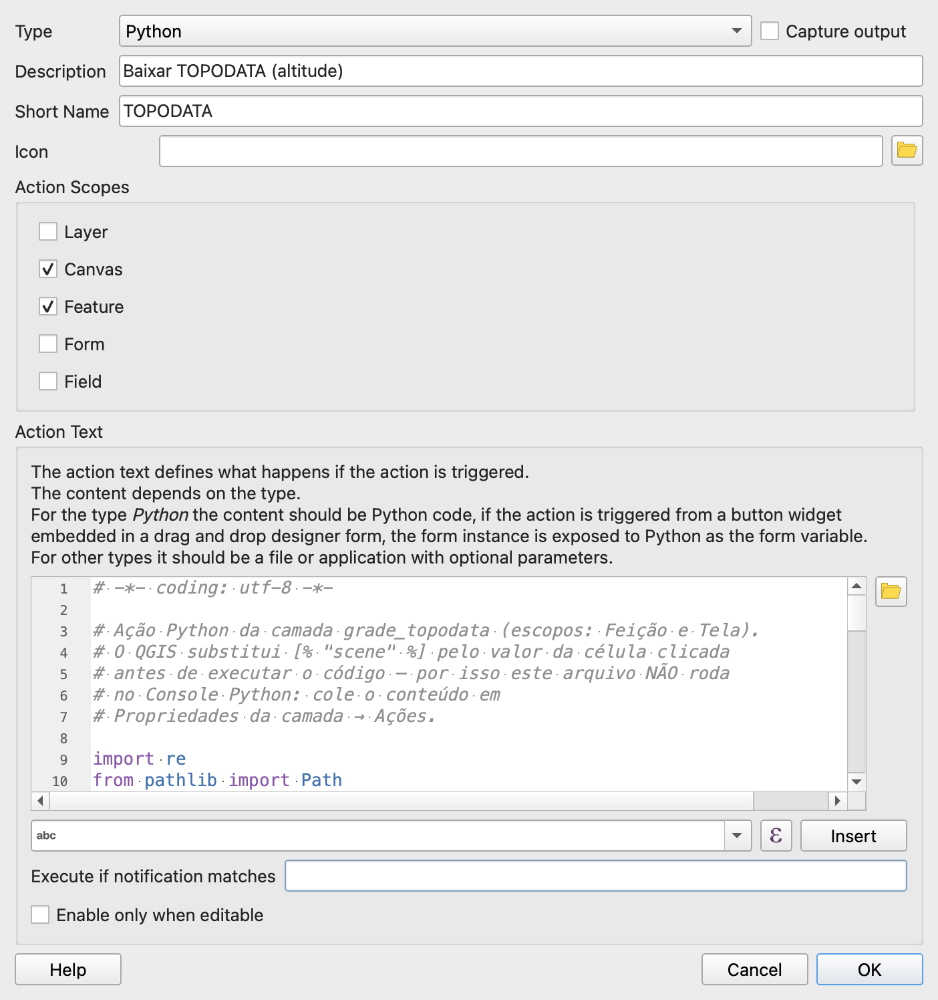

A ação aparece na lista da camada:

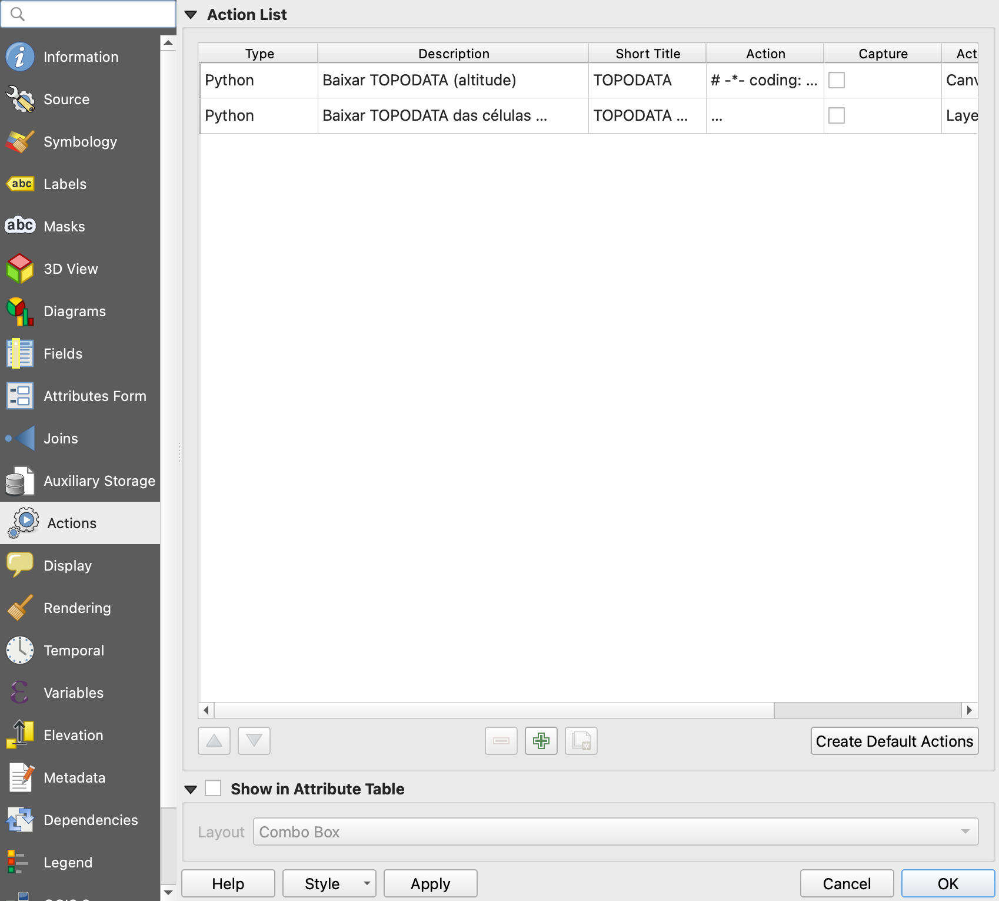

> **Entendendo o `[% "scene" %]`**
>
> Antes de executar uma ação Python, o QGIS **substitui** cada expressão `[% … %]` pelo valor da feição clicada. Para a célula `07S375`:
>
> ```python
> scene = '[% "scene" %]'.strip()   # o QGIS executa: scene = '07S375'.strip()
> ```
>
> Por isso o script **não roda no Console Python**: lá não há substituição, e `scene` seria literalmente `[% "scene" %]`.

### 4.3 Executar a ação

1. Na barra **Atributos (Attributes)**, abra o menu da ferramenta **Executar ação da feição (Run Feature Action)** (engrenagem com uma seta).
2. Escolha **`Baixar TOPODATA (altitude)`**.
3. Clique numa célula da grade.
4. Escolha a pasta de destino.
5. Aguarde a barra de progresso.

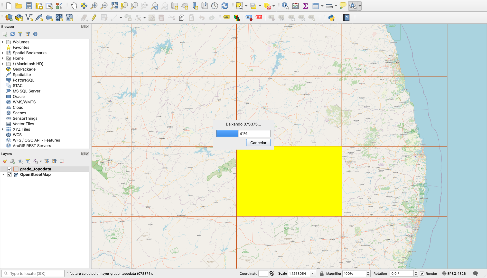

Ao terminar, o raster aparece no mapa e no painel **Camadas**, com o nome da célula:

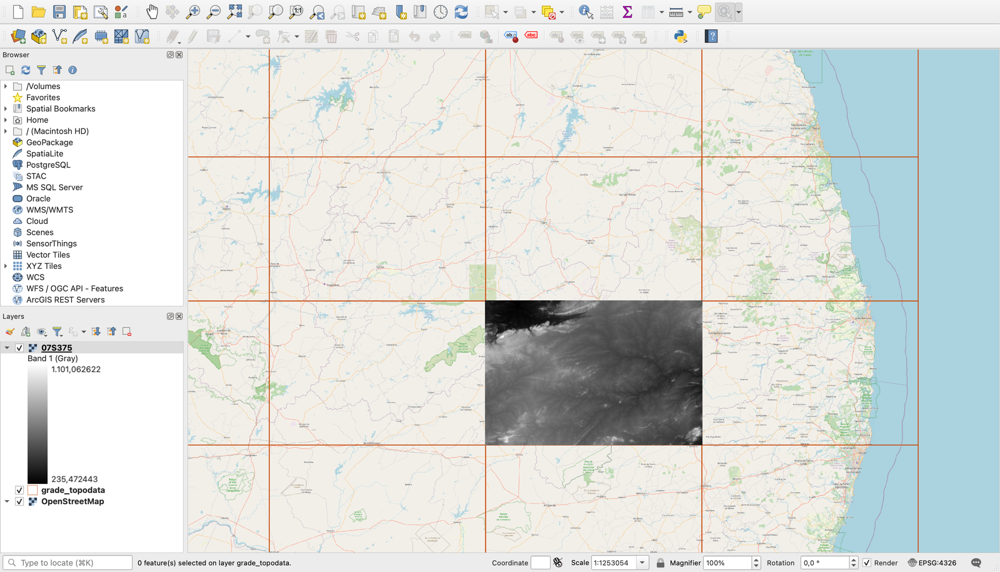

### 4.4 Guardar a ação

1. Salve o projeto (`Ctrl+S`): a ação fica gravada no `.qgz`.
2. Para levar a ação para outros projetos: **Propriedades** → **Estilo (Style)** → **Salvar estilo (Save Style)**, com a categoria **Ações (Actions)** marcada.

> **Nota:** o estilo salvo (`.qml`) leva junto a simbologia e as ações. Ao carregar a grade em outro projeto, carregue o estilo e a ação já vem pronta.

---

## Parte 5 — Ação para várias células selecionadas

### 5.1 O prompt

Na mesma conversa — a IA já tem o script da Parte 4 como referência:

```text
Agora crie uma segunda versão que trabalhe com VÁRIAS células:
- use as feições SELECIONADAS da camada ativa (iface.activeLayer());
- valide: há camada ativa? há seleção? existe o campo "scene"?
- peça a pasta de destino UMA vez só;
- para cada célula, as mesmas regras de antes: reaproveitar arquivo válido,
  não duplicar camada já carregada, baixar via ".part";
- uma QProgressDialog para o conjunto (célula i de n, MB baixados) com
  Cancelar que interrompe o download em andamento;
- um erro numa célula NÃO pode interromper as outras: guarde e continue;
- no fim, um relatório em QMessageBox: selecionadas, baixadas, reaproveitadas,
  camadas adicionadas e os erros (no máximo 10, com a URL).
```

O resultado está em [`acao_baixar_selecionadas.py`](acao_baixar_selecionadas.py).

Repare na diferença de estrutura: o `try/except` está **dentro** do laço. Na Parte 4, um erro encerra a ação; aqui, um erro vira **uma linha no relatório**, e o laço segue para a próxima célula.

### 5.2 Duas formas de rodar

**a) Editor do Console Python.** Selecione algumas células, abra o editor (`Ctrl+Alt+P` → *Mostrar editor*), abra o arquivo e execute. Bom para testar.

**b) Como ação de camada.** Crie uma nova ação Python como na Parte 4, com:

- **Descrição:** `Baixar TOPODATA das células selecionadas`
- **Escopo:** apenas **Camada (Layer)**
- **Texto da ação:** o conteúdo de `acao_baixar_selecionadas.py`

Ações de escopo *Camada* aparecem no botão **Ações (Actions)** da barra da **Tabela de atributos** (ícone de engrenagem, perto do fim da barra). Abra a tabela, selecione as células e execute.

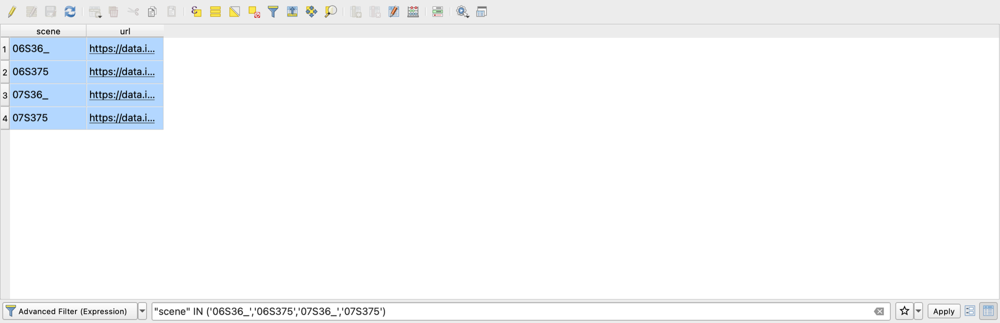

Durante o download, a janela mostra a célula e os MB já baixados:

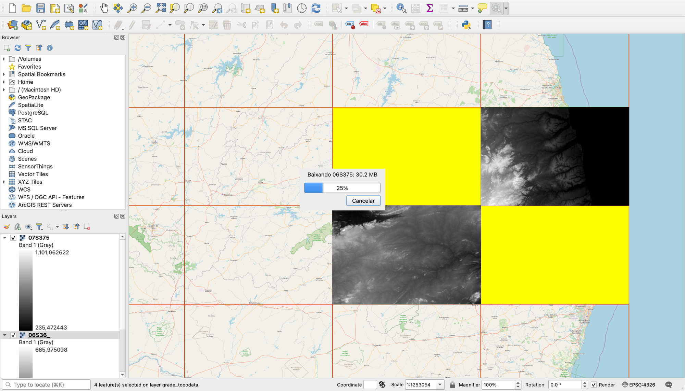

### 5.3 Conferir

Selecione 4 células vizinhas (por exemplo, em volta da sua cidade) e rode **duas vezes**:

| Execução | Baixados | Reaproveitados | Camadas adicionadas |
| --- | --- | --- | --- |
| 1ª | 4 | 0 | 4 |
| 2ª (camadas ainda no projeto) | 0 | 4 | 0 |

Se a 2ª execução baixar tudo de novo, a verificação de "arquivo existente" não está funcionando.

Nas capturas abaixo, a célula `07S375` já tinha sido baixada pela ação de clique da Parte 4. Por isso a 1ª execução mostra **3 baixados e 1 reaproveitado**:

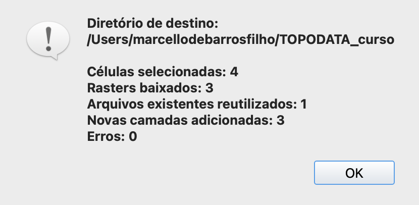

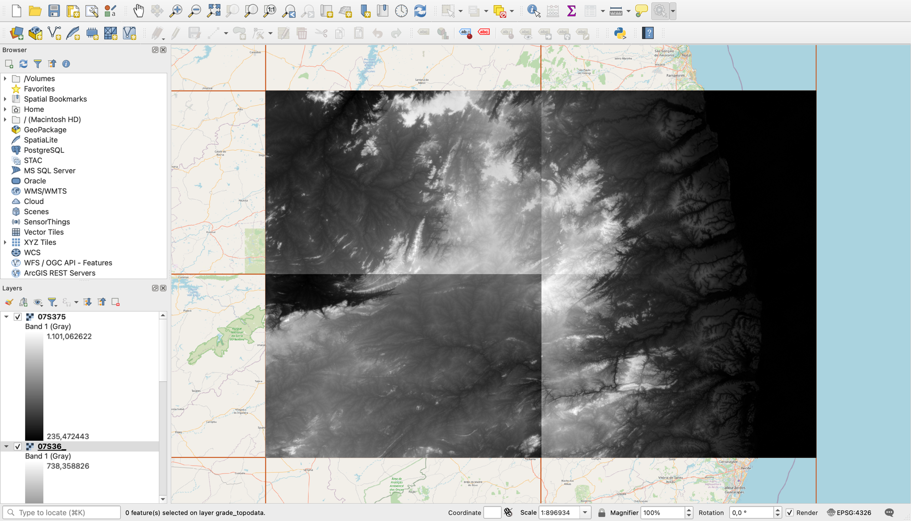

Na 2ª execução, nada é baixado. Repare que ela rodou com um **raster como camada ativa** (o último baixado), e mesmo assim funcionou, graças ao `[% @layer_id %]`:

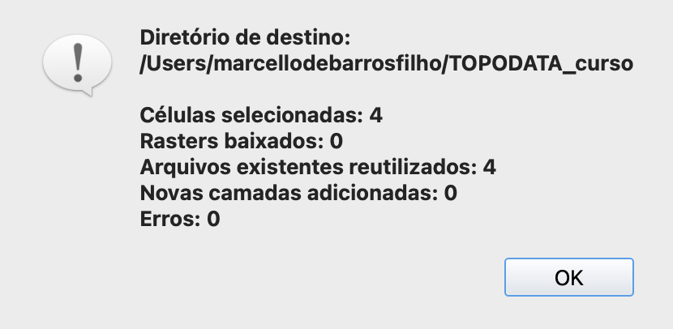

> **Cuidado com o tamanho:** cada folha de altitude tem ~70 MB em média. As 556 folhas do Brasil somam **~40 GB**.

---

<!-- navegação -->
[⬅️ 🛣️ Duplicação da PB-200](../pb200/pb200.md) · [🏠 Início](../../README.md) · [⛰️ Perfil da PB-200 ➡️](../perfil_pb200/perfil_pb200.md)
