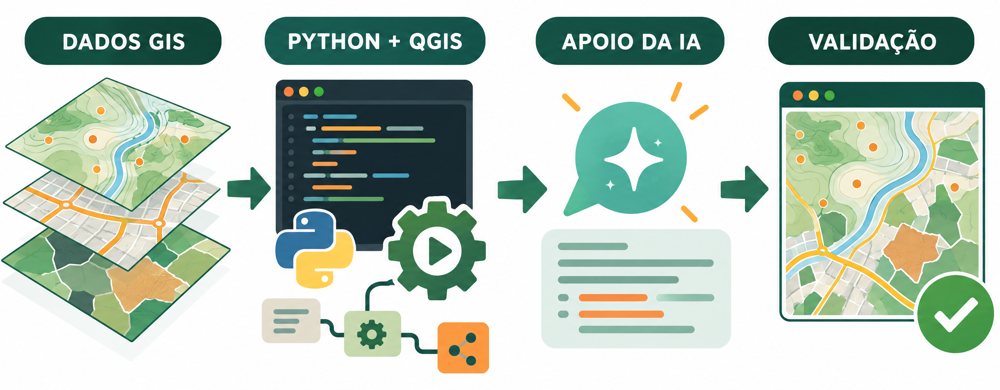
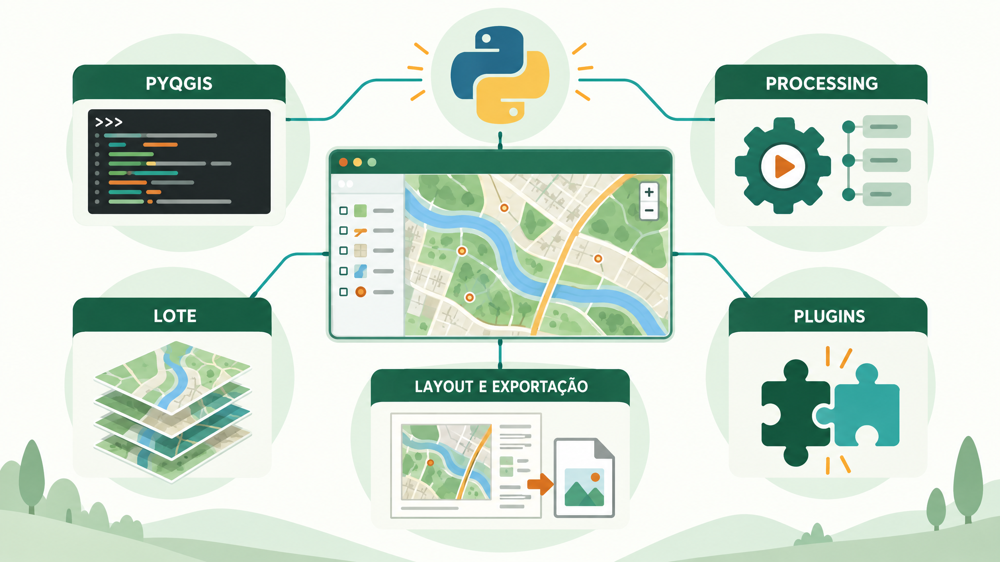
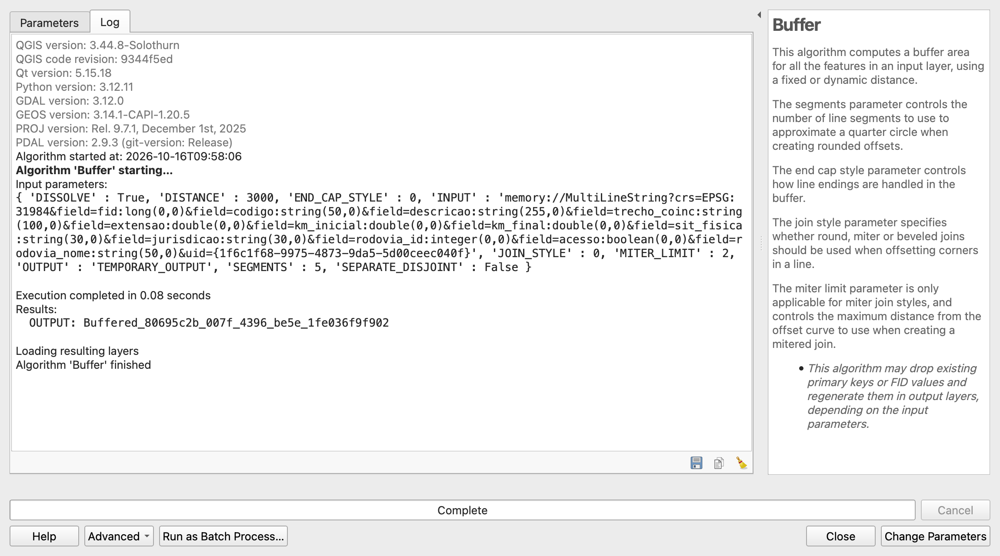
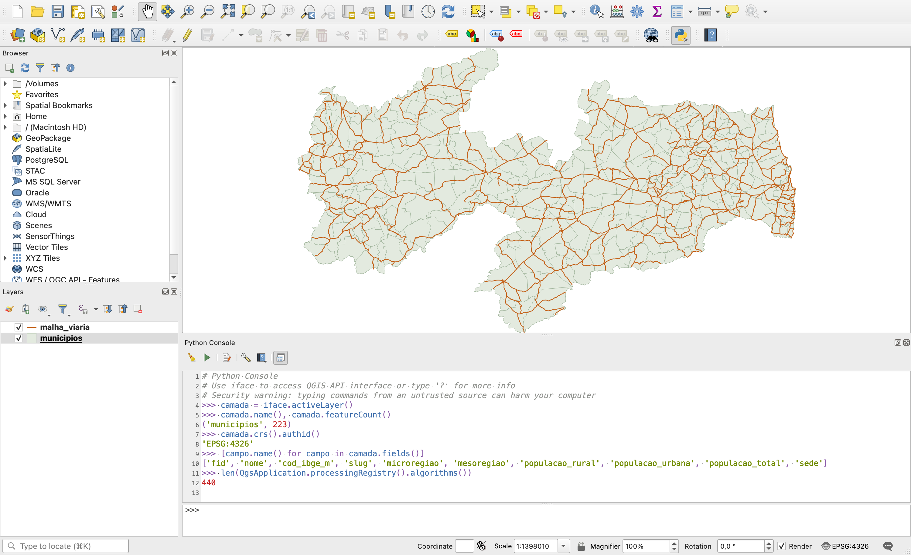
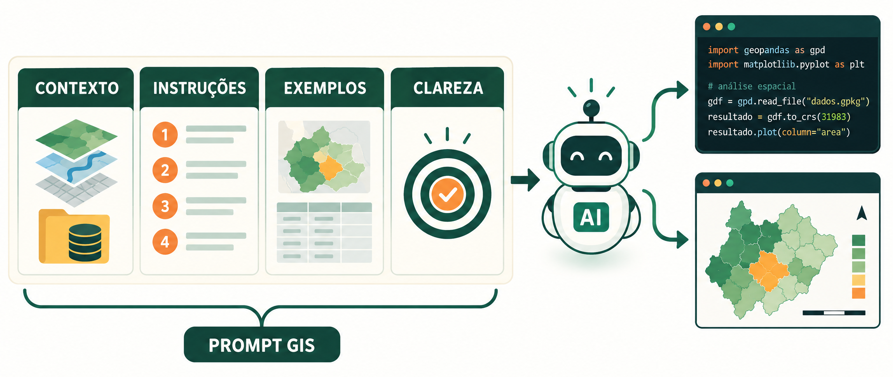
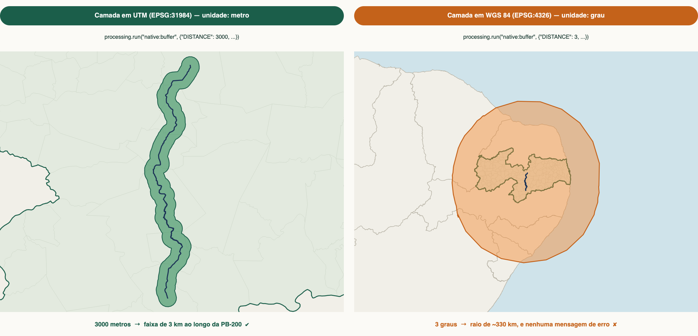
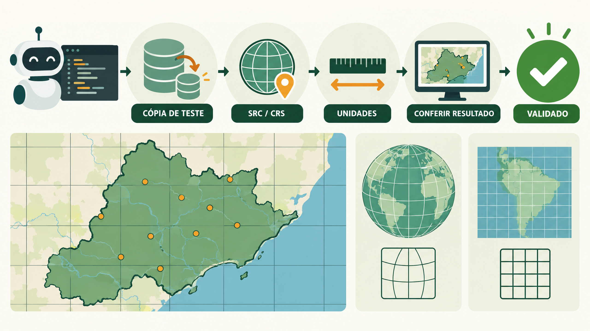
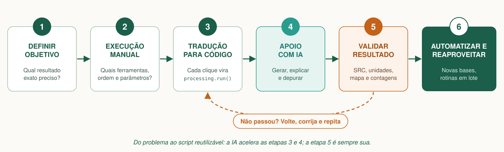

<!-- navegação -->
[🏠 Início](../../README.md) · [📍 Geocodificação urbana ➡️](../geocodificacao/geocodificacao.md)

# Automatizando o QGIS com Python e IA

> **Roteiro de aula:** a aula de abertura do minicurso, prática e guiada
> **Público:** estudantes e profissionais de geotecnologias; **não é preciso saber Python** · **Nível:** 🟢 Iniciante
> **Duração:** 35 minutos de aula (seções 1 a 5) + material de referência para todo o curso (seções 6 a 8)
> **Tema:** o que é automatizar no QGIS, as peças do quebra-cabeça (QGIS, Python, PyQGIS, Processing e IA), bons prompts e validação
> **Tecnologias:** QGIS 3.44 (Caixa de Ferramentas, Histórico de Processamento, Console Python); IA generativa

---

## 🧭 1. A proposta da aula

Pense na última vez que você repetiu a mesma sequência de ferramentas no QGIS: abrir a camada, reprojetar, gerar um buffer, recortar, calcular a área, exportar… e depois fazer tudo de novo para o próximo arquivo, o próximo município, a próxima rodovia.

Este curso parte de uma ideia simples: **se você sabe fazer à mão, você pode ensinar o computador a fazer por você.** A linguagem **Python** pode ser utilizada dentro do **QGIS** para automatizar tarefas; a Inteligência Artificial (IA) generativa é uma intérprete que ajuda a escrever nessa linguagem. Mas quem decide *o que* fazer, e quem confere se ficou certo, continua sendo você.

A pergunta que guia a aula:

> **Se você sabe fazer à mão, como ensinar o computador a fazer por você, e como saber se ele aprendeu certo?**



### 🎯 Objetivos de aprendizagem

Ao final da aula, a turma será capaz de:

1. **explicar** o que é automatizar e por que só automatiza bem quem sabe fazer à mão;
2. **reconhecer** as peças do curso (QGIS, Python, PyQGIS, Processing e IA) e o papel de cada uma;
3. **obter** o código Python de qualquer ferramenta da Caixa de Ferramentas;
4. **inspecionar** uma camada no Console Python: quantas feições, que SRC, quais campos;
5. **escrever** um prompt com contexto, instruções, exemplos e clareza;
6. **desconfiar** de um resultado que "rodou sem erro", conferindo unidades e SRC.

---

## 📋 2. Preparação e roteiro de tempo

### 🛠️ Antes da aula, o(a) professor(a) confere

- [ ] **QGIS** 3.34 LTR ou mais recente (material testado no 3.44), com o Console Python.
- [ ] **Dados:** o `minicurso_dados.gpkg`, com a camada `municipios` carregada no projeto (veja [`dados_curso/`](../../dados_curso/README.md)).
- [ ] **Projetor**, para mostrar as figuras e os passos enquanto a turma acompanha no próprio QGIS.
- [ ] **Assistente de IA** aberto no navegador (ChatGPT, Claude, Gemini, Copilot ou similar).

> 💡 **Dica para quem conduz a aula:** esta é a aula que dá o vocabulário de todo o curso. Ninguém precisa sair dela sabendo Python; precisa sair sabendo **onde o código mora** (Histórico, Console), **como pedir** (prompt) e **por que conferir** (unidades e SRC). As seções 6 a 8 são material de consulta para o curso inteiro: não tente cobri-las na aula.

### ⏱️ Planejamento minuto a minuto (35 min)

| Intervalo | Etapa | Foco da turma |
| :--- | :--- | :--- |
| **0–5 min** | Pergunta e contexto | O que é automatizar? As peças do quebra-cabeça. |
| **5–13 min** | Atividade 1: todo clique tem um código | Rodar uma ferramenta à mão e achar o código dela. |
| **13–20 min** | Atividade 2: o Console Python | Quatro linhas para conhecer uma camada. |
| **20–28 min** | Atividade 3: bons prompts | Transformar um prompt fraco num prompt bom. |
| **28–32 min** | Atividade 4: rodou sem erro ≠ está certo | O buffer em graus. Atribuir × reprojetar. |
| **32–35 min** | Síntese e fechamento | Check-out oral e mensagem final. |

---

## 💡 3. Fundamentação

### 3.1 O que é automatizar?

Automatizar é **transformar uma sequência de operações em instruções que o computador executa**, sem que você precise repetir cada clique.

> 🗣️ **Como explicar para a turma:**
> *"Automatizar é escrever a receita de bolo depois de fazer o bolo à mão algumas vezes. Quem nunca fez o bolo escreve uma receita que o forno executa direitinho, e o bolo sai errado do mesmo jeito, só que mais rápido."*

> 💡 Um script pode executar *perfeitamente* uma análise *conceitualmente errada*. Automação aumenta a velocidade, inclusive a velocidade de errar. Por isso, **só automatiza bem quem sabe fazer à mão**.

### 3.2 As peças do quebra-cabeça

Antes de escrever qualquer linha de código, vale organizar o vocabulário. São cinco peças, cada uma com um papel:

| Recurso | O que é | Analogia |
| --- | --- | --- |
| **QGIS** | O ambiente: camadas, mapas, algoritmos, layouts | A oficina |
| **Python** | A linguagem: variáveis, repetições (`for`), condições (`if`) | O idioma |
| **PyQGIS** | A biblioteca que dá ao Python acesso aos objetos do QGIS (projeto, camadas, feições, atributos) | As mãos dentro da oficina |
| **Processing** | A estrutura que organiza **todas** as ferramentas de análise como algoritmos com parâmetros | A caixa de ferramentas |
| **IA generativa** | Assistente que ajuda a planejar, escrever, explicar e depurar o código | Um colega experiente, mas que precisa ser supervisionado |

### 3.3 Onde o Python entra no QGIS



O Python alcança praticamente tudo no QGIS. Para este curso, o que importa é saber **qual porta usar para cada situação**:

| Recurso | Quando usar | No curso |
| --- | --- | --- |
| **Console Python** | Testar comandos, inspecionar camadas, desenvolver um script passo a passo | ✅ Ponto de partida |
| **Processing via código** (`processing.run`) | Executar e encadear algoritmos que já existem na Caixa de Ferramentas | ✅ **Foco principal** |
| **PyQGIS** | Ler e alterar camadas, feições e atributos quando nenhum algoritmo pronto resolve | ✅ Quando necessário |
| **Processamento em lote** | Rodar *uma* ferramenta em vários arquivos, pela interface | ✅ Como comparação |
| **Modelador Gráfico** | Montar um fluxo visualmente e exportá-lo como script Python | ✅ Como ponte entre clique e código |
| **Layouts e exportação** | Gerar séries de mapas padronizados | ➖ Mencionado |
| **Plugins** | Criar extensões com interface própria | ❌ **Fora do escopo** |

> **Dentro ou fora do QGIS?** Todos os scripts do curso rodam **dentro** do QGIS, no Editor do Console Python. Lá, o projeto aberto, as camadas e o objeto `iface` (a interface gráfica) já estão disponíveis. Scripts *fora* do QGIS (no terminal, agendados) também são possíveis, mas exigem configurar o ambiente, e o `iface` não existe neles. Guarde essa diferença: ela vai aparecer quando você pedir código à IA.

---

## 🛠️ 4. Trilha prática guiada

### 📍 Atividade 1: todo clique tem um código (8 min)

**Objetivo:** descobrir que o QGIS já escreve o código de cada ferramenta que você roda. Esta é a ponte que sustenta o curso inteiro.

1. Abra a **Caixa de Ferramentas de Processamento** (`Ctrl+Alt+T`) e rode uma ferramenta qualquer sobre a camada `municipios`, por exemplo **Centroides** (*Centroids*).
2. Na própria janela da ferramenta, abra a aba **Log**: o QGIS registrou o nome do algoritmo e **todos** os parâmetros usados.



3. Agora aperte **`Ctrl+Alt+H`** (**Processamento → Histórico**): a mesma execução está lá, **já escrita como `processing.run(...)`**.

A figura mostra o Log de um buffer de 3 km na PB-200. Compare com o código abaixo: é a mesma coisa.

```python
process = processing.run("native:buffer", {
    "INPUT": camada_pb200_utm,
    "DISTANCE": 3000,           # unidades do SRC da camada (aqui, metros)
    "SEGMENTS": 5,
    "END_CAP_STYLE": 0,         # 0 = arredondado
    "JOIN_STYLE": 0,
    "MITER_LIMIT": 2,
    "DISSOLVE": True,
    "OUTPUT": "TEMPORARY_OUTPUT",   # camada temporária, em memória
})
buffer_utm_3km = process["OUTPUT"]

# Adiciona a nova camada gerada diretamente à tela do QGIS
QgsProject.instance().addMapLayer(buffer_utm_3km)
```

Três coisas a observar:

1. **`"native:buffer"`** é o identificador do algoritmo. Cada ferramenta da Caixa tem o seu (`native:clip`, `native:reprojectlayer`, `native:intersection`…).
2. **Os parâmetros são um dicionário:** pares `"NOME": valor`, exatamente os campos do formulário da ferramenta.
3. **O resultado também é um dicionário;** a camada gerada está em `process["OUTPUT"]` e pode virar a entrada do próximo algoritmo. É assim que se *encadeia* um fluxo.

> 💬 **Pausa para reflexão com a turma:** *se o QGIS já escreve o código, o que falta para automatizar uma análise inteira?*

<details>
<summary>Resposta esperada</summary>

Juntar os passos em um script, usando a saída de um como entrada do próximo, e trocar os valores fixos (caminhos, nomes, distâncias) por variáveis, para repetir com outros dados. É o caminho de todo o curso: **fazer à mão → copiar o código → juntar os passos em um script → generalizar.** Você não precisa decorar nenhum ID nem parâmetro: o Histórico, o botão **Avançado → Copiar como comando Python** e o `processing.algorithmHelp("native:buffer")` entregam tudo.

</details>

---

### 📍 Atividade 2: primeiro contato com o Console Python (7 min)

**Objetivo:** conhecer uma camada sem abrir nenhuma janela.



1. Abra o Console em **Complementos → Console Python** (`Ctrl+Alt+P`).
2. Com a camada `municipios` selecionada no painel Camadas, digite uma linha de cada vez:

```python
camada = iface.activeLayer()                  # a camada selecionada no painel
camada.name(), camada.featureCount()          # ('municipios', 223)
camada.crs().authid()                         # 'EPSG:4326'
[campo.name() for campo in camada.fields()]   # nomes dos campos
```

> 🗣️ **Como explicar o `iface`:**
> *"`iface` é a abreviação de interface: é a janela do QGIS vista pelo Python. Por meio dele, o código faz o que você faria com o mouse: `iface.activeLayer()` devolve a camada selecionada, `iface.mapCanvas()` dá acesso ao mapa."* Como representa a janela, o `iface` **só existe dentro do QGIS**: fora dele, a primeira linha falharia com `NameError: name 'iface' is not defined`.

Para comandos maiores, use o **Editor** do Console (ícone *Mostrar editor*): ali você escreve, salva e executa scripts inteiros. É onde todos os exercícios do curso acontecem.

> ⚠️ **Aviso de segurança:** o Console executa comandos de verdade. Se o código mandar apagar, sobrescrever ou editar, ele vai executar imediatamente. **Leia e entenda o código antes de clicar em Executar**, principalmente trechos gerados por IA.

> 💬 **Pausa para reflexão:** *as quatro linhas responderam a três perguntas. Quais? E o que o `'EPSG:4326'` avisa sobre essa camada?*

<details>
<summary>Resposta esperada</summary>

*Quantas feições?* (223), *em que SRC?* (EPSG:4326) e *quais campos?* São as perguntas que todo analista faz antes de qualquer análise. E **EPSG:4326 é um SRC geográfico, em graus**: qualquer distância ou área calculada nessa camada estará em graus, não em metros. Guarde isso para a Atividade 4.

</details>

---

### 📍 Atividade 3: a IA como copiloto, escrevendo bons prompts (8 min)

**Objetivo:** ver que a IA só sabe o que você conta a ela.



Um **prompt** é a instrução que você envia à IA. A IA não vê seu projeto, não conhece seus dados e não sabe qual versão do QGIS você usa. Tudo o que você não disser, ela vai **supor**, e suposições viram código errado.

| Elemento | ❌ Prompt fraco | ✅ Prompt melhorado | Por que melhora |
| --- | --- | --- | --- |
| **Contexto** | "Faça um código para o QGIS." | "QGIS 3.44, Console Python. Camada de linhas `malha_viaria` (EPSG:4326), campo `rodovia_nome`." | evita API antiga (QGIS 2) e código para o ambiente errado |
| **Instruções** | "Faça a análise e salve." | "1) extraia a PB-200; 2) reprojete para EPSG:31984; 3) buffer de 3 000 m dissolvido; 4) salve em GeoPackage." | o fluxo fica explícito e verificável |
| **Exemplos** | "Quero um código organizado." | "Parâmetros em constantes no topo; um bloco comentado por etapa; imprima o nº de feições ao final." | define uma forma concreta, que você pode conferir |
| **Clareza** | "Selecione áreas perto da estrada." | "Considere *próxima* a feição a até 3 000 m da rodovia." | "perto", "grande", "otimizado" não são critérios |

1. Em duplas, cada uma escolhe **um** prompt fraco da tabela e o reescreve com os quatro elementos.
2. Compare com o prompt completo da seção 6.2.

> 🔒 **Compartilhe a estrutura, não os dados.** Para obter ajuda com código, basta enviar nomes de camadas, campos, tipos e SRC, não o arquivo. Dados pessoais, sigilosos ou de clientes não devem ir para serviços externos sem autorização.

> 💬 **Pausa para reflexão:** *"Não funcionou, corrige." Por que este é o pior prompt possível para depurar um erro?*

<details>
<summary>Resposta esperada</summary>

Porque a IA não vê o erro, nem o código, nem o seu QGIS. Para depurar, envie **a mensagem de erro completa**, o trecho de código, a versão do QGIS e a etapa em que falhou. Com isso, ela consegue apontar a causa; sem isso, só chuta.

</details>

---

### 📍 Atividade 4: rodou sem erro ≠ está certo (4 min)





Os dois códigos rodaram **sem nenhuma mensagem de erro**. À esquerda, a camada está em UTM: `DISTANCE: 3000` significa 3 000 **metros**, e o resultado é a faixa de 3 km esperada. À direita, alguém escreveu `DISTANCE: 3` "pensando em quilômetros" numa camada em WGS 84, cuja unidade é o **grau**: o buffer tem raio de ~330 km e engole a Paraíba inteira.

O QGIS fez exatamente o que foi pedido. O erro estava na **interpretação das unidades**, e nenhum interpretador Python, nenhuma IA, vai avisar você disso.

> 🚨 **Atribuir não é reprojetar:**
>
> - **Atribuir projeção (`Set CRS`):** apenas troca a "etiqueta" do arquivo. As coordenadas internas dos pontos continuam exatamente as mesmas.
> - **Reprojetar (`Reproject layer`):** recalcula matematicamente todas as coordenadas X e Y para o novo sistema.
>
> Trocar a etiqueta de uma camada em graus para UTM sem recalcular as coordenadas faz os dados "desaparecerem" ou irem parar no meio do oceano, sem nenhum aviso de erro.

> 💬 **Pausa para reflexão:** *qual conferência simples teria pegado o buffer de 330 km?*

<details>
<summary>Resposta esperada</summary>

Olhar o mapa, ou medir a faixa com a ferramenta de medição: ela tem mesmo 3 km? Antes disso, conferir o SRC da camada (`camada.crs().authid()`, como na Atividade 2). O ciclo completo de validação está na seção 6.3.

</details>

---

## 🎓 5. Fechamento: checagem de aprendizagem

### 💬 Check-out oral

Peça que a turma complete as frases:

1. *"Para descobrir o código Python de uma ferramenta, eu…"*
2. *"Um bom prompt para GIS diz à IA…"*
3. *"Um buffer de 3 numa camada em EPSG:4326 não tem 3 km porque…"*

<details>
<summary>Respostas esperadas</summary>

1. … rodo a ferramenta à mão e copio o `processing.run(...)` do Histórico (`Ctrl+Alt+H`), da aba Log ou do botão **Copiar como comando Python**.
2. … o contexto (versão do QGIS, onde o código roda, camadas, campos e SRC), as instruções passo a passo, exemplos da forma que quero e critérios claros, sem "perto" ou "grande".
3. … a unidade da camada é o grau: o buffer tem 3 graus, ~330 km. Antes do buffer, é preciso reprojetar para um SRC em metros.

</details>

### 🏁 Mensagem final

> 💡 *"A Inteligência Artificial pode gerar o código e o Processing Framework do QGIS pode executar os cálculos. No entanto, a **responsabilidade técnica** sobre o resultado final (a escolha do SRC correto, a precisão das unidades de medida e a interpretação do fenômeno geográfico) é exclusivamente de quem assina o projeto. **É sua.**"*

---

## 💻 6. Para todo o curso: o método, o prompt completo e a validação

### 6.1 O método de trabalho: do problema ao script reutilizável

Este é o fluxo de trabalho que orienta cada exercício do curso:



| Etapa | Foco da etapa | Pergunta-chave que ela responde |
| :--- | :--- | :--- |
| **1. Objetivo** | Diagnóstico do problema | *Qual é o desafio geoespacial e qual resultado exato preciso obter?* |
| **2. Fluxo manual** | Mapeamento no QGIS | *Quais ferramentas nativas utilizarei, em qual sequência e com quais parâmetros?* |
| **3. Código (Processing)** | Tradução para PyQGIS | *Como converter cada clique da interface no algoritmo correspondente em `processing.run(...)`?* |
| **4. Apoio com IA** | Aceleração e escrita | *Como construir o prompt ideal para gerar, compreender ou depurar o script rapidamente?* |
| **5. Validação** | Auditoria geoespacial | *O resultado reflete corretamente a realidade do terreno, com SRC e unidades exatas?* |
| **6. Reaproveitamento** | Escala e automação | *Como estruturar este código para processar novas bases ou rotinas em lote de forma autônoma?* |

### 6.2 Um prompt completo

```text
Atue como especialista em PyQGIS. Escreva um script para o Editor do Console
Python do QGIS 3.44, usando processing.run e algoritmos "native:".

Dados (já carregados no projeto, em EPSG:4326):
- malha_viaria (linhas), campo rodovia_nome (ex.: 'PB-200')
- municipios (polígonos), campos nome e cod_ibge_m

Passos:
1. extrair a rodovia 'PB-200';
2. reprojetar para EPSG:31984 (SIRGAS 2000 / UTM 24S);
3. gerar um buffer de 3000 m, dissolvido;
4. listar os municípios que intersectam o buffer.

Regras:
- verifique se as camadas existem antes de começar e mostre mensagens claras;
- não altere as camadas originais; saídas intermediárias em memória;
- parâmetros em constantes no topo; comentários em português;
- não use APIs do QGIS 2 (processing.runalg, QgsMapLayerRegistry);
- se faltar alguma informação, pergunte em vez de supor.
```

**Três hábitos que fazem diferença:**

1. **Peça por etapas.** Uma etapa por vez, rodando cada uma antes de pedir a próxima. Se algo der errado no passo 2, você descobre no passo 2, e não depois de 150 linhas.
2. **Peça explicações.** "Explique linha a linha" e "quais parâmetros ficaram no padrão?" são perguntas que ensinam e, de quebra, revelam erros.
3. **Depure com contexto.** Ao surgir um erro, envie **a mensagem completa**, o trecho de código, a versão do QGIS e a etapa em que falhou.

### 6.3 O ciclo de validação

Trate todo código, seu ou da IA, como uma **proposta** a ser testada:

#### Antes de pedir o código

☐ Defina o objetivo da análise e os critérios (distâncias, unidades, campos).  
☐ Confira os nomes **exatos** das camadas e dos campos (maiúsculas e acentos contam).  
☐ Informe o SRC de cada camada: graus ou metros.  
☐ Verifique a versão do QGIS e onde o código vai rodar.  

#### Antes de executar

☐ Leia o código e entenda o que cada bloco faz (caso não saiba Python, peça à IA para explicar e comentar o código).  
☐ Confirme se os algoritmos e parâmetros existem (`processing.algorithmHelp`).  
☐ Verifique se o script apaga, sobrescreve ou edita algo, e trabalhe em uma **cópia**.  
☐ Teste primeiro em uma área pequena.  

#### Depois de executar

☐ Confira se o resultado aparece **no lugar certo** do mapa.  
☐ Avalie se o número de feições faz sentido.  
☐ Meça uma amostra com a ferramenta de medição (a faixa tem mesmo 3 km?).  
☐ Verifique se a tabela de atributos está preenchida, sem nulos inesperados.  
☐ Compare o resultado com uma execução manual do mesmo fluxo.  

### Aplicação prática no mundo real

Nos exercícios seguintes, este fluxo será aplicado a cenários reais de análise territorial no estado da **Paraíba**, organizados em uma **trilha de aprendizagem progressiva**, em ordem crescente de complexidade:

#### 📍 Exercício 1 — Geocodificação urbana em João Pessoa

- **Nível:** 🟢 Iniciante
- **O desafio:** você recebe uma planilha com nomes e endereços de João Pessoa (PB), mas sem coordenadas. A tarefa é transformá-la em uma camada de pontos no mapa. Você descreve o que quer, a IA escreve o script e você confere o resultado.
- **O que você irá aprender:**
  - ler uma tabela (CSV) com Python;
  - consultar um serviço web de geocodificação (Nominatim / OpenStreetMap), respeitando limites de requisições;
  - tratar endereços não encontrados sem perder linhas da tabela;
  - criar uma camada temporária de pontos no QGIS;
  - desconfiar de um ponto "encontrado": verificar se ele caiu na rua correta.

👉 [Abrir o exercício](../geocodificacao/geocodificacao.md)

#### 🛣️ Exercício 2 — Impacto ambiental da duplicação da PB-200

- **Nível:** 🟡 Intermediário
- **O desafio:** delimitar a área de influência da duplicação da rodovia PB-200 (buffer de 3 km) e cruzá-la com os municípios atingidos e com o mapeamento de uso do solo, para responder: *quanto de cada classe de uso, em hectares, há dentro da faixa, em cada município?*
- **O que você irá aprender:**
  - fazer a análise primeiro à mão e depois traduzir cada clique em `processing.run(...)`;
  - encadear algoritmos (reprojetar, buffer, recortar, interseção), usando a saída de um como entrada do próximo;
  - calcular áreas em hectares num SRC métrico adequado (UTM / SIRGAS 2000);
  - comparar o resultado do script com o do fluxo manual.

👉 [Abrir o exercício](../pb200/pb200.md)

#### 🗺️ Exercício 3 — Grade interativa SRTM/TOPODATA

- **Nível:** 🟡 Intermediário
- **O desafio:** partir de um mapa índice na web e criar uma grade no QGIS em que basta **clicar numa célula** para baixar e carregar automaticamente o Modelo Digital de Elevação (MDE) TOPODATA daquela região.
- **O que você irá aprender:**
  - usar a IA para investigar a estrutura de dados de uma página web;
  - converter os dados em uma camada vetorial (GeoJSON);
  - descobrir a regra de formação dos links de download de cada quadrícula;
  - criar **ações personalizadas** em Python no QGIS para baixar arquivos sob demanda, com barra de progresso.

👉 [Abrir o exercício](../grade_topodata/grade_topodata.md)

#### ⛰️ Exercício 4 — Perfil topográfico da PB-200

- **Nível:** 🟡 Intermediário
- **O desafio:** juntar os dois exercícios anteriores e traçar o perfil topográfico da PB-200 inteira, do km 0 ao km 104, com o MDE TOPODATA baixado pela ação de clique. O ponto de partida é um tutorial da web escrito para uma versão antiga do QGIS.
- **O que você irá aprender:**
  - usar a IA para atualizar código antigo e conferir o que ela trocou (GRASS e SAGA por algoritmos nativos);
  - descobrir por que a solução "óbvia" para unir trechos falha (trechos invertidos e com falhas) e costurá-los pela ordem do km;
  - gerar pontos ao longo de uma linha e ler a altitude de cada um no raster;
  - desenhar o perfil com matplotlib e conferir com a ferramenta nativa Perfil de Elevação;
  - interpretar o resultado: exagero vertical, ruído do SRTM e o que o dado permite (ou não) afirmar.

👉 [Abrir o exercício](../perfil_pb200/perfil_pb200.md)

#### 🚶 Exercício 5 — Alcance a partir do IFPB

- **Nível:** 🔴 Avançado
- **O desafio:** descobrir até onde se chega, pelas ruas, a partir do IFPB Campus João Pessoa: andando 800 m e dirigindo 4 km. A malha viária é baixada uma única vez do OpenStreetMap, e as análises rodam offline.
- **O que você irá aprender:**
  - separar o download (OSMnx, uma vez) da análise (PyQGIS + NetworkX, sem internet), ganhando velocidade e independência de servidores públicos;
  - montar um grafo dirigido a partir de um GeoPackage e tirar dele duas redes: a pé e de carro, com mão única;
  - calcular a distância pela rede (Dijkstra) e cortar as ruas em faixas de distância;
  - comparar o alcance pela rede com o círculo em linha reta;
  - conferir o resultado com a Área de serviço nativa do QGIS e desconfiar de números que não fecham.

👉 [Abrir o exercício](../alcance_ifpb/alcance_ifpb.md)

#### 🔥 Exercício 6 — Focos de queimadas na Paraíba

- **Nível:** 🔴 Avançado
- **O desafio:** mostrar *quando* e *onde* o fogo apareceu na Paraíba em 2026, a partir dos 2.445 focos do BDQueimadas (INPE). Primeiro, com o Controlador Temporal do QGIS; depois, num dashboard publicado no GitHub Pages, que qualquer pessoa abre no navegador ou no celular, sem instalar o QGIS.
- **O que você irá aprender:**
  - configurar as propriedades temporais de uma camada e animar o mapa, à mão e com PyQGIS;
  - limpar dados para a web: valores `-999`, fuso horário (UTC × horário da Paraíba) e tamanho dos arquivos;
  - montar um dashboard com Leaflet (TimeDimension, heat e markercluster), Vue.js e Highcharts, com uma representação cartográfica por vez;
  - revisar o painel como um leitor: o que ele mostra, quais filtros valem, acessibilidade e falhas de rede;
  - conferir que o dashboard mostra os mesmos números do QGIS.

👉 [Abrir o exercício](../queimadas_pb/queimadas_pb.md) · 🌐 [Abrir o dashboard publicado](https://marcellobenigno.github.io/automatizando-qgis-python-ia/queimadas_pb/)

#### 🚧 Próximos exercícios

Em produção.

---

## 📖 7. Dicionário e referências

### Dicionário para estudantes

| Termo | Significado |
| --- | --- |
| **Algoritmo** | Ferramenta do Processing que recebe parâmetros e produz resultados (ex.: `native:buffer`) |
| **Feição** | Uma entidade da camada (ponto, linha ou polígono) com seus atributos |
| **`iface`** | Objeto que dá acesso à interface gráfica do QGIS; existe só dentro do QGIS |
| **Histórico de Processamento** | O registro de cada ferramenta rodada, já escrita como `processing.run(...)` (`Ctrl+Alt+H`) |
| **Prompt** | Instrução enviada a uma ferramenta de IA |
| **Reprojetar** | Recalcular as coordenadas de um SRC para outro |
| **SRC / CRS** | Sistema de Referência de Coordenadas; define se as coordenadas estão em graus ou metros, e em relação a quê |
| **`TEMPORARY_OUTPUT`** | Saída em memória, sem gravar arquivo em disco |
| **Validação** | Verificar se o resultado atende aos requisitos e representa corretamente a análise |

### Para consultar

- [PyQGIS Developer Cookbook](https://docs.qgis.org/latest/pt_BR/docs/pyqgis_developer_cookbook/): o manual de referência do PyQGIS
- [Usando os algoritmos de processamento a partir do console](https://docs.qgis.org/latest/pt_BR/docs/user_manual/processing/console.html)
- [Documentação da API do QGIS para Python](https://qgis.org/pyqgis/)

Consulte sempre a documentação da **versão instalada**: classes, métodos e parâmetros mudam entre versões.

---

## 🚀 8. Desafios para depois da aula

1. **Outra camada no Console.** Selecione `malha_viaria` e repita as quatro linhas da Atividade 2. Quantos trechos? Que SRC? Qual campo guarda o nome da rodovia?
2. **Do Histórico ao editor.** Rode **Centroides** à mão, copie o comando do Histórico (`Ctrl+Alt+H`), cole no Editor do Console, troque a camada de entrada e rode de novo pelo editor.
3. **Prompt fraco × prompt bom.** Mande à IA o prompt "Faça um código para o QGIS que gere um buffer na PB-200" e, depois, o prompt completo da seção 6.2. Compare as duas respostas: quantos dos problemas da Atividade 3 aparecem na primeira?

---

<!-- navegação -->
[🏠 Início](../../README.md) · [📍 Geocodificação urbana ➡️](../geocodificacao/geocodificacao.md)
