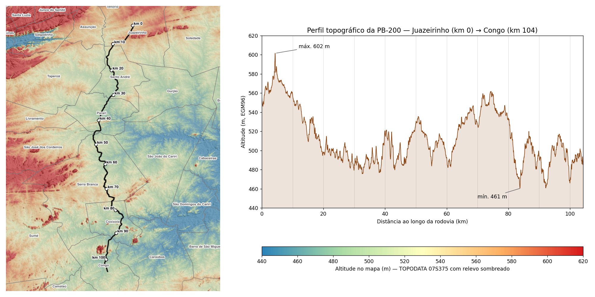
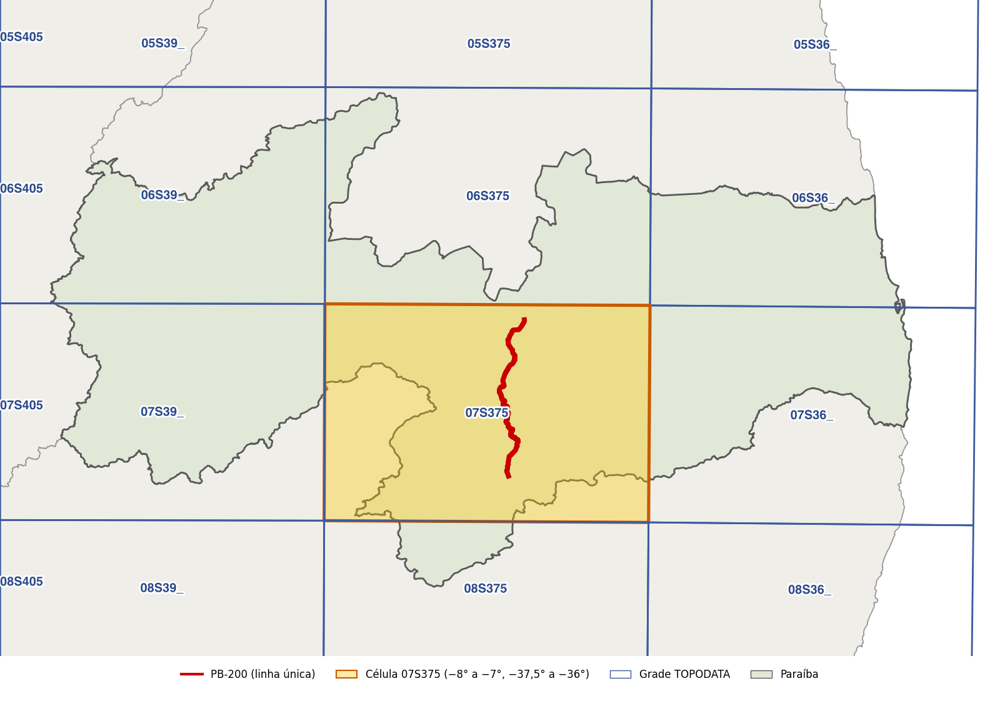
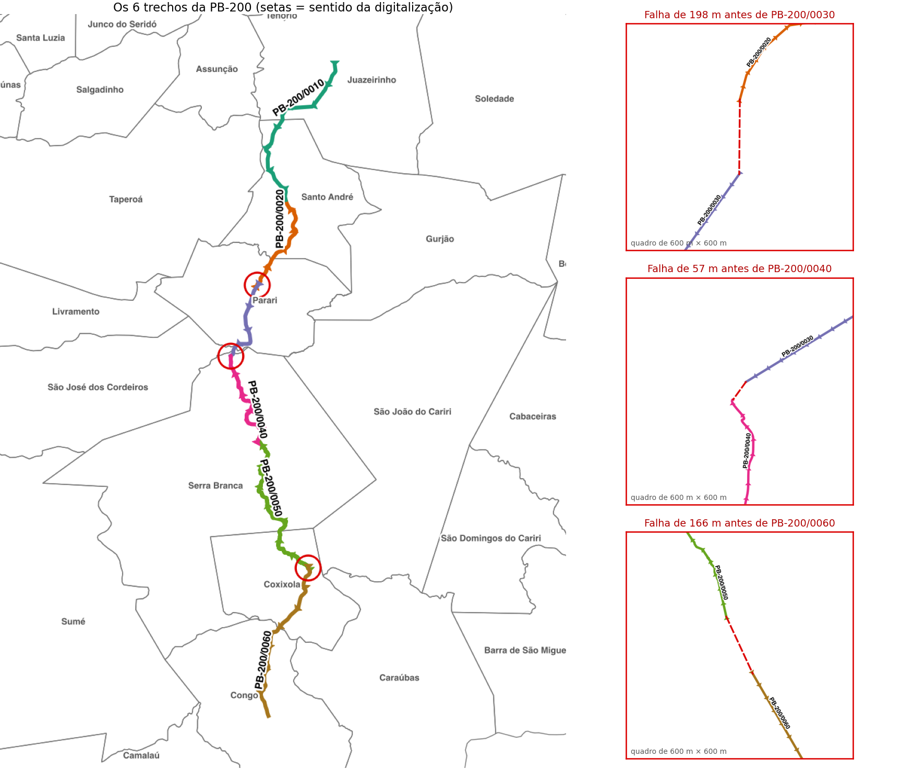
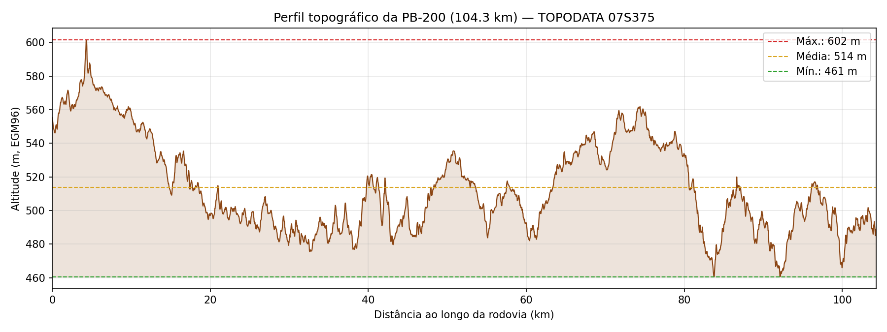
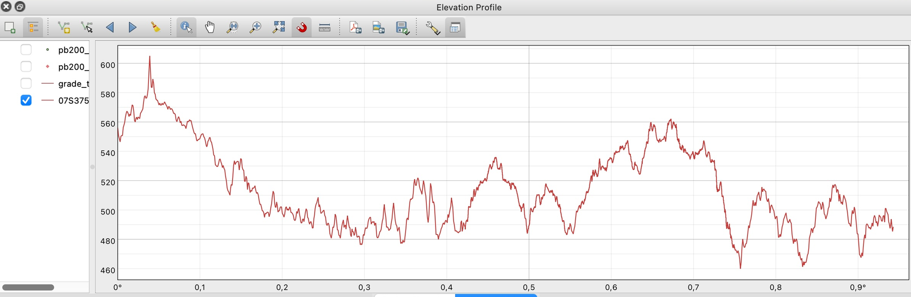

<!-- navegação -->
[⬅️ 🗺️ Grade SRTM/TOPODATA](../grade_topodata/grade_topodata.md) · [🏠 Início](../../README.md) · [🚶 Alcance a partir do IFPB ➡️](../alcance_ifpb/alcance_ifpb.md)

# Perfil topográfico da PB-200: atualizar um tutorial com IA e conferir o que ela entrega

> **Roteiro de aula:** prático, guiado e com aprofundamento técnico
> **Público:** estudantes de geotecnologias, engenharia e ciências da terra · **Nível:** 🟡 Intermediário
> **Duração:** 35 minutos de aula prática (seções 1 a 5) + aprofundamento técnico para estudo posterior (seções 6 e 7)
> **Tema:** perfil topográfico de uma rodovia a partir de um MDE, e atualização de código antigo com IA
> **Tecnologias:** QGIS 3.44 (Processing e Perfil de Elevação), PyQGIS, matplotlib, MDE TOPODATA; IA generativa

---

## 🧭 1. A proposta da aula

Este exercício junta os dois anteriores: a **PB-200** do [exercício de licenciamento](../pb200/pb200.md) e o **MDE TOPODATA** da [grade interativa](../grade_topodata/grade_topodata.md). O resultado é o **perfil topográfico** da rodovia inteira, do km 0 (Juazeirinho) ao km 104 (Congo).

Partimos de um tutorial publicado na web em 2021, escrito para uma versão antiga do QGIS, e usamos a IA para atualizá-lo. O ponto principal da aula é **conferir o que ela entrega**.

A pergunta que guia a atividade:

> **Como a altitude varia ao longo dos 104 km da PB-200, e quanto podemos confiar num perfil feito com código que a IA atualizou?**



### 🎯 Objetivos de aprendizagem

Ao final da aula, a turma será capaz de:

1. **explicar** o que é um perfil topográfico e o que é o **exagero vertical** de um gráfico;
2. **identificar** por que unir os trechos de uma rodovia exige conferir o **sentido** e as **falhas** entre eles;
3. **conferir** uma solução "de manual" da IA contra os dados reais, contando partes e medindo comprimentos;
4. **distinguir** o relevo real do ruído do MDE num perfil serrilhado;
5. **validar** o perfil do script com a ferramenta nativa **Perfil de Elevação** do QGIS.

---

## 📋 2. Preparação e roteiro de tempo

### 🛠️ Antes da aula, o(a) professor(a) confere

- [ ] **QGIS** 3.34 LTR ou mais recente (material testado no 3.44).
- [ ] **matplotlib** no Python do QGIS, para o gráfico (opcional: sem ele, o script grava o GeoPackage e o CSV, mas não desenha o perfil).
- [ ] **Dados:** o `minicurso_dados.gpkg`, com a camada `malha_viaria` (veja [`dados_curso/`](../../dados_curso/README.md)).
- [ ] **MDE:** a folha TOPODATA **`07S375ZN.tif`** já baixada. A PB-200 (lat −7,07° a −7,79°) fica inteira nessa célula, que vai de −7° a −8°. Use a **ação de clique** do exercício anterior ([Atividade 3 da grade TOPODATA](../grade_topodata/grade_topodata.md#-atividade-3-a-ação-de-clique-12-min)); se a folha já foi baixada, a ação só reaproveita o arquivo.
- [ ] **Rede da sala:** não é preciso internet se o MDE já estiver baixado.



> 💡 **Dica para quem conduz a aula:** rode o script [`perfil_pb200.py`](perfil_pb200.py) uma vez antes da aula. A Atividade 3 usa a camada `pb200_linha_unica` que ele grava; com ela pronta, ninguém fica para trás.

> As capturas de tela estão com o QGIS 3.44 em inglês; no texto aparecem os nomes em português e, entre parênteses, em inglês.

### ⏱️ Planejamento minuto a minuto (35 min)

| Intervalo | Etapa | Foco da turma |
| :--- | :--- | :--- |
| **0–5 min** | Pergunta e contexto | O que é um perfil topográfico? Do que ele precisa? |
| **5–15 min** | Atividade 1: uma rodovia, uma linha | A solução "óbvia" da IA dá 5 partes. Por quê? |
| **15–25 min** | Atividade 2: o perfil e o serrilhado | Rodar o script, ler o perfil e decidir o que é relevo e o que é ruído. |
| **25–32 min** | Atividade 3: validação cruzada | Comparar com o Perfil de Elevação nativo do QGIS. |
| **32–35 min** | Síntese e fechamento | Check-out oral e mensagem final. |

---

## 💡 3. Fundamentação

### 3.1 O que é um perfil topográfico

Um **perfil topográfico** mostra como a altitude varia ao longo de uma linha. Na duplicação da PB-200, ele ajuda a identificar rampas, pontos altos e baixos e os trechos que vão exigir corte ou aterro.

> 🗣️ **Como explicar para a turma:**
> *"Imagine percorrer a PB-200 de bicicleta com um altímetro, anotando a altitude a cada 30 metros. O perfil é o gráfico dessas anotações: no eixo X, quanto você já andou; no eixo Y, a altitude naquele ponto."*

Para montar o perfil, precisamos de três coisas:

1. **Uma linha, e uma só:** a PB-200 inteira, orientada do km 0 ao km 104.
2. **Um modelo de elevação** que cubra a rodovia: a folha TOPODATA `07S375`.
3. **Um jeito de "andar" pela linha:** pontos a intervalos regulares, cada um com a distância desde o início e a altitude lida do MDE.

### 3.2 Os dados

| Dado | Origem | Observação |
| --- | --- | --- |
| `malha_viaria` em `minicurso_dados.gpkg` | [`dados_curso/README.md`](../../dados_curso/README.md) | campo `rodovia_nome = 'PB-200'`: **6 trechos** |
| `07S375ZN.tif` | ação de clique da [grade TOPODATA](../grade_topodata/grade_topodata.md#-atividade-3-a-ação-de-clique-12-min) | EPSG:4326, pixel de 1″ (~30 m), altitude em metros (EGM96), NoData = −9999 |

> ⚠️ **O MDE mede a superfície, não o chão.** O TOPODATA deriva do SRTM, um radar que registra o topo do que está no terreno: vegetação, construções, taludes. Ele tem um ruído próprio de alguns metros. Guarde isso para a Atividade 2.

### 3.3 Um tutorial de 2021 no QGIS 3.44

A referência é o tutorial [*Python QGIS Tutorial: Create Elevation Profile*](https://www.geodose.com/2021/02/python-qgis-tutorial-create-elevation-profile.html), do Geodose. Ele usa ferramentas que mudaram desde 2021: o SAGA deixou a instalação padrão no QGIS 3.30, e as duas tarefas que o tutorial faz com o GRASS e o SAGA hoje têm algoritmos nativos. Além disso, há uma armadilha de unidade escondida. A IA atualizou o código; o que conferir na resposta está na seção 6.2.

> 🚨 **A armadilha de unidade:** o tutorial usa o tamanho do pixel do MDE como intervalo entre pontos. Com o TOPODATA em EPSG:4326, esse valor é **0,000278 grau**. Usado como distância numa linha em UTM, vira **um ponto a cada 0,3 mm**. O intervalo certo é **30 m**.

---

## 🛠️ 4. Trilha prática guiada

### 📍 Atividade 1: uma PB-200, uma linha (10 min)

**Objetivo:** unir os 6 trechos da rodovia e descobrir por que a solução "óbvia" não funciona.

1. Peça à IA uma forma de unir os trechos. A resposta típica é: `native:extractbyattribute` → `native:reprojectlayer` → `native:dissolve` → `native:mergelines`.
2. Rode e confira o resultado no Console Python:
   ```python
   g = next(linha.getFeatures()).geometry()
   print(g.isMultipart(), g.constGet().numGeometries(), g.length() / 1000)
   ```
   Nos dados do curso, aparece:
   ```text
   True 5 103.85
   ```
   São **5 partes**, e não uma linha. O comprimento também não fecha.
3. Investigue: abra os trechos com a simbologia **Seta** (*Propriedades → Simbologia → Seta (Arrow)*), para ver o sentido em que cada um foi digitalizado.



| Problema | Onde | Efeito |
| --- | --- | --- |
| **Sentido invertido** | os trechos `0020`, `0040` e `0050` foram digitalizados do km maior para o menor | o "fim" de um trecho não encontra o "início" do seguinte |
| **Falhas entre trechos** | ~198 m antes de `0030`, ~166 m antes de `0060`, ~57 m antes de `0040` e ~4 m antes de `0020` | o `mergelines` só junta linhas que **se tocam** |

4. **A solução:** os atributos `km_inicial` e `km_final` dão a ordem certa. O script ordena os trechos pelo km, inverte os que estão ao contrário e liga as falhas em linha reta, **relatando** cada uma (seção 6.3). A linha única tem **~104,27 km**, contra **104,25 km** da soma do campo `extensao`.

> 💬 **Pausa para reflexão com a turma:**
> - *A resposta da IA (`dissolve` + `mergelines`) estava errada?*
> - *Se gerássemos o perfil sobre as 5 partes, o que sairia errado?*

<details>
<summary>Respostas esperadas</summary>

- Não: ela está certa **em geral**, é a resposta de manual. O que a IA não sabe é que estes trechos têm sentidos invertidos e falhas de até 198 m. Quem conhece os dados é você, e por isso o roteiro manda **contar as partes e medir o comprimento** antes de seguir.
- Cada parte recomeçaria a contagem de distância, e a ordem das partes seria arbitrária. Nos dados do curso, o "km 0" cairia num lugar a 472 m de altitude, e não em Juazeirinho (555 m).

</details>

---

### 📍 Atividade 2: o perfil e o serrilhado (10 min)

**Objetivo:** gerar o perfil e decidir o que nele é relevo e o que é ruído.

1. Abra [`perfil_pb200.py`](perfil_pb200.py) no **Editor do Console Python**, ajuste `GPKG`, `MDE` e `PASTA_SAIDA` e clique em **Executar script**.
2. Confira o fim da saída no console:
   ```text
   [4] 3476 pontos a cada 30 m
   [5] Altitude: mín. 460.6 m · máx. 601.6 m · média 513.7 m
   ...
   [7] Verificações
         CRS da linha: EPSG:31984 (esperado EPSG:31984)
         Comprimento:  104.27 km × soma de 'extensao' 104.25 km (100.0%)
         Pontos sem altitude: 0 de 3476
   ```



3. **Leia o perfil:**
   - o ponto mais alto (~602 m) fica nos primeiros 5 km, ainda perto de Juazeirinho, no Planalto da Borborema;
   - o ponto mais baixo (~461 m) fica por volta do km 84, onde começa o trecho de **leito natural** (`PB-200/0060`);
   - a amplitude total é de apenas **~140 m em 104 km**.

> 🗣️ **Como explicar o exagero vertical:**
> *"O gráfico parece uma serra, mas a estrada é quase plana. Na figura, 1 cm no eixo Y vale cerca de 17 m, e 1 cm no eixo X vale cerca de 3,7 km: o relevo aparece ~210 vezes mais íngreme do que é. Sem esse exagero, o perfil seria uma linha reta, e ninguém veria as rampas."*

4. **O serrilhado.** A curva parece cheia de dentes. Antes de concluir que o script errou, meça os dentes no CSV:

| Medida | Valor |
| --- | --- |
| Variação típica entre dois pontos vizinhos (30 m) | **0,6 m** (mediana) |
| 95% das variações ficam abaixo de | **2,3 m** |
| Maior variação entre vizinhos | **7,5 m** |
| Oscilação em torno de uma média móvel de 300 m | **±1,3 m** (desvio-padrão) |

São oscilações de 1 a 2 m, e três motivos explicam por que parecem grandes:

1. **O exagero vertical (~210 vezes):** uma oscilação de 1 m, invisível no terreno, vira um dente no gráfico.
2. **O MDE é feito de degraus:** o `rastersampling` não interpola; cada ponto recebe o valor do pixel de ~30 m em que cai. A rodovia corta os pixels em diagonal, e o perfil "pula" de um valor para o seguinte. Em 10% dos passos o valor nem muda.
3. **O SRTM mede a superfície:** vegetação, construções e taludes entram na altitude, além do ruído próprio do radar. Uma pista de ~10 m de largura também não "aparece" num pixel de 30 m.

> 💬 **Pausa para reflexão:** *um dente de 2 m perto do km 40 é uma lombada na estrada?*

<details>
<summary>Resposta esperada</summary>

Não. O ruído de ±1 a 2 m está dentro da precisão do dado. As formas grandes são relevo real: a descida do Planalto da Borborema nos primeiros 30 km, as elevações perto dos km 51 e 74 e o vale perto do km 84. Os dentes pequenos não são. Interpretar um dente de 2 m como uma lombada seria ler no dado mais do que ele tem.

</details>

---

### 📍 Atividade 3: validação cruzada com o Perfil de Elevação (7 min)

Desde a versão 3.26, o QGIS tem uma ferramenta nativa de perfil. Use-a para validar o script:

1. Mude o CRS do projeto para **EPSG:31984** (canto inferior direito da janela), para o eixo X sair em metros (veja o aviso abaixo).
2. Botão direito em `07S375ZN` → **Propriedades (Properties)** → **Elevação (Elevation)** → marque **Representa superfície de elevação (Represents elevation surface)** → **OK**.
3. Menu **Exibir (View)** → **Perfil de Elevação (Elevation Profile)**.
4. Na barra do painel, clique em **Capturar curva a partir de feição (Capture Curve From Feature)** e clique na linha `pb200_linha_unica`.



A captura acima foi feita com o projeto em EPSG:4326, por isso o eixo X está em graus:

| | Script (pontos a cada 30 m) | Perfil de Elevação | |
| --- | --- | --- | :---: |
| Comprimento | 104,27 km | **~0,94°** (1° ao longo da linha ≈ 110,6 km) | ✅ |
| Altitude máxima | 601,6 m (km 4,35) | pico logo acima de 600 m, perto de 0,04° (≈ 4,4 km) | ✅ |
| Altitude mínima | 460,6 m (km 83,76) | vale perto de 460 m, em ~0,76° (≈ 84 km) | ✅ |
| Forma da curva | — | a mesma: pico inicial, vales em 0,30°, 0,76° e 0,83° e elevação em 0,67° | ✅ |

> ⚠️ **O eixo X em graus.** O Perfil de Elevação mede a distância no CRS do **projeto**. Com o projeto em EPSG:4326, o eixo vai de 0° a ~0,94°. Por isso o passo 1 muda o projeto para EPSG:31984.

> ⚠️ **Cuidado ao ler valores com o mouse.** Na captura acima, passar o mouse "no ponto mais alto" e "no mais baixo" deu **587,78 m** e **488,32 m**, longe dos 601,6 e 460,6 m do script. A auditoria mostrou por quê:
>
> - **587,78 m não é o valor de nenhum pixel** ao longo da rodovia (testado a cada 5 m): é a leitura do ponto em que o cursor estava, e não o pico da curva.
> - **488,32 m existe**, mas no km ~84,9 (0,768°), na encosta logo ao lado do vale mais baixo.
>
> Num gráfico serrilhado, é muito difícil parar o cursor exatamente no extremo. Para comparar mínimo e máximo, use a forma da curva e os números do script.

> 💬 **Pausa para reflexão:** *se a ferramenta nativa existe, por que escrever o script?*

<details>
<summary>Resposta esperada</summary>

Porque o script é **repetível** (outra rodovia é só trocar a constante `RODOVIA`), gera **dados** (o CSV vai para a planilha do projeto de engenharia) e documenta **cada decisão**: a ordem dos trechos, o intervalo de 30 m e as falhas ligadas em linha reta. A ferramenta nativa é ótima para olhar; o script, para entregar e reproduzir.

</details>

---

## 🎓 5. Fechamento: checagem de aprendizagem

### 💬 Check-out oral

Peça que a turma complete as frases:

1. *"A solução `dissolve` + `mergelines` parecia certa, mas nos dados da PB-200 ela falhou porque…"*
2. *"O perfil parece montanhoso, mas a PB-200 é quase plana: o que engana é…"*
3. *"Um dente de 2 m no perfil não deve ser lido como uma lombada porque…"*

<details>
<summary>Respostas esperadas</summary>

1. … três trechos estão digitalizados ao contrário e há falhas de até 198 m entre eles; o `mergelines` só junta linhas que se tocam, e o resultado teve 5 partes.
2. … o **exagero vertical**: ~140 m de amplitude em 104 km, com o relevo desenhado ~210 vezes mais íngreme do que é.
3. … está dentro da precisão do MDE: pixel de 30 m, valores em degraus e um radar que mede a superfície, com ruído de alguns metros.

</details>

### 🏁 Mensagem final

> *"A IA atualizou um tutorial de 2021 em segundos e propôs a solução de manual para unir a rodovia. As duas respostas eram plausíveis, e as duas precisavam de conferência: uma tinha uma armadilha de unidade, a outra não conhecia os nossos dados. Contar as partes, medir o comprimento e comparar com uma ferramenta independente é o que transforma um gráfico bonito num resultado confiável."*

---

## 💻 6. Aprofundamento técnico: o script e a IA

### 6.1 O que o script entrega

```
┌────────────────────────┐     ┌────────────────────────┐     ┌────────────────────────┐
│ 1. UMA LINHA           │ ──> │ 2. PONTOS E ALTITUDES  │ ──> │ 3. PERFIL E CONFERÊNCIA│
│ • filtra os 6 trechos  │     │ • a cada 30 m          │     │ • gráfico (matplotlib) │
│ • reprojeta (UTM 24S)  │     │ • distância acumulada  │     │ • CSV para a planilha  │
│ • ordena e costura     │     │ • altitude do MDE      │     │ • verificações         │
└────────────────────────┘     └────────────────────────┘     └────────────────────────┘
```

Em `dados_curso/perfil_pb200/resultados/`:

1. `pb200_perfil.gpkg`, com a camada `pb200_linha_unica` (1 feição, ~104 km, EPSG:31984) e a camada `pb200_pontos_z` (pontos a cada 30 m com `distance` e `z_1`);
2. `pb200_perfil.csv`, com as colunas `km`, `lon`, `lat` e `altitude_m`;
3. `pb200_perfil.png`, o gráfico do perfil.

### 6.2 Atualizando o tutorial de 2021

O código do Geodose tem quatro blocos: definir entradas, gerar pontos ao longo da linha, ler a altitude de cada ponto e calcular a distância acumulada, e desenhar o gráfico. O centro dele é este trecho:

```python
raster_layer=QgsRasterLayer(elevation_data,'ogr')
interval=raster_layer.rasterUnitsPerPixelX()

processing.run("grass7:v.to.points", {'input':line,'use':1,'dmax':interval,'-i':True,'-t':False,'output':out_points})
processing.run("saga:addrastervaluestopoints", {'SHAPES':line_points,'GRIDS':[dem],'RESAMPLING':0,'RESULT':point_z})
```

**O prompt:**

```text
Vou criar um perfil topográfico no QGIS 3.44 com PyQGIS. Minha referência é
este tutorial de 2021 (QGIS 3.16):

<cole aqui o código completo do tutorial>

Atualize o código para o QGIS 3.44:
- use apenas algoritmos nativos (native:...), sem GRASS e sem SAGA;
- para cada algoritmo antigo, diga qual o substitui e por quê;
- aponte os erros do código original (variáveis, unidades, CRS);
- não invente nomes de parâmetros: liste os que você usou para eu conferir
  com processing.algorithmHelp().
```

**O que conferir na resposta:**

| No tutorial (QGIS 3.16) | No QGIS 3.44 |
| --- | --- |
| `grass7:v.to.points` | **`native:pointsalonglines`** (*Pontos ao longo da geometria*). Não depende do GRASS e já cria o campo `distance` (distância desde o início da linha) |
| `saga:addrastervaluestopoints` | **`native:rastersampling`** (*Amostrar valores de raster*). O SAGA saiu da instalação padrão no QGIS 3.30 e hoje é um plugin à parte |
| loop com `QgsDistanceArea` e `setEllipsoid('NAD83')` para somar distâncias | **desnecessário:** com a linha em UTM, o campo `distance` já é a distância acumulada em metros |
| `interval = rasterUnitsPerPixelX()` | **armadilha de unidade:** **0,000278 grau**, que numa linha em UTM vira um ponto a cada 0,3 mm. Use **30 m** |
| `out_points` × `line_points`, `dem` × `elevation_data` | o código original **nem roda**: as variáveis definidas não são as mesmas usadas |
| `f.attributes()[-1]` | leia pelo nome (`f["z_1"]`) e trate `NULL` (ponto fora do raster ou NoData) |

Confira os parâmetros reais de cada algoritmo direto no QGIS:

```python
processing.algorithmHelp("native:pointsalonglines")
processing.algorithmHelp("native:rastersampling")
```

### 6.3 Unir os trechos: do "óbvio" à costura

**O prompt da solução "óbvia"** (a da Atividade 1):

```text
Na camada malha_viaria do GeoPackage, a PB-200 está dividida em trechos
(campo rodovia_nome = 'PB-200'). Escreva um código PyQGIS que filtre os
trechos, reprojete para EPSG:31984 e una tudo em uma única linha.
```

**O prompt da costura**, depois de investigar os dados:

```text
Os trechos têm km_inicial e km_final, mas alguns estão digitalizados ao
contrário e há falhas de até 200 m entre eles. Escreva uma função PyQGIS
que:
- ordene os trechos por km_inicial;
- inverta cada trecho cujo início esteja mais longe do fim do trecho
  anterior do que o seu próprio fim;
- concatene os vértices em uma única LineString (ligando as falhas em
  linha reta) e devolva também a lista de falhas, em metros;
- oriente o 1º trecho pelo 2º (o fim do 1º é o lado que encosta no 2º).
```

O coração da função `unir_trechos()`, copiado de [`perfil_pb200.py`](perfil_pb200.py):

```python
pontos = list(linhas[0])
falhas = []
for f, linha in zip(trechos[1:], linhas[1:]):
    ultimo = pontos[-1]
    if ultimo.distance(linha[-1]) < ultimo.distance(linha[0]):
        linha.reverse()  # digitalizado no sentido contrário ao km
    falha = ultimo.distance(linha[0])
    falhas.append((f["codigo"], falha))
    # Se os trechos se tocam, não repete o vértice comum
    pontos.extend(linha[1:] if falha < 0.01 else linha)
return QgsGeometry.fromPolylineXY(pontos), falhas
```

> **Nota: o que conferir no código**
>
> | Trecho | Por que é assim |
> | --- | --- |
> | `sorted(..., key=lambda f: f["km_inicial"])` | a ordem dos trechos vem do atributo, não da geometria nem da ordem em que estão gravados |
> | `ultimo.distance(linha[-1]) < ultimo.distance(linha[0])` → `reverse()` | um trecho invertido "começa" no lado mais distante do anterior |
> | `linha[1:] if falha < 0.01 else linha` | quando os trechos se tocam, o vértice comum não é repetido |
> | as falhas são **relatadas**, não escondidas | 198 m em linha reta é aceitável num perfil de 104 km, mas a decisão é sua |

Se o comprimento da linha única der muito maior que 104 km (por exemplo, 150 km), algum trecho foi ligado pelo lado errado e a linha "vai e volta".

### 6.4 Pontos e altitudes

Com a linha única em UTM, os dois algoritmos da seção 6.2 fazem o resto:

```python
pontos = rodar("native:pointsalonglines", {
    "INPUT": linha, "DISTANCE": INTERVALO_M})          # 30 m

pontos_mde = rodar("native:reprojectlayer", {
    "INPUT": pontos, "TARGET_CRS": mde.crs()})
pontos_z = rodar("native:rastersampling", {
    "INPUT": pontos_mde, "RASTERCOPY": mde, "COLUMN_PREFIX": "z_"})
```

- `pointsalonglines` cria os campos **`distance`** (metros desde o início) e `angle`.
- `rastersampling` cria **`z_1`**: o prefixo `z_` mais o número da banda.
- O `rastersampling` **reprojeta os pontos sozinho** quando o CRS do raster é outro. Mesmo assim, o script reprojeta antes para EPSG:4326, para o CSV sair em longitude e latitude.

> **Por que 30 m?** É aproximadamente o tamanho do pixel do TOPODATA (1″). Com pontos mais próximos, vários caem no mesmo pixel e repetem o valor. Com pontos mais distantes, o perfil perde detalhes, como o fundo de vales estreitos.

> **E o mínimo "verdadeiro"?** Amostrando a cada **5 m**, de modo que nenhum pixel atravessado pela rodovia fica de fora, o mínimo é **459,6 m** (km 83,74), 1 m abaixo do valor do script. Com pontos a cada 30 m, alguns pixels ficam entre dois pontos e não são lidos. O máximo é o mesmo nos dois casos (601,6 m). Diferenças de ~1 m como essa são normais entre ferramentas que amostram o raster com densidades diferentes.

> **E se a rodovia cruzasse duas folhas?** Seria preciso juntar os MDEs antes, por exemplo com `gdal:buildvirtualraster`, que cria um mosaico virtual. Fica como desafio.

### 6.5 Rodar o script: a saída completa

```text
[1] PB-200: 6 trechos
[2] Reprojetado para EPSG:31984
      PB-200/0010   km   0.00 a  22.54  Pavimentada
      ...
      PB-200/0060   km  83.09 a 104.25  Leito Natural
[3] Linha única: 104.27 km
      falha de    3.7 m antes de PB-200/0020 (ligada em linha reta)
      falha de  197.5 m antes de PB-200/0030 (ligada em linha reta)
      falha de   57.1 m antes de PB-200/0040 (ligada em linha reta)
      falha de  166.3 m antes de PB-200/0060 (ligada em linha reta)
[4] 3476 pontos a cada 30 m
[5] Altitude: mín. 460.6 m · máx. 601.6 m · média 513.7 m
[6] Resultados salvos em .../perfil_pb200/resultados
      Gráfico: .../perfil_pb200/resultados/pb200_perfil.png
[7] Verificações
      CRS da linha: EPSG:31984 (esperado EPSG:31984)
      Comprimento:  104.27 km × soma de 'extensao' 104.25 km (100.0%)
      Pontos sem altitude: 0 de 3476
```

### 6.6 Perguntas para fazer à IA

- *"Qual o exagero vertical deste gráfico, para `figsize=(12, 4.5)` e eixos de 0–104 km × 460–602 m? Como desenhar sem exagero?"* Depois teste com `ax.set_aspect(...)` e veja por que ninguém desenha perfis de estrada sem exagero.
- *"Meu perfil topográfico feito com o SRTM a cada 30 m está serrilhado. É erro do script ou característica do dado? Que números do CSV eu posso calcular para decidir?"* Compare a resposta com a tabela da Atividade 2. Se a IA sugerir suavizar sem falar do custo disso, veja o Desafio 4.

---

## 🛡️ 7. Resolução de problemas e dicionário

### ⚠️ Armadilhas comuns

| Sintoma | Causa | Como corrigir |
| :--- | :--- | :--- |
| **a linha "única" tem 5 partes** | trechos com sentido invertido e falhas entre eles; o `mergelines` só junta linhas que se tocam | ordenar por `km_inicial`, inverter e costurar (seção 6.3) |
| **o "km 0" do perfil cai num lugar a 472 m** | o perfil foi gerado sobre as partes soltas, em ordem arbitrária | gerar o perfil sobre a linha única, orientada do km 0 ao 104 |
| **a linha única tem ~150 km** | um trecho foi ligado pelo lado errado e a linha "vai e volta" | conferir a orientação de cada trecho e comparar com a soma de `extensao` |
| **milhões de pontos, ou o QGIS trava** | o intervalo veio de `rasterUnitsPerPixelX()`, em graus | usar **30 m** com a linha em UTM |
| **algoritmo `grass7:` ou `saga:` não encontrado** | o SAGA saiu da instalação padrão, e o provedor GRASS pode estar desativado na sua instalação | usar os nativos `native:pointsalonglines` e `native:rastersampling` |
| **o código do tutorial nem roda** | as variáveis definidas (`out_points`, `dem`) não são as usadas (`line_points`, `elevation_data`) | atualizar o código, conferindo cada nome |
| **altitudes `NULL` em alguns pontos** | ponto fora do MDE ou sobre NoData (−9999) | conferir se a folha cobre a rodovia; ler `f["z_1"]` pelo nome e tratar `NULL` |
| **eixo X do Perfil de Elevação em graus** | o projeto está em EPSG:4326 | mudar o CRS do projeto para EPSG:31984 antes de capturar a curva |
| **máximo e mínimo lidos com o mouse não batem** | o cursor raramente para no extremo de uma curva serrilhada | comparar a forma da curva e os números do script |

### 📖 Dicionário para estudantes

- **Perfil topográfico:** gráfico da altitude ao longo de uma linha.
- **MDE (Modelo Digital de Elevação):** raster em que cada pixel guarda uma altitude.
- **SRTM / TOPODATA:** o SRTM é a missão de radar que mediu a altitude do planeta; o TOPODATA é o MDE do INPE derivado dele, com pixel de ~30 m.
- **Exagero vertical:** quantas vezes o eixo Y foi "esticado" em relação ao X para o relevo aparecer.
- **NoData:** o valor que um raster usa para "sem dado" (aqui, −9999).
- **UTM / EPSG:31984:** sistema de coordenadas em metros; o fuso 24S cobre a PB-200.
- **Média móvel:** a média de cada ponto com seus vizinhos; suaviza a curva, mas achata picos e vales.
- **Mosaico virtual:** um arquivo que junta várias folhas de raster sem copiar os dados.

---

## 🚀 8. Desafios para depois da aula

1. **Outra rodovia.** Troque `RODOVIA` por outra estadual. Se ela cruzar mais de uma folha TOPODATA, baixe as folhas com a ação de células selecionadas e crie um mosaico com `gdal:buildvirtualraster` antes de amostrar.
2. **Pavimentada × leito natural.** Pinte o gráfico com uma cor por `sit_fisica`. Dica: guarde em `unir_trechos()` a distância acumulada em que cada trecho começa.
3. **Declividade.** Calcule a rampa (%) entre pontos consecutivos e destaque os trechos acima de 6%.
4. **Suavizar o perfil.** Desenhe, por cima da curva original, uma **média móvel** de ~300 m (11 pontos de 30 m). Depois responda:
   - O que acontece com a altitude máxima e com a mínima?
   - Qual janela (5, 11, 31 pontos) tira os dentes sem apagar os vales?
   - Por que, no Desafio 3, calcular a rampa sobre a curva **original** dá valores irreais?

   <details>
   <summary>Uma solução possível</summary>

   Acrescente no script, logo depois de `ax.fill_between(...)`:

   ```python
   JANELA = 11  # pontos: 11 × 30 m ≈ 300 m
   meio = JANELA // 2
   suave = []
   for i in range(len(altitudes)):
       vizinhos = altitudes[max(0, i - meio):i + meio + 1]  # menos pontos nas pontas
       suave.append(sum(vizinhos) / len(vizinhos))
   ax.plot(km, suave, color="black", linewidth=1.5, label="Média móvel (~300 m)")
   print(f"Suavizado: mín. {min(suave):.1f} m · máx. {max(suave):.1f} m")
   ```

   Com a janela de 11 pontos, a máxima cai de **602 para 594 m** e a mínima sobe de **461 para 463 m**. Suavizar tira o ruído, mas também "achata" picos e vales reais e estreitos. Por isso o script guarda os valores originais no CSV, e a média móvel entra só no gráfico.

   </details>

---

<!-- navegação -->
[⬅️ 🗺️ Grade SRTM/TOPODATA](../grade_topodata/grade_topodata.md) · [🏠 Início](../../README.md) · [🚶 Alcance a partir do IFPB ➡️](../alcance_ifpb/alcance_ifpb.md)
